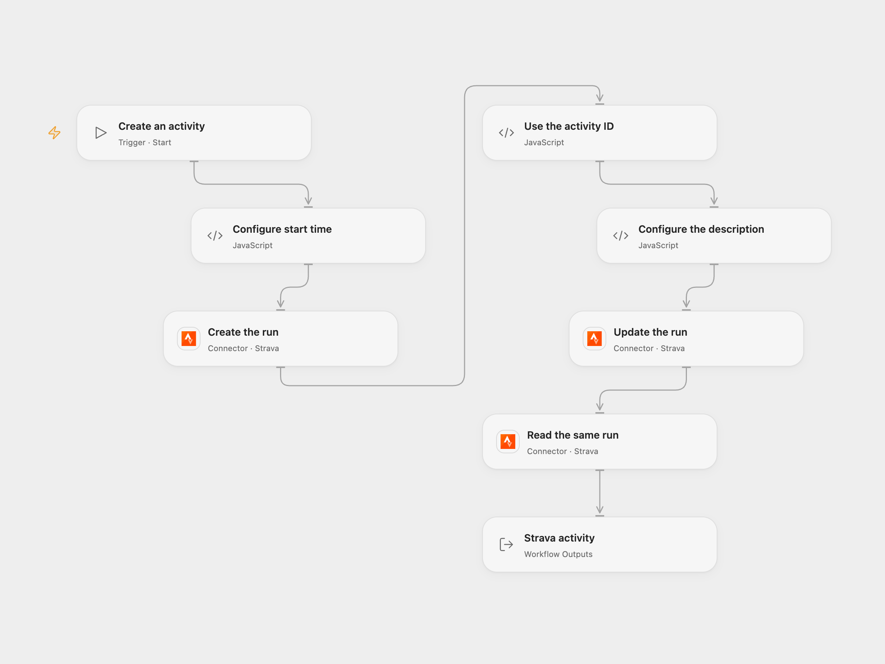

# Create, Update, and Read a Strava Activity

Create a manual running activity, update its description, and read it from Strava.

<picture>
  <source media="(prefers-color-scheme: dark)" srcset="preview-dark.png">
  
</picture>

[Open Flow JSON](templates/create-update-and-read-strava-activity.openflow.json) · [n8n JSON](templates/create-update-and-read-strava-activity.n8n.json)

## Setup

Connect Strava with activity read and write permissions. Enter the actual start date and time in ISO format with Z or a UTC offset in **Configure start time**. Edit the run name, duration, distance and description as needed.

In n8n, connect Strava to the three nodes and enter the actual start time in **Strava**. Run one format per intended activity.

## Behavior

Run manually to create a one-hour, 1,000-metre run, update its description, and read the same activity by its returned ID. The final activity is returned. Check Strava before retrying an uncertain request: the run may already exist and earlier writes are not rolled back.

Inspiration &amp; credits

## Changes to the source

- Replace the fixed 2020 start time with user configuration. Open Flow validates the date and converts it to UTC before creating an activity and uses the current sport type alongside the source type.

Adapted from [Create, update and get activity in Strava](https://github.com/Zie619/n8n-workflows/blob/ae8cf6dc5b873cbb4f74587aa9180ed3a9f70682/workflows/Manual/1206_Manual_Strava_Create_Triggered.json) in [Zie619/n8n-workflows](https://github.com/Zie619/n8n-workflows). The source export does not identify a separate template author or license.

The collection’s [MIT notice](https://github.com/Zie619/n8n-workflows/blob/94007c1445d9258a7da116646b79473e7c7c3282/LICENSE) is pinned at a later revision. This is the collection notice at that revision; it does not establish a separate original template author's license. Our changes are listed above; see [repository licensing](../../README.md#licensing).

> MIT License
>
> Copyright (c) 2025 Zie619
>
> Permission is hereby granted, free of charge, to any person obtaining a copy
> of this software and associated documentation files (the "Software"), to deal
> in the Software without restriction, including without limitation the rights
> to use, copy, modify, merge, publish, distribute, sublicense, and/or sell
> copies of the Software, and to permit persons to whom the Software is
> furnished to do so, subject to the following conditions:
>
> The above copyright notice and this permission notice shall be included in all
> copies or substantial portions of the Software.
>
> THE SOFTWARE IS PROVIDED "AS IS", WITHOUT WARRANTY OF ANY KIND, EXPRESS OR
> IMPLIED, INCLUDING BUT NOT LIMITED TO THE WARRANTIES OF MERCHANTABILITY,
> FITNESS FOR A PARTICULAR PURPOSE AND NONINFRINGEMENT. IN NO EVENT SHALL THE
> AUTHORS OR COPYRIGHT HOLDERS BE LIABLE FOR ANY CLAIM, DAMAGES OR OTHER
> LIABILITY, WHETHER IN AN ACTION OF CONTRACT, TORT OR OTHERWISE, ARISING FROM,
> OUT OF OR IN CONNECTION WITH THE SOFTWARE OR THE USE OR OTHER DEALINGS IN THE
> SOFTWARE.

