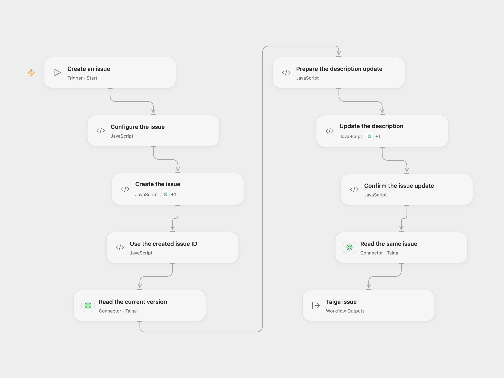

# Create, Update, and Read a Taiga Issue

Create a Taiga issue, update its description, and retrieve the same issue.

<picture>
  <source media="(prefers-color-scheme: dark)" srcset="preview-dark.png">
  
</picture>

[Open Flow JSON](templates/create-update-and-read-taiga-issue.openflow.json) · [n8n JSON](templates/create-update-and-read-taiga-issue.n8n.json)

## Setup

Connect all Taiga nodes to the same account and instance, including the Actions in **Create the issue** and **Update the description**. Enter your numeric project ID and subject in **Configure the issue**, and edit the description in **Prepare the description update**. The account needs permission to create and update issues.

In n8n, connect the same Taiga credentials to the three nodes, enter your project ID in **Taiga**, and edit the subject and description. Run one format per intended issue.

## Behavior

Run manually to create an issue, update its description, then read the issue by the ID returned by creation. Both formats read the current version before updating. Open Flow returns the final issue; n8n returns the final node result. If a write fails or its outcome is uncertain, inspect Taiga before retrying: the issue may already exist or have changed, and earlier writes are not rolled back.

## Changes to the source

- Replace the source project ID with a configuration value. Open Flow checks the project ID and response IDs.
- Open Flow uses the Taiga Actions for creation and update, sending only the source fields.

Source and license

Adapted from [Create, update and get an issue on Taiga](https://github.com/Zie619/n8n-workflows/blob/ae8cf6dc5b873cbb4f74587aa9180ed3a9f70682/workflows/Manual/1100_Manual_Taiga_Create_Triggered.json) in [Zie619/n8n-workflows](https://github.com/Zie619/n8n-workflows). The source export does not identify a separate template author or license.

The collection’s [MIT notice](https://github.com/Zie619/n8n-workflows/blob/94007c1445d9258a7da116646b79473e7c7c3282/LICENSE) is pinned at a later revision. This is the collection notice at that revision; it does not establish a separate original template author's license. Our changes are listed above; see [repository licensing](../../README.md#licensing).

> MIT License
>
> Copyright (c) 2025 Zie619
>
> Permission is hereby granted, free of charge, to any person obtaining a copy
> of this software and associated documentation files (the "Software"), to deal
> in the Software without restriction, including without limitation the rights
> to use, copy, modify, merge, publish, distribute, sublicense, and/or sell
> copies of the Software, and to permit persons to whom the Software is
> furnished to do so, subject to the following conditions:
>
> The above copyright notice and this permission notice shall be included in all
> copies or substantial portions of the Software.
>
> THE SOFTWARE IS PROVIDED "AS IS", WITHOUT WARRANTY OF ANY KIND, EXPRESS OR
> IMPLIED, INCLUDING BUT NOT LIMITED TO THE WARRANTIES OF MERCHANTABILITY,
> FITNESS FOR A PARTICULAR PURPOSE AND NONINFRINGEMENT. IN NO EVENT SHALL THE
> AUTHORS OR COPYRIGHT HOLDERS BE LIABLE FOR ANY CLAIM, DAMAGES OR OTHER
> LIABILITY, WHETHER IN AN ACTION OF CONTRACT, TORT OR OTHERWISE, ARISING FROM,
> OUT OF OR IN CONNECTION WITH THE SOFTWARE OR THE USE OR OTHER DEALINGS IN THE
> SOFTWARE.

