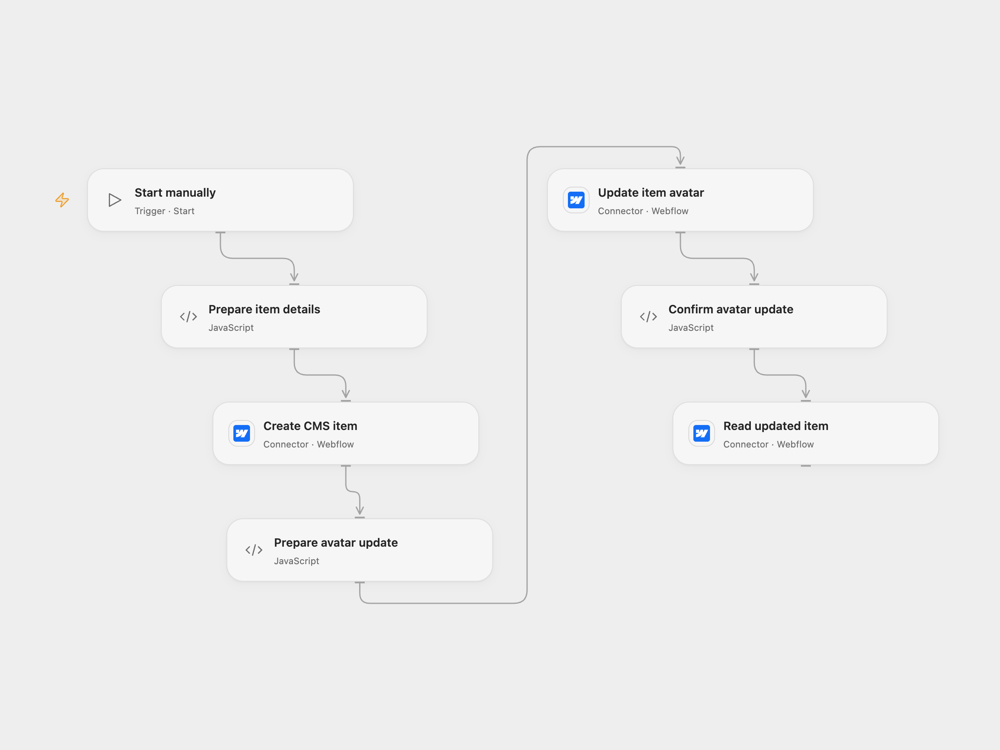

# Create, Update and Read a Webflow CMS Item

Create a Webflow CMS item, add an image and read the updated item.

<picture>
  <source media="(prefers-color-scheme: dark)" srcset="preview-dark.png">
  
</picture>

[Open Flow JSON](templates/create-update-and-read-webflow-item.openflow.json) · [n8n JSON](templates/create-update-and-read-webflow-item.n8n.json)

## Setup

Connect Webflow with CMS read and write access. Open Flow uses an API token; n8n uses Webflow OAuth2. In Open Flow set the collection ID, item name, slug and public HTTPS image URL in **Prepare item details**. The collection must have an image field with slug `avatar` and any other required fields must be supplied in the create and update steps. Webflow must be able to fetch the image; its image size limit applies.

In n8n, connect Webflow OAuth2 with Legacy disabled and CMS read/write access to all three HTTP nodes and set the collection ID, name, slug and image URL in **Prepare item details**. The collection must have the same field. Run one format manually.

## Behavior

The workflow creates an unarchived, non-draft item, updates its avatar with the configured image, confirms the returned avatar, then reads the item by the same ID. The item is staged for the next site publish; this workflow does not publish the site. A failure stops subsequent steps. A failed or uncertain create or update may already have succeeded, so inspect Webflow before retrying to avoid duplicate items or updates.

Inspiration &amp; credits

## Changes to the source

- Replace personal site and collection IDs and the example image with configuration. Use the current Webflow v2 API; n8n HTTP nodes use the Webflow OAuth2 credential to preserve non-draft status and image values.

Adapted from [Create, update and read a Webflow CMS item](https://github.com/Zie619/n8n-workflows/blob/ae8cf6dc5b873cbb4f74587aa9180ed3a9f70682/workflows/Manual/0022_Manual_Webflow_Automate_Triggered.json) in [Zie619/n8n-workflows](https://github.com/Zie619/n8n-workflows). The source export does not identify a separate template author or license.

The collection’s [MIT notice](https://github.com/Zie619/n8n-workflows/blob/94007c1445d9258a7da116646b79473e7c7c3282/LICENSE) is pinned at a later revision. This is the collection notice at that revision; it does not establish a separate original template author's license. Our changes are listed above; see [repository licensing](../../README.md#licensing).

> MIT License
>
> Copyright (c) 2025 Zie619
>
> Permission is hereby granted, free of charge, to any person obtaining a copy
> of this software and associated documentation files (the "Software"), to deal
> in the Software without restriction, including without limitation the rights
> to use, copy, modify, merge, publish, distribute, sublicense, and/or sell
> copies of the Software, and to permit persons to whom the Software is
> furnished to do so, subject to the following conditions:
>
> The above copyright notice and this permission notice shall be included in all
> copies or substantial portions of the Software.
>
> THE SOFTWARE IS PROVIDED "AS IS", WITHOUT WARRANTY OF ANY KIND, EXPRESS OR
> IMPLIED, INCLUDING BUT NOT LIMITED TO THE WARRANTIES OF MERCHANTABILITY,
> FITNESS FOR A PARTICULAR PURPOSE AND NONINFRINGEMENT. IN NO EVENT SHALL THE
> AUTHORS OR COPYRIGHT HOLDERS BE LIABLE FOR ANY CLAIM, DAMAGES OR OTHER
> LIABILITY, WHETHER IN AN ACTION OF CONTRACT, TORT OR OTHERWISE, ARISING FROM,
> OUT OF OR IN CONNECTION WITH THE SOFTWARE OR THE USE OR OTHER DEALINGS IN THE
> SOFTWARE.

