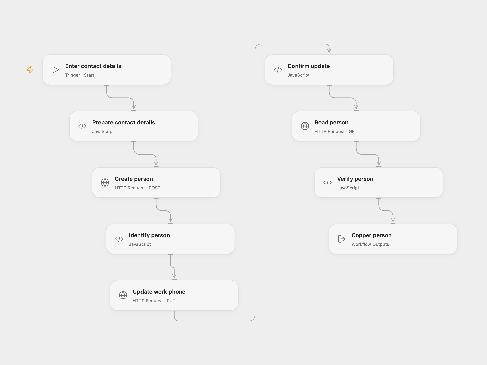

# Create and Update a Copper Contact

Create a Copper person, add their work phone and read the contact.

<picture>
  <source media="(prefers-color-scheme: dark)" srcset="preview-dark.png">
  
</picture>

[Open Flow JSON](templates/create-update-copper-contact.openflow.json) · [n8n JSON](templates/create-update-copper-contact.n8n.json)

## Setup

Use a Copper API key and the email of the Copper user who generated it, with permission to create, edit and read people. In Open Flow, create a secret Variable for the API key and bind **Auth Token** on all three HTTP nodes. Run with the account email and the contact's name, work email and work phone. In n8n, connect the Copper credential to all three Copper nodes and edit **Set contact details**.

## Behavior

The workflow creates one person, replaces that person's phone-number list with the supplied work number and reads the same person. It checks the work email and phone on the final record. Copper applies only fields present in the update; the workflow does not send other fields. An error stops later steps. No retry, rollback or duplicate check is performed; a lost response can mean a write succeeded, so inspect Copper before retrying.

## Changes to the source

- Replace the example personal details with inputs and check the final person ID, work email and phone.
- Open Flow uses the Copper HTTP API with the same account and key authentication.

Source and license

Adapted from [Create, update, and get a person from Copper](https://github.com/Zie619/n8n-workflows/blob/ae8cf6dc5b873cbb4f74587aa9180ed3a9f70682/workflows/Manual/0011_Manual_Copper_Automate_Triggered.json) in [Zie619/n8n-workflows](https://github.com/Zie619/n8n-workflows). The matching [n8n community listing](https://n8n.io/workflows/1021-create-update-and-get-a-person-from-copper/) credits Harshil Agrawal. The original template does not state a separate license.

The collection’s [MIT notice](https://github.com/Zie619/n8n-workflows/blob/94007c1445d9258a7da116646b79473e7c7c3282/LICENSE) is pinned at a later revision. This is the collection notice at that revision; it does not establish a separate original template author's license. Our changes are listed above; see [repository licensing](../../README.md#licensing).

> MIT License
>
> Copyright (c) 2025 Zie619
>
> Permission is hereby granted, free of charge, to any person obtaining a copy
> of this software and associated documentation files (the "Software"), to deal
> in the Software without restriction, including without limitation the rights
> to use, copy, modify, merge, publish, distribute, sublicense, and/or sell
> copies of the Software, and to permit persons to whom the Software is
> furnished to do so, subject to the following conditions:
>
> The above copyright notice and this permission notice shall be included in all
> copies or substantial portions of the Software.
>
> THE SOFTWARE IS PROVIDED "AS IS", WITHOUT WARRANTY OF ANY KIND, EXPRESS OR
> IMPLIED, INCLUDING BUT NOT LIMITED TO THE WARRANTIES OF MERCHANTABILITY,
> FITNESS FOR A PARTICULAR PURPOSE AND NONINFRINGEMENT. IN NO EVENT SHALL THE
> AUTHORS OR COPYRIGHT HOLDERS BE LIABLE FOR ANY CLAIM, DAMAGES OR OTHER
> LIABILITY, WHETHER IN AN ACTION OF CONTRACT, TORT OR OTHERWISE, ARISING FROM,
> OUT OF OR IN CONNECTION WITH THE SOFTWARE OR THE USE OR OTHER DEALINGS IN THE
> SOFTWARE.

