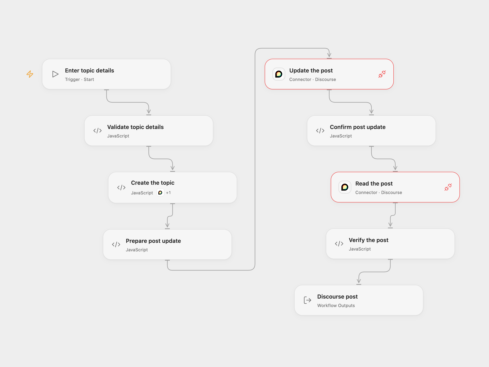

# Create and Update a Discourse Post

Create a Discourse topic, update its first post and read it back.

<picture>
  <source media="(prefers-color-scheme: dark)" srcset="preview-dark.png">
  
</picture>

[Open Flow JSON](templates/create-update-discourse-post.openflow.json) · [n8n JSON](templates/create-update-discourse-post.n8n.json)

## Setup

Connect a Discourse account allowed to create topics in the chosen category and edit its posts. The Open Flow connection requires a publicly reachable HTTPS forum; private network addresses are not supported. In Open Flow, select the account for **Create the topic**, **Update the post** and **Read the post**. Allow the create-topic Action for the first node and **Provider API** access for the two HTTP nodes. Run with the category ID, title, initial post and updated post. In n8n, connect the same Discourse credential to all three service nodes, set the forum URL in **Set topic details** to exactly match the credential’s forum URL, and enter the category ID, title and both bodies there.

## Behavior

The workflow creates a topic, changes the first post and retrieves that same post. Both writes can notify forum members and trigger other integrations. An error stops later steps. There is no automatic retry or rollback; if a response is lost, inspect the forum before retrying to avoid duplicate topics or edits.

Inspiration &amp; credits

## Changes to the source

- Replace the example category and text with inputs and verify post identity after updating.
- Use the Discourse create-topic Action and Provider API in Open Flow. Both formats use the current nested post update payload; the source n8n node sends the text at the top level.

Adapted from [Create, update and get a post via Discourse](https://github.com/Zie619/n8n-workflows/blob/ae8cf6dc5b873cbb4f74587aa9180ed3a9f70682/workflows/Manual/1201_Manual_Discourse_Automate_Triggered.json) in [Zie619/n8n-workflows](https://github.com/Zie619/n8n-workflows). The matching [n8n community listing](https://n8n.io/workflows/930-create-update-and-get-a-post-via-discourse/) credits Harshil Agrawal. The original template does not state a separate license.

The collection’s [MIT notice](https://github.com/Zie619/n8n-workflows/blob/94007c1445d9258a7da116646b79473e7c7c3282/LICENSE) is pinned at a later revision. This is the collection notice at that revision; it does not establish a separate original template author's license. Our changes are listed above; see [repository licensing](../../README.md#licensing).

> MIT License
>
> Copyright (c) 2025 Zie619
>
> Permission is hereby granted, free of charge, to any person obtaining a copy
> of this software and associated documentation files (the "Software"), to deal
> in the Software without restriction, including without limitation the rights
> to use, copy, modify, merge, publish, distribute, sublicense, and/or sell
> copies of the Software, and to permit persons to whom the Software is
> furnished to do so, subject to the following conditions:
>
> The above copyright notice and this permission notice shall be included in all
> copies or substantial portions of the Software.
>
> THE SOFTWARE IS PROVIDED "AS IS", WITHOUT WARRANTY OF ANY KIND, EXPRESS OR
> IMPLIED, INCLUDING BUT NOT LIMITED TO THE WARRANTIES OF MERCHANTABILITY,
> FITNESS FOR A PARTICULAR PURPOSE AND NONINFRINGEMENT. IN NO EVENT SHALL THE
> AUTHORS OR COPYRIGHT HOLDERS BE LIABLE FOR ANY CLAIM, DAMAGES OR OTHER
> LIABILITY, WHETHER IN AN ACTION OF CONTRACT, TORT OR OTHERWISE, ARISING FROM,
> OUT OF OR IN CONNECTION WITH THE SOFTWARE OR THE USE OR OTHER DEALINGS IN THE
> SOFTWARE.

