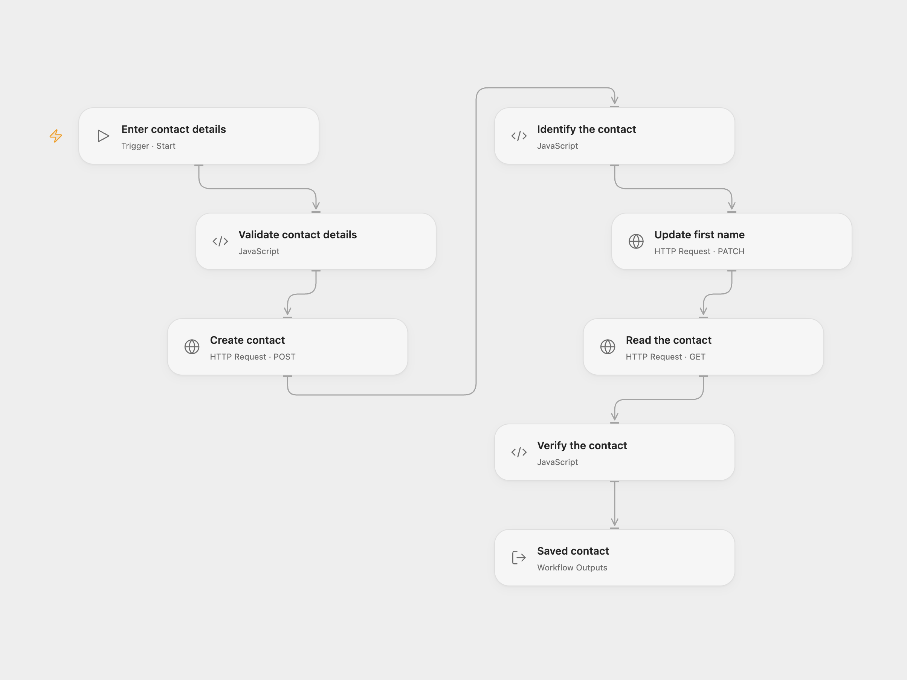

# Create and Update an E-goi Subscriber

Create an E-goi contact, update their first name and read the saved contact.

<picture>
  <source media="(prefers-color-scheme: dark)" srcset="preview-dark.png">
  
</picture>

[Open Flow JSON](templates/create-update-egoi-subscriber.openflow.json) · [n8n JSON](templates/create-update-egoi-subscriber.n8n.json)

## Setup

Use an E-goi list and an API key with contact create, update and read access. In Open Flow, store the key as a secret Variable and bind **Auth Token** on **Create contact**, **Update first name** and **Read the contact**. Run with the list ID, email, initial first name and updated first name. In n8n, connect E-goi credentials to all three nodes and edit **Set contact details**. Run one format.

Only add people who have agreed to receive your messages. E-goi determines the contact status; list automations may send messages.

## Behavior

Each run creates one contact with the initial first name, updates that same contact to the new first name and reads it back. A failed step stops later steps. E-goi may reject an existing email according to its list rules. The workflow does not deduplicate, roll back or retry writes. A lost response can mean a write succeeded; inspect E-goi before retrying. n8n performs an intermediate read after the update; Open Flow reads after the update.

Inspiration &amp; credits

## Changes to the source

- Replace the personal example and list ID with inputs and check the final contact ID, email and name.
- Return the raw contact in both formats and use the returned contact ID for every operation.

Adapted from [Create, update, and get a subscriber using the e-goi node](https://github.com/Zie619/n8n-workflows/blob/ae8cf6dc5b873cbb4f74587aa9180ed3a9f70682/workflows/Manual/0300_Manual_Egoi_Create_Triggered.json) in [Zie619/n8n-workflows](https://github.com/Zie619/n8n-workflows). The matching [n8n community listing](https://n8n.io/workflows/852-create-update-and-get-a-subscriber-using-the-e-goi-node/) credits Harshil Agrawal. The original template does not state a separate license.

The collection’s [MIT notice](https://github.com/Zie619/n8n-workflows/blob/94007c1445d9258a7da116646b79473e7c7c3282/LICENSE) is pinned at a later revision. This is the collection notice at that revision; it does not establish a separate original template author's license. Our changes are listed above; see [repository licensing](../../README.md#licensing).

> MIT License
>
> Copyright (c) 2025 Zie619
>
> Permission is hereby granted, free of charge, to any person obtaining a copy
> of this software and associated documentation files (the "Software"), to deal
> in the Software without restriction, including without limitation the rights
> to use, copy, modify, merge, publish, distribute, sublicense, and/or sell
> copies of the Software, and to permit persons to whom the Software is
> furnished to do so, subject to the following conditions:
>
> The above copyright notice and this permission notice shall be included in all
> copies or substantial portions of the Software.
>
> THE SOFTWARE IS PROVIDED "AS IS", WITHOUT WARRANTY OF ANY KIND, EXPRESS OR
> IMPLIED, INCLUDING BUT NOT LIMITED TO THE WARRANTIES OF MERCHANTABILITY,
> FITNESS FOR A PARTICULAR PURPOSE AND NONINFRINGEMENT. IN NO EVENT SHALL THE
> AUTHORS OR COPYRIGHT HOLDERS BE LIABLE FOR ANY CLAIM, DAMAGES OR OTHER
> LIABILITY, WHETHER IN AN ACTION OF CONTRACT, TORT OR OTHERWISE, ARISING FROM,
> OUT OF OR IN CONNECTION WITH THE SOFTWARE OR THE USE OR OTHER DEALINGS IN THE
> SOFTWARE.

