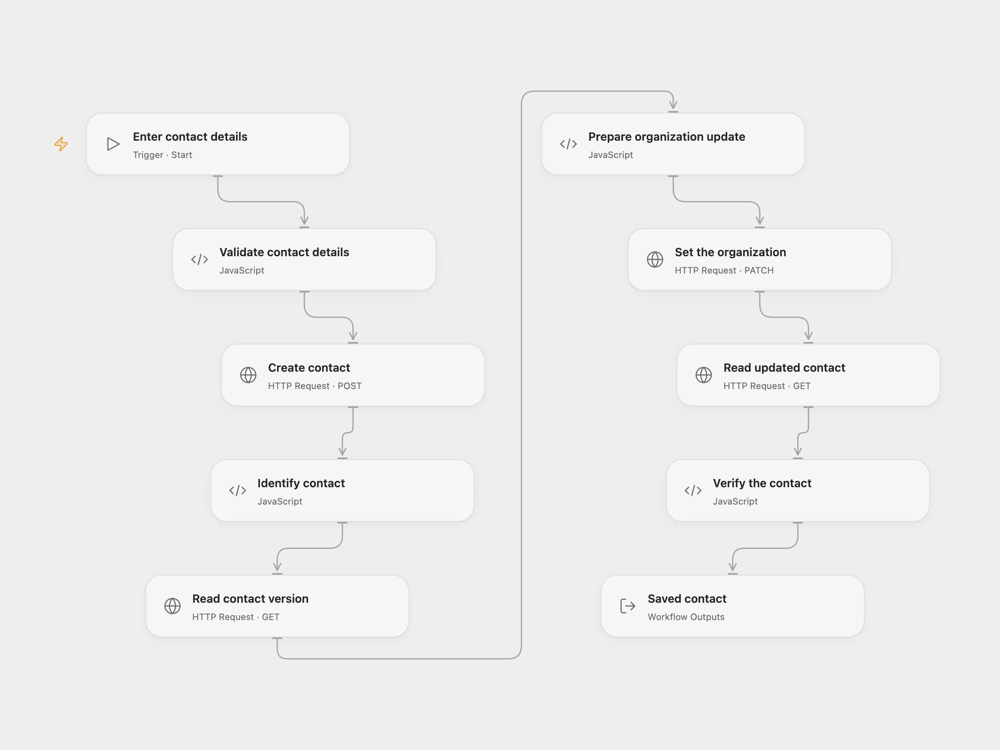

# Create and Update a Google Contact

Create a Google contact, set their organization and read the updated contact.

<picture>
  <source media="(prefers-color-scheme: dark)" srcset="preview-dark.png">
  
</picture>

[Open Flow JSON](templates/create-update-google-contact.openflow.json) · [n8n JSON](templates/create-update-google-contact.n8n.json)

## Setup

Enable the Google People API and authorize the `https://www.googleapis.com/auth/contacts` scope. In Open Flow, store a Google OAuth access token in a secret Variable and bind **Auth Token** on all four HTTP Request nodes. Access tokens expire; refresh the token externally and update the Variable. Run with the person's given and family names and their organization name, title and domain.

In n8n, connect the same Google Contacts OAuth2 credential to the Google Contacts and HTTP Request nodes and edit **Set contact details**. Run one format.

## Behavior

Each run creates a contact, reads its current contact-source version, replaces its organization with the supplied values and reads it back. An ETag conflict or any failed step stops the run. A write whose response is lost may have succeeded; inspect Google Contacts before retrying. The workflow does not retry or roll back writes, and each run can create another contact.

Inspiration &amp; credits

## Changes to the source

- Replace example names and organization with inputs. Read the contact-source ETag and include it when updating, as required by the People API.
- Verify the returned contact and its organization. The n8n update uses HTTP Request with the Google Contacts credential.

Adapted from [Create, update and get a contact in Google Contacts](https://github.com/Zie619/n8n-workflows/blob/ae8cf6dc5b873cbb4f74587aa9180ed3a9f70682/workflows/Manual/0409_Manual_Googlecontacts_Create_Triggered.json) in [Zie619/n8n-workflows](https://github.com/Zie619/n8n-workflows). The matching [n8n community listing](https://n8n.io/workflows/637-manage-contacts-in-google-contacts/) credits Harshil Agrawal. The original template does not state a separate license.

The collection’s [MIT notice](https://github.com/Zie619/n8n-workflows/blob/94007c1445d9258a7da116646b79473e7c7c3282/LICENSE) is pinned at a later revision. This is the collection notice at that revision; it does not establish a separate original template author's license. Our changes are listed above; see [repository licensing](../../README.md#licensing).

> MIT License
>
> Copyright (c) 2025 Zie619
>
> Permission is hereby granted, free of charge, to any person obtaining a copy
> of this software and associated documentation files (the "Software"), to deal
> in the Software without restriction, including without limitation the rights
> to use, copy, modify, merge, publish, distribute, sublicense, and/or sell
> copies of the Software, and to permit persons to whom the Software is
> furnished to do so, subject to the following conditions:
>
> The above copyright notice and this permission notice shall be included in all
> copies or substantial portions of the Software.
>
> THE SOFTWARE IS PROVIDED "AS IS", WITHOUT WARRANTY OF ANY KIND, EXPRESS OR
> IMPLIED, INCLUDING BUT NOT LIMITED TO THE WARRANTIES OF MERCHANTABILITY,
> FITNESS FOR A PARTICULAR PURPOSE AND NONINFRINGEMENT. IN NO EVENT SHALL THE
> AUTHORS OR COPYRIGHT HOLDERS BE LIABLE FOR ANY CLAIM, DAMAGES OR OTHER
> LIABILITY, WHETHER IN AN ACTION OF CONTRACT, TORT OR OTHERWISE, ARISING FROM,
> OUT OF OR IN CONNECTION WITH THE SOFTWARE OR THE USE OR OTHER DEALINGS IN THE
> SOFTWARE.

