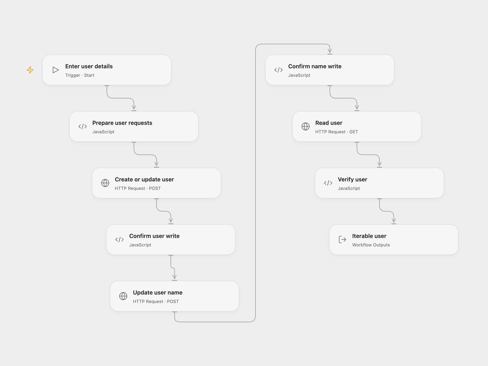

# Create and Update an Iterable User

Create or update an Iterable user, set their Name field and read the profile.

<picture>
  <source media="(prefers-color-scheme: dark)" srcset="preview-dark.png">
  
</picture>

[Open Flow JSON](templates/create-update-iterable-user.openflow.json) · [n8n JSON](templates/create-update-iterable-user.n8n.json)

## Setup

Use an email-based Iterable project and a server-side API key with user read and write access. In Open Flow, create a secret Variable for the key and bind **Auth Token** on all three HTTP nodes. Run with the user's email, the value for the case-sensitive **Name** field, and region `us` or `eu` matching the Iterable project. In n8n, connect Iterable credentials to all three nodes, choose the same project region in the credential and edit **Set user details**.

Make sure your project permits the **Name** field and that you are authorized to update the user. Creating a profile can trigger project automations; check your project's messaging and consent settings.

## Behavior

The workflow makes two ordered user upserts for the same email. The first sends only the email; the second sets **Name**. It reads the user and checks that the email and field match. Iterable may drop an unrecognized field depending on project schema settings; the final check reports that case. An error stops subsequent steps. There is no automatic retry or rollback; after a lost response, inspect the profile before retrying.

## Changes to the source

- Replace the empty email and name with configured values, preserve both upserts and use the same email throughout.
- Return the user after checking the stored **Name**; use the Iterable HTTP API in Open Flow.

Source and license

Adapted from [Create, update and get a user from Iterable](https://github.com/Zie619/n8n-workflows/blob/ae8cf6dc5b873cbb4f74587aa9180ed3a9f70682/workflows/Manual/0208_Manual_Iterable_Create_Triggered.json) in [Zie619/n8n-workflows](https://github.com/Zie619/n8n-workflows). The matching [n8n community listing](https://n8n.io/workflows/813-create-update-and-get-a-user-from-iterable/) credits Harshil Agrawal. The original template does not state a separate license.

The collection’s [MIT notice](https://github.com/Zie619/n8n-workflows/blob/94007c1445d9258a7da116646b79473e7c7c3282/LICENSE) is pinned at a later revision. This is the collection notice at that revision; it does not establish a separate original template author's license. Our changes are listed above; see [repository licensing](../../README.md#licensing).

> MIT License
>
> Copyright (c) 2025 Zie619
>
> Permission is hereby granted, free of charge, to any person obtaining a copy
> of this software and associated documentation files (the "Software"), to deal
> in the Software without restriction, including without limitation the rights
> to use, copy, modify, merge, publish, distribute, sublicense, and/or sell
> copies of the Software, and to permit persons to whom the Software is
> furnished to do so, subject to the following conditions:
>
> The above copyright notice and this permission notice shall be included in all
> copies or substantial portions of the Software.
>
> THE SOFTWARE IS PROVIDED "AS IS", WITHOUT WARRANTY OF ANY KIND, EXPRESS OR
> IMPLIED, INCLUDING BUT NOT LIMITED TO THE WARRANTIES OF MERCHANTABILITY,
> FITNESS FOR A PARTICULAR PURPOSE AND NONINFRINGEMENT. IN NO EVENT SHALL THE
> AUTHORS OR COPYRIGHT HOLDERS BE LIABLE FOR ANY CLAIM, DAMAGES OR OTHER
> LIABILITY, WHETHER IN AN ACTION OF CONTRACT, TORT OR OTHERWISE, ARISING FROM,
> OUT OF OR IN CONNECTION WITH THE SOFTWARE OR THE USE OR OTHER DEALINGS IN THE
> SOFTWARE.

