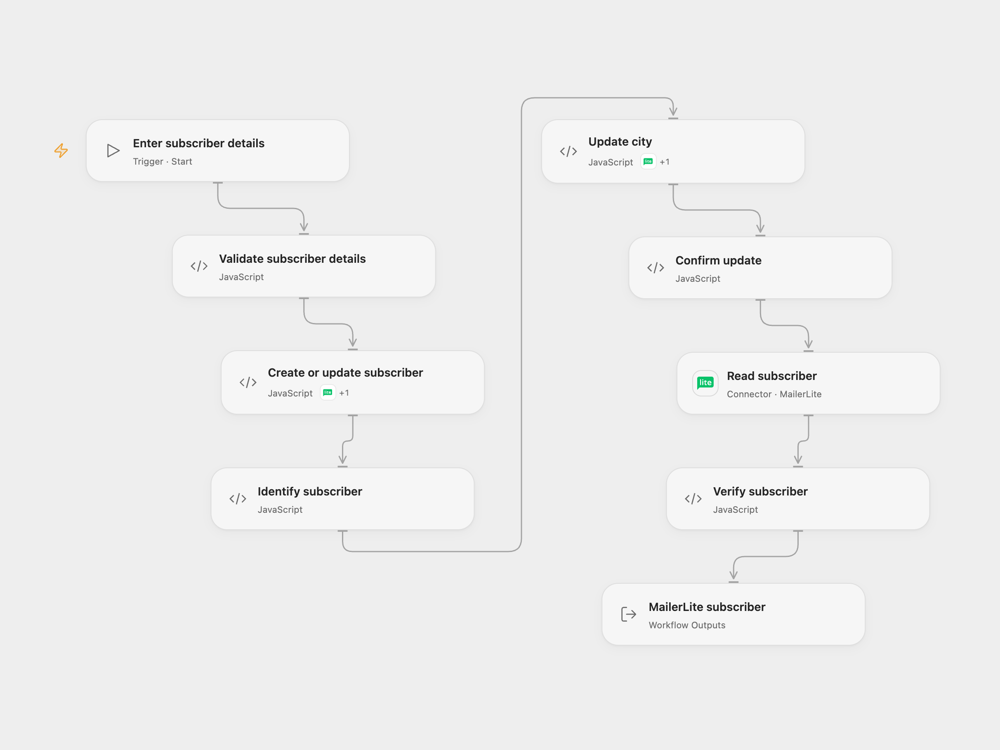

# Create and Update a MailerLite Subscriber

Create or update a MailerLite subscriber, set their city and read their profile.

<picture>
  <source media="(prefers-color-scheme: dark)" srcset="preview-dark.png">
  
</picture>

[Open Flow JSON](templates/create-update-mailerlite-subscriber.openflow.json) · [n8n JSON](templates/create-update-mailerlite-subscriber.n8n.json)

## Setup

Use a current MailerLite account and API key with subscriber access. In Open Flow, connect MailerLite to **Create or update subscriber**, **Update city** and **Read subscriber**, and allow the named Actions. Run with the subscriber's email, name and city. In n8n, connect the same current MailerLite credential to all three nodes, turn off **Classic API** in the credential, and edit **Set subscriber details**.

Only add people who have agreed to receive your messages. Check the account's API double opt-in settings and automations; MailerLite determines subscriber status and may send a confirmation email or trigger automations.

## Behavior

The workflow creates or updates a subscriber by email, updates that same subscriber's city and reads the profile. The create operation can update an existing subscriber's name. It does not request a status change or resubscription. MailerLite controls the resulting status. A failure stops later steps; there is no retry or rollback. Check MailerLite before retrying an uncertain write.

## Changes to the source

- Replace the example subscriber details with inputs and verify the final identity, name and city.
- Use the current MailerLite API in both formats. The source used MailerLite Classic; Classic and current accounts and credentials are separate. The current create endpoint is an upsert.

Source and license

Adapted from [Create, update and get a subscriber using the MailerLite node](https://github.com/Zie619/n8n-workflows/blob/ae8cf6dc5b873cbb4f74587aa9180ed3a9f70682/workflows/Manual/1218_Manual_Mailerlite_Create_Triggered.json) in [Zie619/n8n-workflows](https://github.com/Zie619/n8n-workflows). The matching [n8n community listing](https://n8n.io/workflows/751-create-update-and-get-a-subscriber-using-the-mailerlite-node/) credits Harshil Agrawal. The original template does not state a separate license.

The collection’s [MIT notice](https://github.com/Zie619/n8n-workflows/blob/94007c1445d9258a7da116646b79473e7c7c3282/LICENSE) is pinned at a later revision. This is the collection notice at that revision; it does not establish a separate original template author's license. Our changes are listed above; see [repository licensing](../../README.md#licensing).

> MIT License
>
> Copyright (c) 2025 Zie619
>
> Permission is hereby granted, free of charge, to any person obtaining a copy
> of this software and associated documentation files (the "Software"), to deal
> in the Software without restriction, including without limitation the rights
> to use, copy, modify, merge, publish, distribute, sublicense, and/or sell
> copies of the Software, and to permit persons to whom the Software is
> furnished to do so, subject to the following conditions:
>
> The above copyright notice and this permission notice shall be included in all
> copies or substantial portions of the Software.
>
> THE SOFTWARE IS PROVIDED "AS IS", WITHOUT WARRANTY OF ANY KIND, EXPRESS OR
> IMPLIED, INCLUDING BUT NOT LIMITED TO THE WARRANTIES OF MERCHANTABILITY,
> FITNESS FOR A PARTICULAR PURPOSE AND NONINFRINGEMENT. IN NO EVENT SHALL THE
> AUTHORS OR COPYRIGHT HOLDERS BE LIABLE FOR ANY CLAIM, DAMAGES OR OTHER
> LIABILITY, WHETHER IN AN ACTION OF CONTRACT, TORT OR OTHERWISE, ARISING FROM,
> OUT OF OR IN CONNECTION WITH THE SOFTWARE OR THE USE OR OTHER DEALINGS IN THE
> SOFTWARE.

