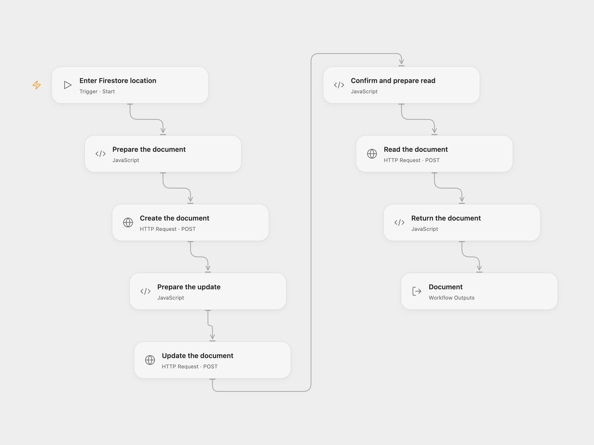

# Create, Update, and Read a Firestore Document

Create an example document, update its name, and read it back from Firestore.

<picture>
  <source media="(prefers-color-scheme: dark)" srcset="preview-dark.png">
  
</picture>

[Open Flow JSON](templates/create-update-read-firestore-document.openflow.json) · [n8n JSON](templates/create-update-read-firestore-document.n8n.json)

## Setup

Create a Firestore database in a Google Cloud project and choose a collection ID. In Open Flow, bind a Google OAuth access token with the datastore or cloud-platform scope to all three HTTP nodes; refresh or replace the token when it expires. Run with the project ID and collection ID. In n8n, configure the project and collection in **Google Cloud Firestore** and connect the same Firestore OAuth credential to all three Firestore nodes. Run one format at a time.

## Behavior

The workflow creates a document with an automatically assigned ID and fields `id: 1` and `name: n8n`. It updates only the name to `nodemation`, then retrieves the same document. It uses the default Firestore database. Each run creates a new document.

The workflow checks the update's per-write status before reading. A failed or uncertain request can leave a document created or updated. Inspect Firestore before retrying; writes are not rolled back or automatically repeated.

Inspiration &amp; credits

## Changes to the source

- Replace the source project and collection with configuration. Open Flow uses Firestore REST with an OAuth access token and returns the simplified document.
- Both formats check the per-write update status before reading the document.

Adapted from [Create, update, and get a document in Google Cloud Firestore](https://github.com/Zie619/n8n-workflows/blob/ae8cf6dc5b873cbb4f74587aa9180ed3a9f70682/workflows/Manual/0261_Manual_Googlefirebasecloudfirestore_Create_Triggered.json) in [Zie619/n8n-workflows](https://github.com/Zie619/n8n-workflows). The matching [n8n community listing](https://n8n.io/workflows/839-create-update-and-get-a-document-in-google-cloud-firestore/) credits Harshil Agrawal. The original template does not state a separate license.

The collection’s [MIT notice](https://github.com/Zie619/n8n-workflows/blob/94007c1445d9258a7da116646b79473e7c7c3282/LICENSE) is pinned at a later revision. This is the collection notice at that revision; it does not establish a separate original template author's license. Our changes are listed above; see [repository licensing](../../README.md#licensing).

> MIT License
>
> Copyright (c) 2025 Zie619
>
> Permission is hereby granted, free of charge, to any person obtaining a copy
> of this software and associated documentation files (the "Software"), to deal
> in the Software without restriction, including without limitation the rights
> to use, copy, modify, merge, publish, distribute, sublicense, and/or sell
> copies of the Software, and to permit persons to whom the Software is
> furnished to do so, subject to the following conditions:
>
> The above copyright notice and this permission notice shall be included in all
> copies or substantial portions of the Software.
>
> THE SOFTWARE IS PROVIDED "AS IS", WITHOUT WARRANTY OF ANY KIND, EXPRESS OR
> IMPLIED, INCLUDING BUT NOT LIMITED TO THE WARRANTIES OF MERCHANTABILITY,
> FITNESS FOR A PARTICULAR PURPOSE AND NONINFRINGEMENT. IN NO EVENT SHALL THE
> AUTHORS OR COPYRIGHT HOLDERS BE LIABLE FOR ANY CLAIM, DAMAGES OR OTHER
> LIABILITY, WHETHER IN AN ACTION OF CONTRACT, TORT OR OTHERWISE, ARISING FROM,
> OUT OF OR IN CONNECTION WITH THE SOFTWARE OR THE USE OR OTHER DEALINGS IN THE
> SOFTWARE.

