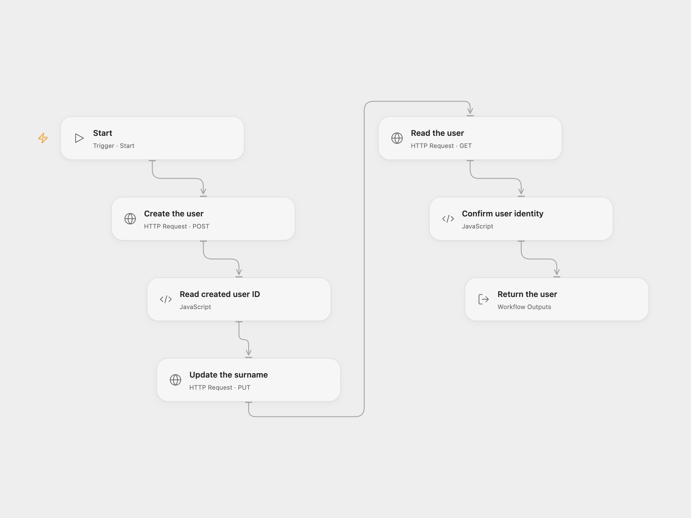

# Create, Update and Read a Workspace User

Create a Google Workspace user, update their surname, and retrieve the user.

<picture>
  <source media="(prefers-color-scheme: dark)" srcset="preview-dark.png">
  
</picture>

[Open Flow JSON](templates/create-update-read-workspace-user.openflow.json) · [n8n JSON](templates/create-update-read-workspace-user.n8n.json)

## Setup

Enable the Google Admin SDK Directory API for your Workspace. Use an administrator account with permission to create, update and read users.

In Open Flow, create a secret Variable containing a JSON text body with the new user's `primaryEmail`, `name.givenName`, `name.familyName`, and `password`, and bind it to **Create the user** → **Body**. For example, replace each placeholder in `{"primaryEmail":"person@example.invalid","name":{"givenName":"First","familyName":"Last"},"password":"REPLACE_WITH_PASSWORD"}`. Obtain a current OAuth access token with scope `https://www.googleapis.com/auth/admin.directory.user` and bind it to the Bearer token inputs of all three HTTP nodes. Access tokens expire; obtain a new one before it expires. Set the desired new family name in **Update the surname**.

In n8n, connect the G Suite Admin credential to all three nodes and configure the domain, username, names and initial password in **G Suite Admin**, then set the updated surname in **G Suite Admin1**.

## Behavior

The workflow creates one user, updates that same user's surname, and reads their final record. Open Flow returns the full API record; n8n's default Get output returns its simplified user fields. The account and any changes may remain if an operation fails or its response is lost. Inspect the Workspace directory before retrying; the workflow does not retry writes.

Inspiration &amp; credits

## Changes to the source

- Replace the source account and password with user configuration. Open Flow uses the Google Directory API with a manually supplied short-lived OAuth token; n8n retains its G Suite Admin connection.

Adapted from [Create, update, and get a user using the G Suite Admin node](https://github.com/Zie619/n8n-workflows/blob/ae8cf6dc5b873cbb4f74587aa9180ed3a9f70682/workflows/Manual/0455_Manual_Gsuiteadmin_Create_Triggered.json) in [Zie619/n8n-workflows](https://github.com/Zie619/n8n-workflows). The source export does not identify a separate template author or license.

The collection’s [MIT notice](https://github.com/Zie619/n8n-workflows/blob/94007c1445d9258a7da116646b79473e7c7c3282/LICENSE) is pinned at a later revision. This is the collection notice at that revision; it does not establish a separate original template author's license. Our changes are listed above; see [repository licensing](../../README.md#licensing).

> MIT License
>
> Copyright (c) 2025 Zie619
>
> Permission is hereby granted, free of charge, to any person obtaining a copy
> of this software and associated documentation files (the "Software"), to deal
> in the Software without restriction, including without limitation the rights
> to use, copy, modify, merge, publish, distribute, sublicense, and/or sell
> copies of the Software, and to permit persons to whom the Software is
> furnished to do so, subject to the following conditions:
>
> The above copyright notice and this permission notice shall be included in all
> copies or substantial portions of the Software.
>
> THE SOFTWARE IS PROVIDED "AS IS", WITHOUT WARRANTY OF ANY KIND, EXPRESS OR
> IMPLIED, INCLUDING BUT NOT LIMITED TO THE WARRANTIES OF MERCHANTABILITY,
> FITNESS FOR A PARTICULAR PURPOSE AND NONINFRINGEMENT. IN NO EVENT SHALL THE
> AUTHORS OR COPYRIGHT HOLDERS BE LIABLE FOR ANY CLAIM, DAMAGES OR OTHER
> LIABILITY, WHETHER IN AN ACTION OF CONTRACT, TORT OR OTHERWISE, ARISING FROM,
> OUT OF OR IN CONNECTION WITH THE SOFTWARE OR THE USE OR OTHER DEALINGS IN THE
> SOFTWARE.

