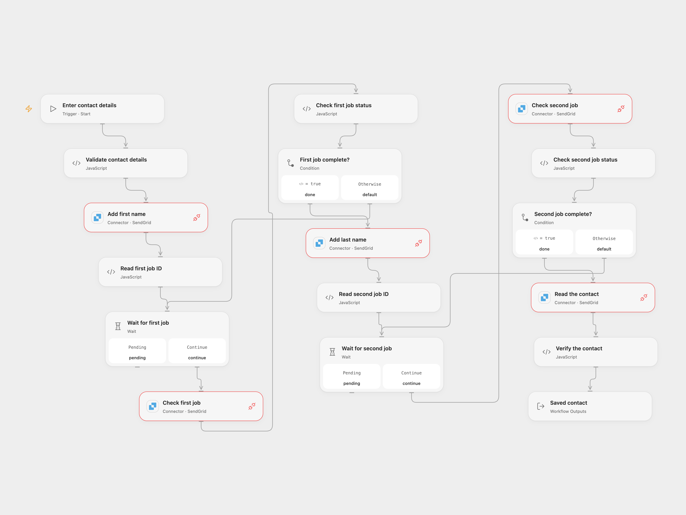

# Create and Update a SendGrid Contact

Add or update a SendGrid contact, then read the saved contact.

<picture>
  <source media="(prefers-color-scheme: dark)" srcset="preview-dark.png">
  
</picture>

[Open Flow JSON](templates/create-update-sendgrid-contact.openflow.json) · [n8n JSON](templates/create-update-sendgrid-contact.n8n.json)

## Setup

Connect SendGrid with Marketing Contacts read/write access and Provider API Request permission in each SendGrid node. Run Open Flow with an email address, first name and last name. In n8n, connect the same SendGrid API credential to all HTTP Request nodes, then edit **Set contact details**. Run one format.

## Behavior

Each run upserts the first name for the email, waits for that import job to complete, upserts the last name, waits again and reads the same contact. A job is checked every five seconds at most 12 times. A failed, unknown or still-pending job stops the run before the next write or read. The final contact must match both names. SendGrid lowercases the email address.

The writes are asynchronous and may already have succeeded when a response is lost or a wait times out. Inspect SendGrid and the job status before retrying. The workflow does not roll back or retry writes. The email-only upsert is appropriate when email is the contact's only identifier; SendGrid requires all existing identifiers when updating a contact with additional identifiers.

Inspiration &amp; credits

## Changes to the source

- Replace blank email and names with user configuration and validate them.
- Wait for each asynchronous job before continuing, bound the checks, and verify the final contact. Open Flow uses the SendGrid Provider API Request for the contact operations; n8n uses HTTP Request with the SendGrid credential.

Adapted from [Create, update and get a contact using the SendGrid node](https://github.com/Zie619/n8n-workflows/blob/ae8cf6dc5b873cbb4f74587aa9180ed3a9f70682/workflows/Manual/0408_Manual_Sendgrid_Create_Triggered.json) in [Zie619/n8n-workflows](https://github.com/Zie619/n8n-workflows). The matching [n8n community listing](https://n8n.io/workflows/901-add-contacts-to-sendgrid-automatically/) credits Harshil Agrawal. The original template does not state a separate license.

The collection’s [MIT notice](https://github.com/Zie619/n8n-workflows/blob/94007c1445d9258a7da116646b79473e7c7c3282/LICENSE) is pinned at a later revision. This is the collection notice at that revision; it does not establish a separate original template author's license. Our changes are listed above; see [repository licensing](../../README.md#licensing).

> MIT License
>
> Copyright (c) 2025 Zie619
>
> Permission is hereby granted, free of charge, to any person obtaining a copy
> of this software and associated documentation files (the "Software"), to deal
> in the Software without restriction, including without limitation the rights
> to use, copy, modify, merge, publish, distribute, sublicense, and/or sell
> copies of the Software, and to permit persons to whom the Software is
> furnished to do so, subject to the following conditions:
>
> The above copyright notice and this permission notice shall be included in all
> copies or substantial portions of the Software.
>
> THE SOFTWARE IS PROVIDED "AS IS", WITHOUT WARRANTY OF ANY KIND, EXPRESS OR
> IMPLIED, INCLUDING BUT NOT LIMITED TO THE WARRANTIES OF MERCHANTABILITY,
> FITNESS FOR A PARTICULAR PURPOSE AND NONINFRINGEMENT. IN NO EVENT SHALL THE
> AUTHORS OR COPYRIGHT HOLDERS BE LIABLE FOR ANY CLAIM, DAMAGES OR OTHER
> LIABILITY, WHETHER IN AN ACTION OF CONTRACT, TORT OR OTHERWISE, ARISING FROM,
> OUT OF OR IN CONNECTION WITH THE SOFTWARE OR THE USE OR OTHER DEALINGS IN THE
> SOFTWARE.

