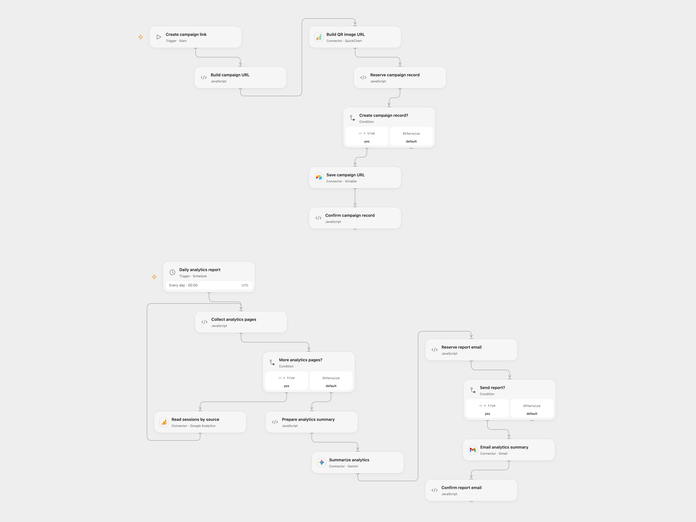

# Create UTM Links and Email Analytics

Create a campaign link and QR code, and email a scheduled analytics summary.

<!-- template-actions:start -->
 
<!-- template-actions:end -->

<picture>
  <source media="(prefers-color-scheme: dark)" srcset="preview-dark.png">
  
</picture>

## Setup

Connect Airtable, Google Analytics, Gemini and Gmail. Create an Airtable table with a URL field. Set its base and table in **Save campaign URL**, the Analytics property in **Read sessions by source**, and the recipient in **Reserve report email**. Enable persistent State.

## Behavior

Start a campaign run with a website URL, source, medium, campaign, term, campaign ID and unique request ID. The workflow adds the UTM parameters, saves the URL in Airtable, and produces a QuickChart QR image URL. Opening the image URL sends the campaign URL to QuickChart. Reusing a request ID skips a previously confirmed Airtable write.

At 00:00 UTC each day the workflow reads all Google Analytics pages for sessions by date and source/medium, from seven days ago through today, and emails a Gemini-generated summary. Google Analytics interprets relative dates in the property timezone; today may be incomplete. The summary can be wrong and the report may be subject to Analytics thresholds or sampling. A report over 50,000 characters stops before the model call.

An uncertain Airtable create or Gmail send may have succeeded. Inspect the destination before retrying. In Open Flow enter the pending key and `confirmed` or `absent` in the corresponding reserve node, rerun the same request, and clear the recovery fields. Avoid overlapping runs; checkpoints are not atomic locks. Keep report data and execution history restricted.

In n8n

In n8n, connect Airtable, Google Analytics, Gemini and Gmail. Set the campaign values and a unique request ID in **Set UTM Parameters For Link**. Configure the Airtable base and table in **Submit UTM Link To Database**, and set the property and recipient in **Configure report**. Select one Data Table with text columns `item_key` and `status` in all checkpoint nodes. Use only one format for the same campaign or report. The workflow adds the UTM parameters, saves the URL in Airtable, and produces a QuickChart QR image URL in Open Flow or an image in n8n. In n8n inspect the pending Data Table row, set it to `done` if confirmed or delete it if absent, and rerun.

Inspiration &amp; credits

Correct UTM encoding and analytics pagination, use a current model, preserve the campaign and report paths, and stop after uncertain writes.

Adapted from [UTM Link Creator & QR Code Generator with Scheduled Google Analytics Reports](https://github.com/Zie619/n8n-workflows/blob/ae8cf6dc5b873cbb4f74587aa9180ed3a9f70682/workflows/Code/1644_Code_Schedule_Automation_Scheduled.json) in [Zie619/n8n-workflows](https://github.com/Zie619/n8n-workflows). Attribution: Zie619 / n8n-workflows.

The collection’s [MIT notice](https://github.com/Zie619/n8n-workflows/blob/94007c1445d9258a7da116646b79473e7c7c3282/LICENSE) is pinned at a later revision. This is the collection notice at that revision; it does not establish a separate original template author's license. Our changes are listed above; see [repository licensing](../../README.md#licensing).

> MIT License
>
> Copyright (c) 2025 Zie619
>
> Permission is hereby granted, free of charge, to any person obtaining a copy
> of this software and associated documentation files (the "Software"), to deal
> in the Software without restriction, including without limitation the rights
> to use, copy, modify, merge, publish, distribute, sublicense, and/or sell
> copies of the Software, and to permit persons to whom the Software is
> furnished to do so, subject to the following conditions:
>
> The above copyright notice and this permission notice shall be included in all
> copies or substantial portions of the Software.
>
> THE SOFTWARE IS PROVIDED "AS IS", WITHOUT WARRANTY OF ANY KIND, EXPRESS OR
> IMPLIED, INCLUDING BUT NOT LIMITED TO THE WARRANTIES OF MERCHANTABILITY,
> FITNESS FOR A PARTICULAR PURPOSE AND NONINFRINGEMENT. IN NO EVENT SHALL THE
> AUTHORS OR COPYRIGHT HOLDERS BE LIABLE FOR ANY CLAIM, DAMAGES OR OTHER
> LIABILITY, WHETHER IN AN ACTION OF CONTRACT, TORT OR OTHERWISE, ARISING FROM,
> OUT OF OR IN CONNECTION WITH THE SOFTWARE OR THE USE OR OTHER DEALINGS IN THE
> SOFTWARE.

