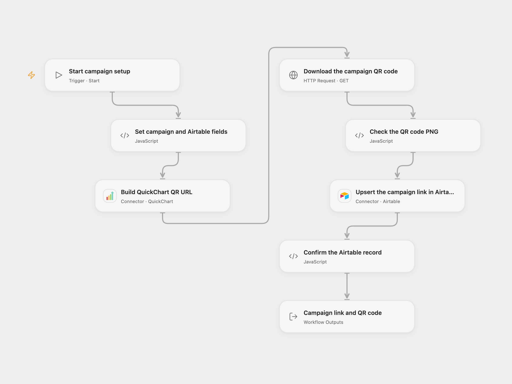

# Create UTM Links and QR Codes in Airtable

Build a tagged campaign URL, download its QR code as a PNG, and save the same link to Airtable.

<!-- template-actions:start -->
 
<!-- template-actions:end -->

<picture>
  <source media="(prefers-color-scheme: dark)" srcset="preview-dark.png">
  
</picture>

## Setup

1. Create a single-line text field named `URL` in Airtable. Set the base ID, table ID, page URL, campaign source, medium, and name in **Set campaign and Airtable fields**. The campaign term and campaign ID are optional. The campaign ID sets `utm_content`.
2. Select an Airtable connection in **Upsert the campaign link in Airtable**. Use an Airtable account or personal access token with write access to the chosen base (`data.records:write`).
3. Run manually and open **Campaign link and QR code** to download the PNG and see the campaign URL, Airtable record ID, and whether the record was created.

## Behavior

The workflow preserves unrelated query parameters and the page fragment. The campaign values replace their matching UTM parameters. Leaving an optional campaign value blank preserves any existing value for that parameter. QuickChart encodes the final URL in a 300 × 300 PNG. Use a public campaign link up to 900 UTF-8 bytes and keep secrets out of its query parameters.

After validating the PNG response, the workflow sends a single Airtable upsert matched on the full URL. A run with the same URL updates its existing record. Airtable rejects an ambiguous match if multiple rows already share that URL. If the write times out or lacks a matching receipt, look for the exact URL in Airtable before retrying.

In n8n

Edit the values in **Set campaign and Airtable fields**. Select an Airtable Personal Access Token API credential in **Upsert the campaign link in Airtable** with `data.records:write` and access to the chosen base. Run manually and open **Campaign link and QR code** to view the link and record ID in JSON and download `campaign-qr.png` from Binary.

Inspiration &amp; credits

Adapted from [UTM Link Creator & QR Code Generator with Scheduled Google Analytics Reports](https://github.com/enescingoz/awesome-n8n-templates/blob/827110332c21cbe000ab13f6d292d5adb1f1f8db/Other_Integrations_and_Use_Cases/UTM%20Link%20Creator%20%26%20QR%20Code%20Generator%20with%20Scheduled%20Google%20Analytics%20Reports.json) in [enescingoz/awesome-n8n-templates](https://github.com/enescingoz/awesome-n8n-templates).

Source collection notice: © 2024–2026 Enes Cingoz, [CC BY 4.0](https://github.com/enescingoz/awesome-n8n-templates/blob/827110332c21cbe000ab13f6d292d5adb1f1f8db/LICENSE). The original workflow is credited to Ottoflow.Ai. The collection notice does not establish a separate license for the original workflow. See [repository licensing](../../README.md#licensing) for the scope of OOMOL contributions and third-party material.

[Original n8n workflow by Ottoflow.Ai](https://n8n.io/workflows/2921-utm-link-creator-and-qr-code-generator-with-scheduled-google-analytics-reports/).

## Changes to the source

This template adapts the independent manual campaign branch. It encodes UTM values, preserves the page's existing query and fragment, downloads the actual PNG, and matches Airtable upserts on the URL field.

