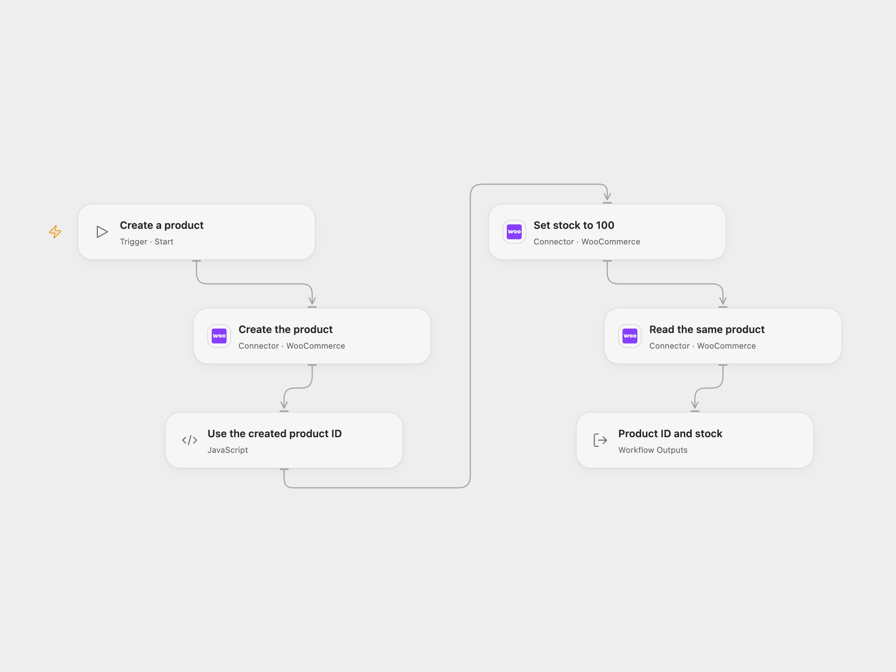

# Create a WooCommerce Product and Set Stock

Create a product, set its stock quantity to 100, then retrieve the same product.

<picture>
  <source media="(prefers-color-scheme: dark)" srcset="preview-dark.png">
  
</picture>

[Open Flow JSON](templates/create-woocommerce-product-and-set-stock.openflow.json) · [n8n JSON](templates/create-woocommerce-product-and-set-stock.n8n.json)

## Setup

Connect all WooCommerce nodes to the same store with REST API credentials that can create, update and read products. Enable inventory management in WooCommerce. Edit the product name, description and regular price in **Create the product**, and the quantity in **Set stock to 100**. The example creates a product in the store and may make it visible according to store defaults.

In n8n, select the same WooCommerce credentials on all three nodes and edit the matching fields in **WooCommerce** and **WooCommerce1**. Run one format for each intended product.

## Behavior

Run manually. The first request creates a product, the second enables product stock management and sets its quantity to 100, and the third reads the product using the ID returned by creation. Open Flow returns the ID, name and stock quantity; n8n returns the product from the final node.

If a request fails or its outcome is uncertain, inspect the store before running again. A product may already exist or its stock may already have changed; earlier writes are not rolled back. The workflow does not deduplicate products.

Inspiration &amp; credits

## Changes to the source

- Enable product stock management in the update: WooCommerce defaults `manage_stock` to false, so a stock quantity alone may not persist. Store-level stock management must also be enabled.
- Keep the separate create, update and get requests. Open Flow checks that creation returns a valid product ID.

Adapted from [Create, update and get a product from WooCommerce](https://github.com/Zie619/n8n-workflows/blob/ae8cf6dc5b873cbb4f74587aa9180ed3a9f70682/workflows/Manual/0293_Manual_Woocommerce_Create_Triggered.json) in [Zie619/n8n-workflows](https://github.com/Zie619/n8n-workflows). The source export does not identify a separate template author or license.

The collection’s [MIT notice](https://github.com/Zie619/n8n-workflows/blob/94007c1445d9258a7da116646b79473e7c7c3282/LICENSE) is pinned at a later revision. This is the collection notice at that revision; it does not establish a separate original template author's license. Our changes are listed above; see [repository licensing](../../README.md#licensing).

> MIT License
>
> Copyright (c) 2025 Zie619
>
> Permission is hereby granted, free of charge, to any person obtaining a copy
> of this software and associated documentation files (the "Software"), to deal
> in the Software without restriction, including without limitation the rights
> to use, copy, modify, merge, publish, distribute, sublicense, and/or sell
> copies of the Software, and to permit persons to whom the Software is
> furnished to do so, subject to the following conditions:
>
> The above copyright notice and this permission notice shall be included in all
> copies or substantial portions of the Software.
>
> THE SOFTWARE IS PROVIDED "AS IS", WITHOUT WARRANTY OF ANY KIND, EXPRESS OR
> IMPLIED, INCLUDING BUT NOT LIMITED TO THE WARRANTIES OF MERCHANTABILITY,
> FITNESS FOR A PARTICULAR PURPOSE AND NONINFRINGEMENT. IN NO EVENT SHALL THE
> AUTHORS OR COPYRIGHT HOLDERS BE LIABLE FOR ANY CLAIM, DAMAGES OR OTHER
> LIABILITY, WHETHER IN AN ACTION OF CONTRACT, TORT OR OTHERWISE, ARISING FROM,
> OUT OF OR IN CONNECTION WITH THE SOFTWARE OR THE USE OR OTHER DEALINGS IN THE
> SOFTWARE.

