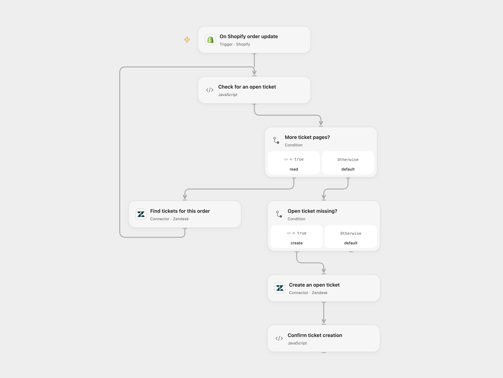

# Create Zendesk Tickets for Shopify Order Updates

Create an open Zendesk ticket for a Shopify order update when the order has no open ticket.

<!-- template-actions:start -->
 
<!-- template-actions:end -->

<picture>
  <source media="(prefers-color-scheme: dark)" srcset="preview-dark.png">
  
</picture>

## Setup

1. Connect your Shopify store to **On Shopify order update**. The connection needs order access and any Shopify approval required for customer names and email addresses.
2. Connect the same Zendesk account to **Find tickets for this order** and **Create an open ticket**. The connection needs read and create access to the relevant tickets and permission to make Provider API Requests. Use a Zendesk account where your store's order numbers identify its tickets uniquely.
3. Publish the workflow to subscribe to the Shopify order-update event.

## Behavior

The workflow looks up Zendesk tickets by the Shopify order number in their external ID. An existing open match ends the run. Otherwise it creates an open ticket with that external ID, the order number, the number of line items, and the customer's name and email when available. Only tickets with the open status count as matches.

Lookup failures stop the run before ticket creation. Zendesk uses the same creation key for competing attempts that see the same ticket history. Zendesk retains that key for two hours. A concurrent update with different ticket details can fail if Zendesk already accepted that key. A failed or unconfirmed create ends the run. Check the order's tickets in Zendesk before manually replaying it.

In n8n

Select your **Shopify Access Token API** credential in **On Shopify order update**. Supply the store's Admin API access token and app secret. Select the same **Zendesk API** credential in the two HTTP Request nodes, and replace `YOUR_ZENDESK_SUBDOMAIN` in both URLs with your Zendesk subdomain. Activate the workflow to subscribe to Shopify's order-update webhook.

Inspiration &amp; credits

Adapted from [Shopify order updates to Zendesk](https://github.com/Zie619/n8n-workflows/blob/ae8cf6dc5b873cbb4f74587aa9180ed3a9f70682/workflows/Shopify/0269_Shopify_Zendesk_Create_Triggered.json) in [Zie619/n8n-workflows](https://github.com/Zie619/n8n-workflows). Attribution: Zie619 / n8n-workflows.

The collection’s [MIT notice](https://github.com/Zie619/n8n-workflows/blob/94007c1445d9258a7da116646b79473e7c7c3282/LICENSE) is pinned at a later revision. This is the collection notice at that revision; it does not establish a separate original template author's license. Our changes are listed above; see [repository licensing](../../README.md#licensing).

> MIT License
>
> Copyright (c) 2025 Zie619
>
> Permission is hereby granted, free of charge, to any person obtaining a copy
> of this software and associated documentation files (the "Software"), to deal
> in the Software without restriction, including without limitation the rights
> to use, copy, modify, merge, publish, distribute, sublicense, and/or sell
> copies of the Software, and to permit persons to whom the Software is
> furnished to do so, subject to the following conditions:
>
> The above copyright notice and this permission notice shall be included in all
> copies or substantial portions of the Software.
>
> THE SOFTWARE IS PROVIDED "AS IS", WITHOUT WARRANTY OF ANY KIND, EXPRESS OR
> IMPLIED, INCLUDING BUT NOT LIMITED TO THE WARRANTIES OF MERCHANTABILITY,
> FITNESS FOR A PARTICULAR PURPOSE AND NONINFRINGEMENT. IN NO EVENT SHALL THE
> AUTHORS OR COPYRIGHT HOLDERS BE LIABLE FOR ANY CLAIM, DAMAGES OR OTHER
> LIABILITY, WHETHER IN AN ACTION OF CONTRACT, TORT OR OTHERWISE, ARISING FROM,
> OUT OF OR IN CONNECTION WITH THE SOFTWARE OR THE USE OR OTHER DEALINGS IN THE
> SOFTWARE.

