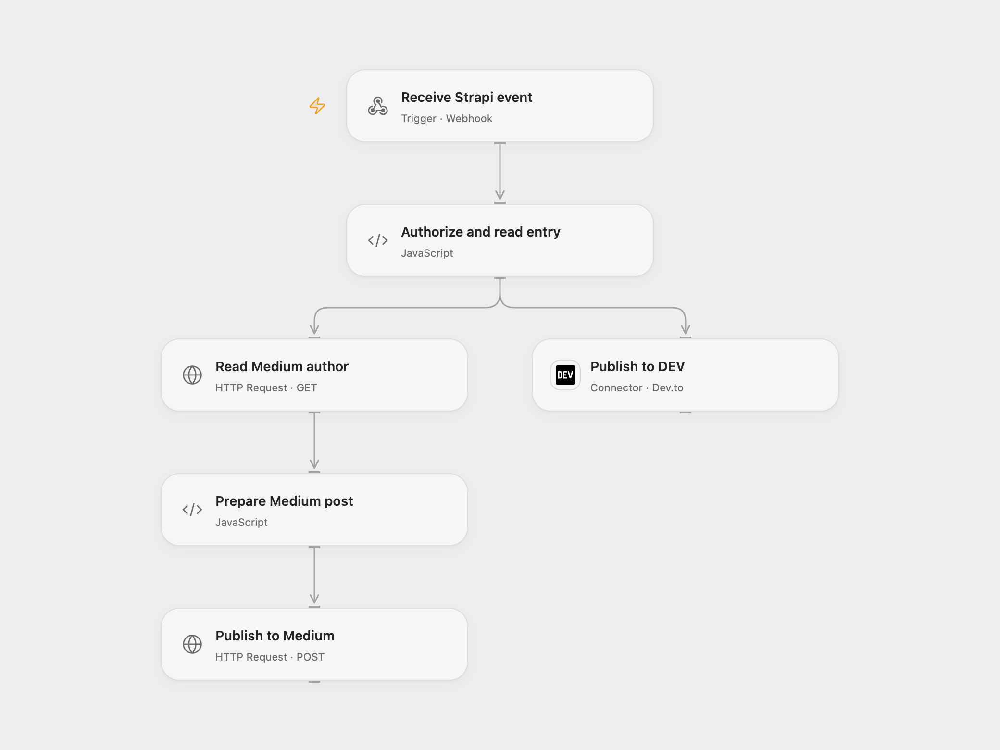

# Cross-post Strapi Entries to DEV and Medium

Publish a Strapi entry to DEV and Medium when a webhook is received.

<picture>
  <source media="(prefers-color-scheme: dark)" srcset="preview-dark.png">
  
</picture>

[Open Flow JSON](templates/cross-post-strapi-entry-to-dev-and-medium.openflow.json) · [n8n JSON](templates/cross-post-strapi-entry-to-dev-and-medium.n8n.json)

## Setup

Configure Strapi to send its webhook to the deployed endpoint with an Authorization header. Bind its full value as a secret Variable in **Authorize and read entry**. The entry must contain the string fields **Title**, **PostContent** and **Tag**. Connect DEV, and bind an existing Medium integration token to both Medium HTTP nodes. Medium no longer issues new integration tokens; existing tokens continue to work. In n8n configure the webhook Header Auth, DEV header credential, and Medium connection.

## Behavior

An authenticated event publishes the entry's title and Markdown content to both services. The DEV post is public and uses the entry's tag. Medium publishes without that tag. Open Flow accepts the standard entry webhook envelope with event, createdAt, model, optional uid and entry; it rejects additional top-level fields. Fields inside entry are retained. A webhook acknowledgment is not confirmation of both publications. Check both accounts before retrying an uncertain delivery; the workflow does not deduplicate posts.

Inspiration &amp; credits

## Changes to the source

- Use the DEV connector and authenticated HTTP for Medium. Use structured JSON for the DEV request so quotes and line breaks remain intact.

Adapted from [Cross-post Strapi entries to Medium and DEV](https://github.com/Zie619/n8n-workflows/blob/ae8cf6dc5b873cbb4f74587aa9180ed3a9f70682/workflows/Http/0952_HTTP_Medium_Automation_Webhook.json) in [Zie619/n8n-workflows](https://github.com/Zie619/n8n-workflows). The source export does not identify a separate template author or license.

The collection’s [MIT notice](https://github.com/Zie619/n8n-workflows/blob/94007c1445d9258a7da116646b79473e7c7c3282/LICENSE) is pinned at a later revision. This is the collection notice at that revision; it does not establish a separate original template author's license. Our changes are listed above; see [repository licensing](../../README.md#licensing).

> MIT License
>
> Copyright (c) 2025 Zie619
>
> Permission is hereby granted, free of charge, to any person obtaining a copy
> of this software and associated documentation files (the "Software"), to deal
> in the Software without restriction, including without limitation the rights
> to use, copy, modify, merge, publish, distribute, sublicense, and/or sell
> copies of the Software, and to permit persons to whom the Software is
> furnished to do so, subject to the following conditions:
>
> The above copyright notice and this permission notice shall be included in all
> copies or substantial portions of the Software.
>
> THE SOFTWARE IS PROVIDED "AS IS", WITHOUT WARRANTY OF ANY KIND, EXPRESS OR
> IMPLIED, INCLUDING BUT NOT LIMITED TO THE WARRANTIES OF MERCHANTABILITY,
> FITNESS FOR A PARTICULAR PURPOSE AND NONINFRINGEMENT. IN NO EVENT SHALL THE
> AUTHORS OR COPYRIGHT HOLDERS BE LIABLE FOR ANY CLAIM, DAMAGES OR OTHER
> LIABILITY, WHETHER IN AN ACTION OF CONTRACT, TORT OR OTHERWISE, ARISING FROM,
> OUT OF OR IN CONNECTION WITH THE SOFTWARE OR THE USE OR OTHER DEALINGS IN THE
> SOFTWARE.

