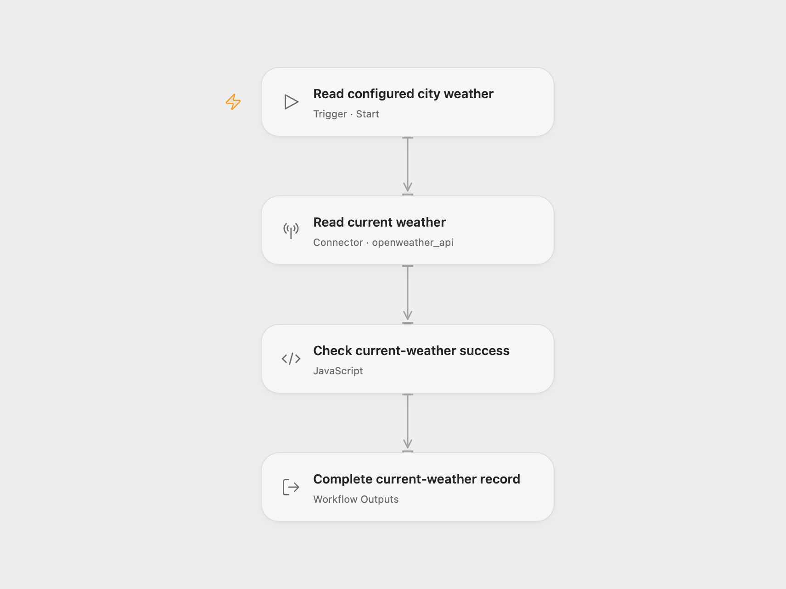

# Current City Weather

Read the current weather for one configured city and return the complete OpenWeather record in metric units.

<picture>
  <source media="(prefers-color-scheme: dark)" srcset="preview-dark.png">
  
</picture>

[Open Flow JSON](templates/current-city-weather.openflow.json) · [n8n JSON](templates/current-city-weather.n8n.json)

## Setup

Use an OpenWeather API key authorized for **Current Weather Data 2.5**. In Open Flow, connect OpenWeather in **Read current weather**. Set **Q** to the city and country code, such as `berlin,de`, and keep **Units** as `metric`. In n8n, select **OpenWeatherMap API** credentials in **OpenWeatherMap**. Enter your API key in the credential’s **Access Token** field, set the city and keep **Metric** format. Shared files contain no account or key.

Run manually. The example city is Berlin, Germany. Each normal run makes one current-weather request, then checks the success code before returning the record. Open Flow exposes it as **Weather**; n8n returns it as one item. The response includes temperatures in Celsius, wind speed in metres per second, weather conditions, observation timestamps and the location’s UTC offset when supplied. All returned properties are retained. The workflow does not fetch forecasts, change units after the request, send notifications or store results.

OpenWeather [still supports city-name lookup but has deprecated its built-in geocoder](https://openweathermap.org/api/current). This template preserves the source’s single city request; it does not add a separate geocoding request. API permissions and limits apply. Authentication errors, unknown cities, throttling, transport failures and a non-success response stop the run. No workflow retry is configured. n8n’s native authentication helper can repeat a request once after HTTP 401; this does not renew the API key. Open Flow does not repeat that rejected request.

Inspiration &amp; credits

## Changes to the source

- Make the original Current Weather, city-name selection and metric defaults explicit.
- Check the API success code before returning the complete response.
- Use the OpenWeather Connector account in Open Flow and preserve the native OpenWeatherMap node in n8n.

Adapted from [Current weather data for a city workflow](https://github.com/Zie619/n8n-workflows/blob/ae8cf6dc5b873cbb4f74587aa9180ed3a9f70682/workflows/Manual/1173_Manual_Openweathermap_Import_Triggered.json) in [Zie619/n8n-workflows](https://github.com/Zie619/n8n-workflows). The source export does not identify a separate template author or license.

The collection’s [MIT notice](https://github.com/Zie619/n8n-workflows/blob/94007c1445d9258a7da116646b79473e7c7c3282/LICENSE) is pinned at a later revision. This is the collection notice at that revision; it does not establish a separate original template author's license. Our changes are listed above; see [repository licensing](../../README.md#licensing).

> MIT License
>
> Copyright (c) 2025 Zie619
>
> Permission is hereby granted, free of charge, to any person obtaining a copy
> of this software and associated documentation files (the "Software"), to deal
> in the Software without restriction, including without limitation the rights
> to use, copy, modify, merge, publish, distribute, sublicense, and/or sell
> copies of the Software, and to permit persons to whom the Software is
> furnished to do so, subject to the following conditions:
>
> The above copyright notice and this permission notice shall be included in all
> copies or substantial portions of the Software.
>
> THE SOFTWARE IS PROVIDED "AS IS", WITHOUT WARRANTY OF ANY KIND, EXPRESS OR
> IMPLIED, INCLUDING BUT NOT LIMITED TO THE WARRANTIES OF MERCHANTABILITY,
> FITNESS FOR A PARTICULAR PURPOSE AND NONINFRINGEMENT. IN NO EVENT SHALL THE
> AUTHORS OR COPYRIGHT HOLDERS BE LIABLE FOR ANY CLAIM, DAMAGES OR OTHER
> LIABILITY, WHETHER IN AN ACTION OF CONTRACT, TORT OR OTHERWISE, ARISING FROM,
> OUT OF OR IN CONNECTION WITH THE SOFTWARE OR THE USE OR OTHER DEALINGS IN THE
> SOFTWARE.

