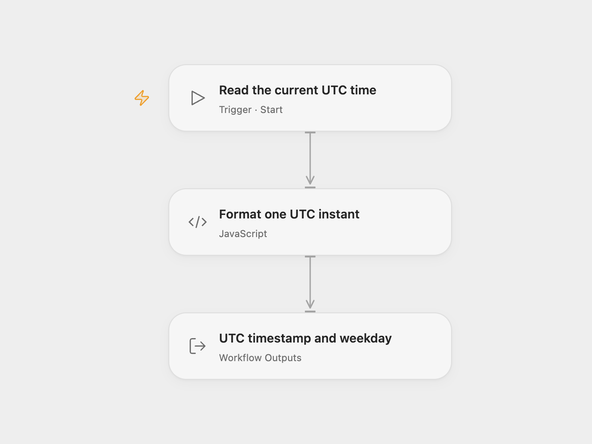

# Current UTC Date and Weekday

Return the current UTC timestamp and its matching English weekday when you run the workflow.

<picture>
  <source media="(prefers-color-scheme: dark)" srcset="preview-dark.png">
  
</picture>

[Open Flow JSON](templates/current-utc-date-and-weekday.openflow.json) · [n8n JSON](templates/current-utc-date-and-weekday.n8n.json)

## Use

Run either format manually. No inputs, accounts or external services are required. The result contains `date_today`, an ISO 8601 UTC timestamp such as `2026-11-10T08:30:00.000Z`, and `day_today`, such as `Tuesday`. The timestamp includes the time; it is not a date-only string.

Both values use one system-clock reading and UTC. They do not use the browser, city or n8n instance’s local timezone. Check the execution machine’s clock when using the result in another process. As a reusable data step, it takes no input and produces a timestamp and weekday at execution time; it does not format an input date, schedule a job or read a calendar service.

## Changes to the source

- Read the clock once so the values cannot cross a midnight boundary between separate readings.
- Use UTC for the weekday as well as the ISO timestamp. The source combined a UTC timestamp with a weekday from the execution machine’s local timezone.

Source and license

Adapted from [Current date and weekday Function workflow](https://github.com/Zie619/n8n-workflows/blob/ae8cf6dc5b873cbb4f74587aa9180ed3a9f70682/workflows/Manual/0157_Manual_Import_Triggered.json) in [Zie619/n8n-workflows](https://github.com/Zie619/n8n-workflows). The source export does not identify a separate template author or license.

The collection’s [MIT notice](https://github.com/Zie619/n8n-workflows/blob/94007c1445d9258a7da116646b79473e7c7c3282/LICENSE) is pinned at a later revision. This is the collection notice at that revision; it does not establish a separate original template author's license. Our changes are listed above; see [repository licensing](../../README.md#licensing).

> MIT License
>
> Copyright (c) 2025 Zie619
>
> Permission is hereby granted, free of charge, to any person obtaining a copy
> of this software and associated documentation files (the "Software"), to deal
> in the Software without restriction, including without limitation the rights
> to use, copy, modify, merge, publish, distribute, sublicense, and/or sell
> copies of the Software, and to permit persons to whom the Software is
> furnished to do so, subject to the following conditions:
>
> The above copyright notice and this permission notice shall be included in all
> copies or substantial portions of the Software.
>
> THE SOFTWARE IS PROVIDED "AS IS", WITHOUT WARRANTY OF ANY KIND, EXPRESS OR
> IMPLIED, INCLUDING BUT NOT LIMITED TO THE WARRANTIES OF MERCHANTABILITY,
> FITNESS FOR A PARTICULAR PURPOSE AND NONINFRINGEMENT. IN NO EVENT SHALL THE
> AUTHORS OR COPYRIGHT HOLDERS BE LIABLE FOR ANY CLAIM, DAMAGES OR OTHER
> LIABILITY, WHETHER IN AN ACTION OF CONTRACT, TORT OR OTHERWISE, ARISING FROM,
> OUT OF OR IN CONNECTION WITH THE SOFTWARE OR THE USE OR OTHER DEALINGS IN THE
> SOFTWARE.

