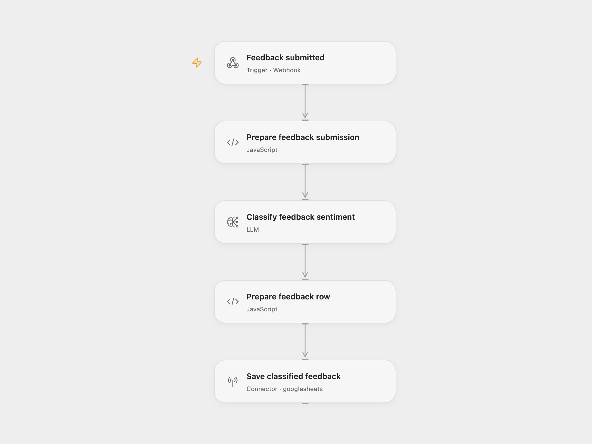

# Customer Feedback Sentiment

Classify customer feedback with AI and append the feedback and sentiment to Google Sheets. The model returns a text assessment; the workflow does not force a fixed sentiment vocabulary.

<picture>
  <source media="(prefers-color-scheme: dark)" srcset="preview-dark.png">
  
</picture>

[Open Flow JSON](templates/customer-feedback-sentiment.openflow.json) · [n8n JSON](templates/customer-feedback-sentiment.n8n.json)

## Setup

Create a sheet named `Feedback` with these headers in columns A–H:

| Timestamp | Category | Customer Feedback | Customer Name | Customer contact | Entered by | Urgent? | Sentiment |
| --- | --- | --- | --- | --- | --- | --- | --- |

For Open Flow, connect Google Sheets in **Save classified feedback**, replace `YOUR_SPREADSHEET_ID`, and select a configured `gpt-4o-mini` model in **Classify feedback sentiment**. Publish and enable the workflow, then configure your form to POST JSON to its webhook URL:

```json
{
  "Name": "Ada",
  "What is your feedback about?": "Product",
  "Your feedback": "The new search saves me time.",
  "How do we get in touch with you?": "ada@example.com"
}
```

Name, category, and feedback are required. Category must be `Product`, `Service`, or `Other`. Contact is optional. An optional `submittedAt` timestamp can come from your form; otherwise the workflow uses the current UTC time.

For n8n, use the included **Submit form with customer feedback** hosted form. Connect OpenAI and Google Sheets, replace the spreadsheet, and keep the listed column headers. Open Flow supplies a JSON webhook instead of hosting that form.

Acknowledgment confirms receipt, before classification and storage finish. Invalid feedback or a model failure prevents the sheet write. Each valid submission appends a row, including repeated requests. `Entered by` is `Form` and `Urgent?` stays blank. Only the feedback text is sent to the configured model provider. The submitted form fields and model assessment are stored in Google Sheets.

## Changes to the source

- Replace the legacy text-completion model with `gpt-4o-mini` in both formats; assessments may differ.
- Validate required input and keep the submitted content available through classification.
- Write literal values with RAW formatting and stop on empty model results.
- Remove the source spreadsheet resource and provide explicit column and configuration placeholders.

## Source and license

Adapted from [AI Customer feedback sentiment analysis](https://github.com/enescingoz/awesome-n8n-templates/blob/827110332c21cbe000ab13f6d292d5adb1f1f8db/OpenAI_and_LLMs/AI%20Customer%20feedback%20sentiment%20analysis.json) in [enescingoz/awesome-n8n-templates](https://github.com/enescingoz/awesome-n8n-templates).

Source collection notice: © 2024–2026 Enes Cingoz, [CC BY 4.0](https://github.com/enescingoz/awesome-n8n-templates/blob/827110332c21cbe000ab13f6d292d5adb1f1f8db/LICENSE). The source export does not identify a separate template author or license. See [repository licensing](../../README.md#licensing) for the scope of OOMOL contributions and third-party material.
