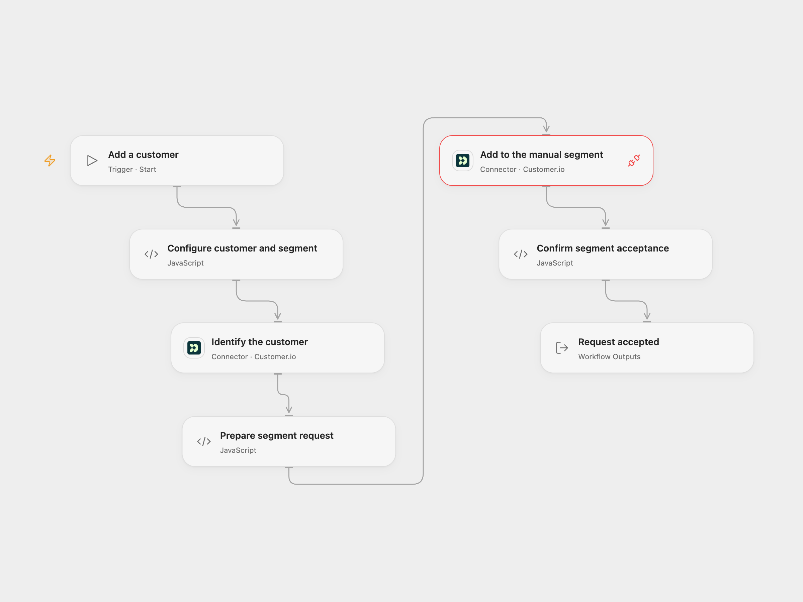

# Customer.io Customer to Manual Segment

Identify a customer and add the customer ID to an existing manual segment in Customer.io.

<picture>
  <source media="(prefers-color-scheme: dark)" srcset="preview-dark.png">
  
</picture>

[Open Flow JSON](templates/customerio-customer-to-manual-segment.openflow.json) · [n8n JSON](templates/customerio-customer-to-manual-segment.n8n.json)

## Setup

Connect Customer.io using the Track API Site ID and API key. Grant Provider API Request access to the same connection. In **Configure customer and segment**, replace the example customer ID `2`, enter an existing numeric manual segment ID and set the `Name` value. The original workflow puts that value inside the `data` profile attribute.

In n8n, select the same Customer.io Track credentials on both nodes, set the customer ID and Name in **CustomerIo**, and replace `YOUR_SEGMENT_ID` in the segment node expression with the actual numeric segment ID. Run one format for each intended request.

## Behavior

Run manually. The workflow identifies or updates the customer, then submits the same ID to the manual segment. It does not work with data-driven segments. Customer.io accepts segment requests without checking whether the person exists; an accepted response alone does not prove membership. Open Flow returns the customer ID and acceptance flag; n8n returns the segment node result.

A failed or uncertain identify or segment request may already have changed Customer.io. Check the profile and segment before repeating. Neither format rolls back an earlier request.

## Changes to the source

- Replace the missing segment ID with setup and preserve the original example `data.Name` attribute.
- Open Flow uses the Customer.io Track Provider API for the manual-segment operation, sending the documented `ids` payload.

Source and license

Adapted from [Create a customer and add them to a segment in Customer.io](https://github.com/Zie619/n8n-workflows/blob/ae8cf6dc5b873cbb4f74587aa9180ed3a9f70682/workflows/Manual/0803_Manual_Customerio_Create_Triggered.json) in [Zie619/n8n-workflows](https://github.com/Zie619/n8n-workflows). The source export does not identify a separate template author or license.

The collection’s [MIT notice](https://github.com/Zie619/n8n-workflows/blob/94007c1445d9258a7da116646b79473e7c7c3282/LICENSE) is pinned at a later revision. This is the collection notice at that revision; it does not establish a separate original template author's license. Our changes are listed above; see [repository licensing](../../README.md#licensing).

> MIT License
>
> Copyright (c) 2025 Zie619
>
> Permission is hereby granted, free of charge, to any person obtaining a copy
> of this software and associated documentation files (the "Software"), to deal
> in the Software without restriction, including without limitation the rights
> to use, copy, modify, merge, publish, distribute, sublicense, and/or sell
> copies of the Software, and to permit persons to whom the Software is
> furnished to do so, subject to the following conditions:
>
> The above copyright notice and this permission notice shall be included in all
> copies or substantial portions of the Software.
>
> THE SOFTWARE IS PROVIDED "AS IS", WITHOUT WARRANTY OF ANY KIND, EXPRESS OR
> IMPLIED, INCLUDING BUT NOT LIMITED TO THE WARRANTIES OF MERCHANTABILITY,
> FITNESS FOR A PARTICULAR PURPOSE AND NONINFRINGEMENT. IN NO EVENT SHALL THE
> AUTHORS OR COPYRIGHT HOLDERS BE LIABLE FOR ANY CLAIM, DAMAGES OR OTHER
> LIABILITY, WHETHER IN AN ACTION OF CONTRACT, TORT OR OTHERWISE, ARISING FROM,
> OUT OF OR IN CONNECTION WITH THE SOFTWARE OR THE USE OR OTHER DEALINGS IN THE
> SOFTWARE.

