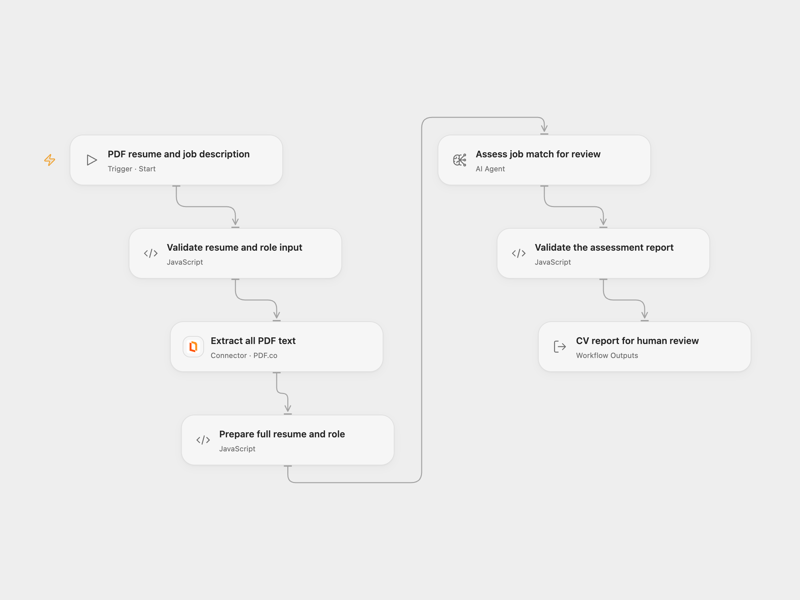

# CV Job Match Report

Compare a linked PDF resume with your full job description. Return a matching score, concise assessment and reasons for and against the match for a recruiter to review.

<picture>
  <source media="(prefers-color-scheme: dark)" srcset="preview-dark.png">
  
</picture>

[Open Flow JSON](templates/cv-job-match-report.openflow.json) · [n8n JSON](templates/cv-job-match-report.n8n.json)

## Configure and run

In Open Flow, supply `pdfUrl` and the complete `jobDescription` at the manual entry. Use a direct public HTTP/HTTPS PDF URL that you are authorized to share with the configured services. Select your PDF.co account on **Extract all PDF text** and configure the model on **Assess job match for review**. PDF.co receives the URL and extracts text from all pages in synchronous inline mode. The complete extracted text and job description go to your model service. No page or character cap is added by the template. Large documents must fit service/model limits and the inspected Open Flow host's 1 MiB per Code input/result; oversize data fails instead of producing a partial report.

For n8n, edit **Set Variables** with the same PDF URL and full job description, and select OpenAI credentials on **OpenAI - Analyze CV**. n8n downloads the PDF into binary `data` and extracts joined text from every page locally in its runtime. Open Flow uses PDF.co as an additional document processor and requires its account. Text layout and extraction can differ. Verify extraction quality, particularly for scanned or complex-layout resumes; an empty/nontext result stops before assessment.

The source model is `gpt-4o-mini`. OpenAI’s [model page](https://developers.openai.com/api/docs/models/gpt-4o-mini) lists `gpt-4o-mini-2024-07-18` as the current default snapshot; its [deprecation notice](https://developers.openai.com/api/docs/deprecations) names that snapshot for January 14, 2027 shutdown. Check your service's alias routing and update/test the workflow before that date. Open Flow uses a tool-free native Agent with one model round and structured output. n8n retains one OpenAI Chat Completions request with strict JSON Schema. Neither format adds temperature or token-budget overrides. Agent/model-service generation settings and output instructions differ, so matching scores and wording can differ.

## Result and review

The result contains `evaluation` and `sourceUrl`. Evaluation includes `percentage`, `summary`, `reasons-suit` and `reasons-notsuit`; each reason has `name` and `text`. The score is validated as 0–100 in ten-point steps, as requested in the source prompt. Empty summaries, malformed reports or incomplete model output stop the run. There is no workflow retry or cross-run deduplication.

The output is an AI assessment for human review. Check claims against the original resume and relevant job requirements before making an employment decision. The workflow does not select, reject, contact or notify applicants. It returns the report only: **no Supabase write is configured**, despite the source tutorial notes mentioning storage.

Inspiration &amp; credits

## Changes to the source

- Include the actual job description in the model input and retain the entire extracted resume as readable text, without URI encoding.
- Configure native PDF download/extraction explicitly and replace the private sample resume URL and employer description with user inputs.
- Build the n8n JSON request as an object, preserve the four-part evaluation structure and validate completed output.
- Retain the original author/community/tutorial credit and clarify the difference between the implemented report and the tutorial's unimplemented storage step.

Adapted from [CV Screening with OpenAI](https://github.com/enescingoz/awesome-n8n-templates/blob/827110332c21cbe000ab13f6d292d5adb1f1f8db/HR_and_Recruitment/CV%20Screening%20with%20OpenAI.json) in [enescingoz/awesome-n8n-templates](https://github.com/enescingoz/awesome-n8n-templates).

Source collection notice: © 2024–2026 Enes Cingoz, [CC BY 4.0](https://github.com/enescingoz/awesome-n8n-templates/blob/827110332c21cbe000ab13f6d292d5adb1f1f8db/LICENSE). The source credits **[Mark Shcherbakov](https://www.linkedin.com/in/marklowcoding/)** and the **[5minAI community](https://www.skool.com/5minai-2861)**, with an [eight-minute setup video](https://youtu.be/TWuI3dOcn0E). It states no separate template license. See [repository licensing](../../README.md#licensing) for the scope of OOMOL contributions and third-party material.

