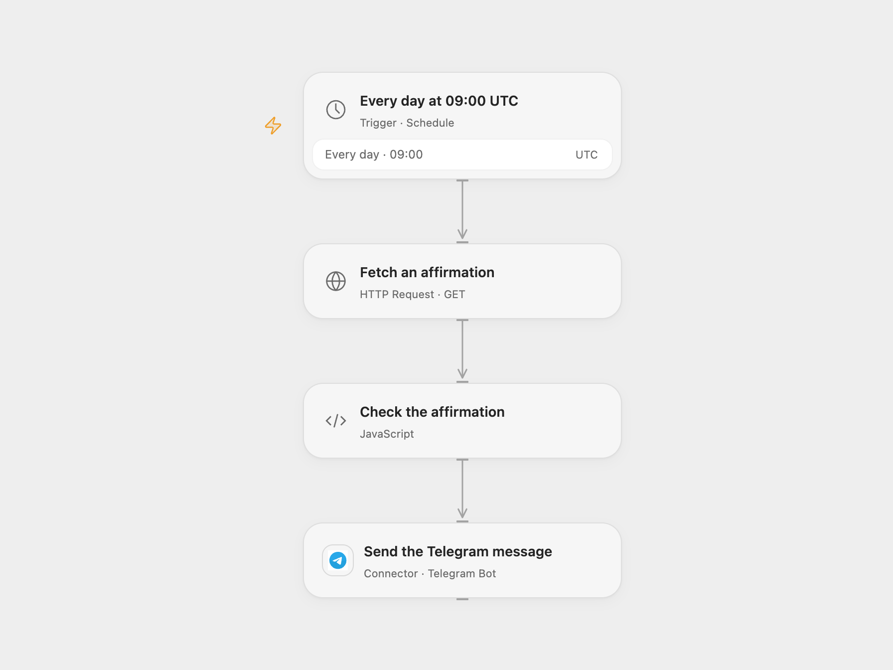

# Daily Affirmation to Telegram

Send one daily affirmation to a Telegram chat.

<picture>
  <source media="(prefers-color-scheme: dark)" srcset="preview-dark.png">
  
</picture>

[Open Flow JSON](templates/daily-affirmation-to-telegram.openflow.json) · [n8n JSON](templates/daily-affirmation-to-telegram.n8n.json)

## Setup

Connect your Telegram bot and enter the destination chat ID in **Send the Telegram message**. Confirm that the bot can send messages to that chat. The schedule is set to 09:00 UTC; change the timezone if you want a different local delivery time. The workflow also needs access to `affirmations.dev`.

In n8n, select Telegram credentials, set the chat ID, and activate the workflow. The workflow timezone starts at UTC; n8n chooses a second within the 09:00 minute.

## Behavior

Once each day, the workflow requests one affirmation and sends it with a short introduction. If the response has no non-empty `affirmation` string or the request fails, no Telegram message is sent. Messages use Telegram legacy Markdown, so formatting characters in an affirmation can affect rendering or cause a send error. A Telegram send failure stops the run; an uncertain send may already have arrived, so check the chat before retrying.

## Changes to the source

- Remove the personal name from the message and add a configurable Telegram destination.
- Set the schedule timezone to UTC explicitly.
- Check that the service returned a non-empty affirmation before sending.

Source and license

Adapted from [Daily Text Affirmations](https://github.com/Zie619/n8n-workflows/blob/ae8cf6dc5b873cbb4f74587aa9180ed3a9f70682/workflows/Http/0745_HTTP_Telegram_Automation_Webhook.json) in [Zie619/n8n-workflows](https://github.com/Zie619/n8n-workflows). The source export does not identify a separate template author or license.

The collection’s [MIT notice](https://github.com/Zie619/n8n-workflows/blob/94007c1445d9258a7da116646b79473e7c7c3282/LICENSE) is pinned at a later revision. This is the collection notice at that revision; it does not establish a separate original template author's license. Our changes are listed above; see [repository licensing](../../README.md#licensing).

> MIT License
>
> Copyright (c) 2025 Zie619
>
> Permission is hereby granted, free of charge, to any person obtaining a copy
> of this software and associated documentation files (the "Software"), to deal
> in the Software without restriction, including without limitation the rights
> to use, copy, modify, merge, publish, distribute, sublicense, and/or sell
> copies of the Software, and to permit persons to whom the Software is
> furnished to do so, subject to the following conditions:
>
> The above copyright notice and this permission notice shall be included in all
> copies or substantial portions of the Software.
>
> THE SOFTWARE IS PROVIDED "AS IS", WITHOUT WARRANTY OF ANY KIND, EXPRESS OR
> IMPLIED, INCLUDING BUT NOT LIMITED TO THE WARRANTIES OF MERCHANTABILITY,
> FITNESS FOR A PARTICULAR PURPOSE AND NONINFRINGEMENT. IN NO EVENT SHALL THE
> AUTHORS OR COPYRIGHT HOLDERS BE LIABLE FOR ANY CLAIM, DAMAGES OR OTHER
> LIABILITY, WHETHER IN AN ACTION OF CONTRACT, TORT OR OTHERWISE, ARISING FROM,
> OUT OF OR IN CONNECTION WITH THE SOFTWARE OR THE USE OR OTHER DEALINGS IN THE
> SOFTWARE.

