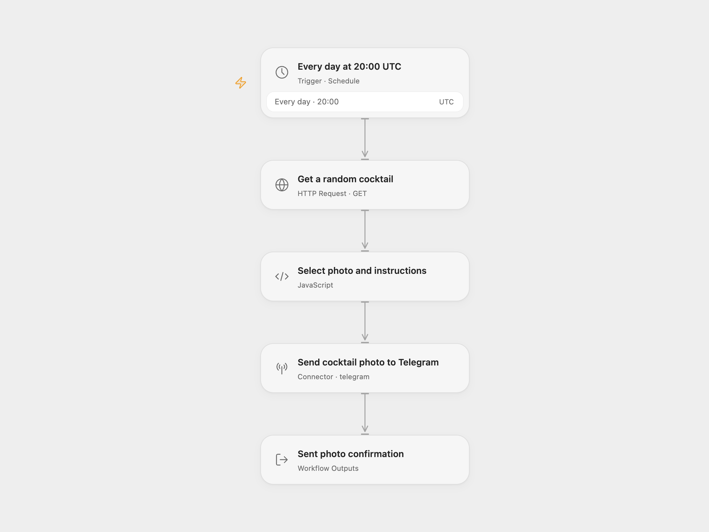

# Daily Cocktail Photo in Telegram

Send one random cocktail photo to Telegram each day, with its available preparation instructions as the caption.

<picture>
  <source media="(prefers-color-scheme: dark)" srcset="preview-dark.png">
  
</picture>

[Open Flow JSON](templates/daily-cocktail-telegram.openflow.json) · [n8n JSON](templates/daily-cocktail-telegram.n8n.json)

## Setup

Connect your bot in **Send cocktail photo to Telegram** and replace the destination chat ID or channel username. The bot must be allowed to post there; a user must have started the bot before it can send them a private message. In n8n, configure the equivalent **Telegram** node.

Both formats run daily at **20:00 UTC**. Change the schedule’s time zone in Open Flow or the workflow time zone in n8n for a different local time. Activate one format after setup.

The API URL uses TheCocktailDB’s public test key `1`, which its documentation permits for development and education. Review [TheCocktailDB API access](https://www.thecocktaildb.com/api.php) for your deployment and replace the key in the request URL when needed. Public app-store releases require a production key.

Each run reads one random result and sends its first drink’s photo and English `strInstructions` text. No ingredient list, translation or additional text is assembled. When instructions are absent or null, it sends the photo without a caption. If the photo is missing, the response is malformed or the instructions exceed the current Telegram Action’s 1,024-character caption limit, the run fails before posting. Captions are plain text and are not truncated or split into extra messages.

Telegram fetches the public photo URL; this workflow does not download or store a local file. The image must meet Telegram’s photo requirements. The API can select the same drink again on another run. There is no history, deduplication or automatic retry. An API or Telegram error stops the run; check the destination before retrying an uncertain send.

Open Flow returns the sent message ID, chat and caption; n8n returns Telegram’s response.

## Changes to the source

- Replace the original chat with a setup placeholder and make the UTC schedule explicit.
- Use an explicit JSON HTTP request and validate the selected image and optional caption.
- Preserve the photo and available instructions without adding an ingredient list or extra posts.

Source and license

Adapted from [Send a cocktail recipe every day via a Telegram](https://github.com/Zie619/n8n-workflows/blob/ae8cf6dc5b873cbb4f74587aa9180ed3a9f70682/workflows/Http/1043_HTTP_Telegram_Send_Webhook.json) in [Zie619/n8n-workflows](https://github.com/Zie619/n8n-workflows). The source export does not identify a separate template author or license.

The collection’s [MIT notice](https://github.com/Zie619/n8n-workflows/blob/94007c1445d9258a7da116646b79473e7c7c3282/LICENSE) is pinned at a later revision. This is the collection notice at that revision; it does not establish a separate original template author's license. Our changes are listed above; see [repository licensing](../../README.md#licensing).

> MIT License
>
> Copyright (c) 2025 Zie619
>
> Permission is hereby granted, free of charge, to any person obtaining a copy
> of this software and associated documentation files (the "Software"), to deal
> in the Software without restriction, including without limitation the rights
> to use, copy, modify, merge, publish, distribute, sublicense, and/or sell
> copies of the Software, and to permit persons to whom the Software is
> furnished to do so, subject to the following conditions:
>
> The above copyright notice and this permission notice shall be included in all
> copies or substantial portions of the Software.
>
> THE SOFTWARE IS PROVIDED "AS IS", WITHOUT WARRANTY OF ANY KIND, EXPRESS OR
> IMPLIED, INCLUDING BUT NOT LIMITED TO THE WARRANTIES OF MERCHANTABILITY,
> FITNESS FOR A PARTICULAR PURPOSE AND NONINFRINGEMENT. IN NO EVENT SHALL THE
> AUTHORS OR COPYRIGHT HOLDERS BE LIABLE FOR ANY CLAIM, DAMAGES OR OTHER
> LIABILITY, WHETHER IN AN ACTION OF CONTRACT, TORT OR OTHERWISE, ARISING FROM,
> OUT OF OR IN CONNECTION WITH THE SOFTWARE OR THE USE OR OTHER DEALINGS IN THE
> SOFTWARE.

