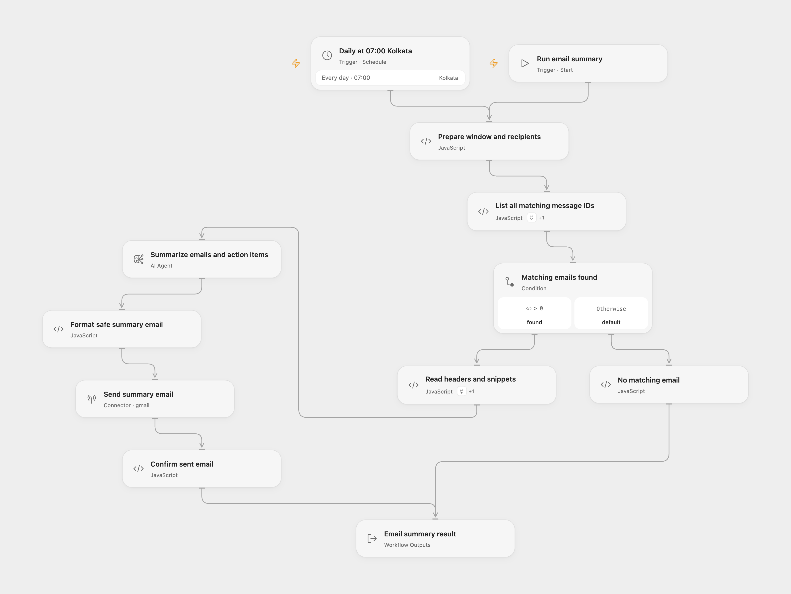

# Daily Gmail Summary Email

Read matching Gmail snippets, summarize the key points and named action items, and send one HTML email to your configured recipient and CC list.

<picture>
  <source media="(prefers-color-scheme: dark)" srcset="preview-dark.png">
  
</picture>

[Open Flow JSON](templates/daily-gmail-summary-email.openflow.json) · [n8n JSON](templates/daily-gmail-summary-email.n8n.json)

## Setup

In **Prepare window and recipients**, replace `YOUR_GMAIL_SEARCH_SCOPE` with a Gmail search expression, such as `to:you@example.com`, set your recipient, and configure optional CC addresses as an array. Use plain email addresses. The search scope is combined with the reporting dates. Spam and Trash are excluded.

In Open Flow, select your Gmail account in the **Actions** configuration of **List all matching message IDs** and **Read headers and snippets**, and on **Send summary email**. Each Code node performs one explicitly declared collection operation with its named Gmail Action. Configure an available gateway model on **Summarize emails and action items**.

In n8n, edit the same settings at the start of **Prepare Window and Recipients**, choose Gmail OAuth2 credentials on both Gmail nodes, and choose an available JSON-capable model and OpenAI credentials on **Summarize Emails**. Both formats collect every matching page with 100 IDs per request, then read each message’s metadata and snippet. Full bodies and attachments are not downloaded for the summary. There is no hidden 25- or 100-message total cap; the complete collection must fit the selected model’s context.

## Reporting window

The daily schedule is 07:00 in Asia/Kolkata. Each run captures one time and searches from 00:00 of the previous local calendar day to that captured time, using Unix seconds in Gmail’s query. A scheduled run covers about 31 hours, so consecutive daily runs overlap by seven hours. This is not a rolling 24-hour digest. Manual runs use the same window rule at their actual run time. Review both the schedule and calculation before changing timezones.

The model receives only message ID, From, To, CC and snippet. It produces one structured summary; Open Flow uses an AI Agent with no external tools and one model round. n8n uses its OpenAI JSON response operation. Gateway/model selection and the Agent’s built-in output instructions differ, so generated wording can differ. Invalid output stops the run without another model request. HTML characters in generated text are escaped before sending. Check summaries against the original messages.

No matching messages means no model call and no email. Open Flow returns `no_matching_email`; n8n produces no further items. A successful run requires Gmail to return a sent message ID. It does not prove recipient delivery. The workflow does not mark, label or delete source messages, deduplicate reports, or retry sends. If the send response is lost, inspect Sent before running again.

## Changes to the source

- Make search scope, recipients and CC configurable, and retain the source author in attribution instead of outgoing branding.
- Align the query and email subject to the source’s previous-midnight-to-morning window and declared timezone; replace ambiguous calendar-date search with explicit Unix seconds and a captured upper bound.
- Preserve complete pagination and correct case-insensitive CC header handling.
- Validate structured model output, escape HTML text and require a confirmed sent message ID.

<details>
<summary>Source and license</summary>

Adapted from [Email Summary Agent](https://github.com/enescingoz/awesome-n8n-templates/blob/827110332c21cbe000ab13f6d292d5adb1f1f8db/Gmail_and_Email_Automation/Email%20Summary%20Agent.json) in [enescingoz/awesome-n8n-templates](https://github.com/enescingoz/awesome-n8n-templates). The source email identifies **Quantana ESAgent / Quantana AI Labs**, retained here as attribution. The export does not state a separate template license.

Source collection notice: © 2024–2026 Enes Cingoz, [CC BY 4.0](https://github.com/enescingoz/awesome-n8n-templates/blob/827110332c21cbe000ab13f6d292d5adb1f1f8db/LICENSE). See [repository licensing](../../README.md#licensing) for the scope of OOMOL contributions and third-party material.

```text
Creative Commons Attribution 4.0 International License

Copyright (c) 2024-2026 Enes Cingoz

You are free to:

  Share - copy and redistribute the material in any medium or format
  Adapt - remix, transform, and build upon the material for any purpose,
  even commercially.

Under the following terms:

  Attribution - You must give appropriate credit, provide a link to the
  license, and indicate if changes were made. You may do so in any
  reasonable manner, but not in any way that suggests the licensor
  endorses you or your use.

  No additional restrictions - You may not apply legal terms or
  technological measures that legally restrict others from doing
  anything the license permits.

Notices:

  You do not have to comply with the license for elements of the
  material in the public domain or where your use is permitted by an
  applicable exception or limitation.

  No warranties are given. The license may not give you all of the
  permissions necessary for your intended use. For example, other rights
  such as publicity, privacy, or moral rights may limit how you use the
  material.

For the full license text, see:
https://creativecommons.org/licenses/by/4.0/legalcode
```

</details>
