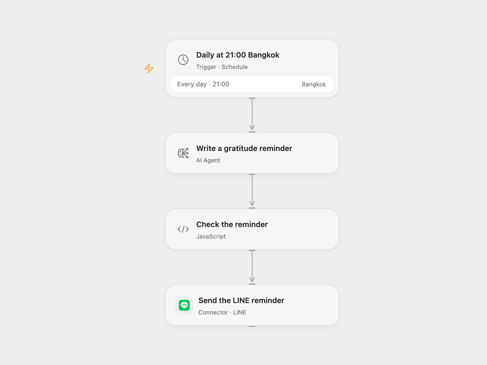

# Send a Daily Gratitude Reminder on LINE

Generate a daily reflection prompt and send it to a LINE conversation.

<picture>
  <source media="(prefers-color-scheme: dark)" srcset="preview-dark.png">
  
</picture>

[Open Flow JSON](templates/daily-gratitude-reminder-on-line.openflow.json) · [n8n JSON](templates/daily-gratitude-reminder-on-line.n8n.json)

## Setup

Connect an AI model and a LINE Messaging API channel. Set a reachable user, group or room ID in **Send the LINE reminder**. In n8n connect Azure OpenAI, select your deployed model, configure a Header Auth credential named `Authorization` with value `Bearer YOUR_LINE_CHANNEL_ACCESS_TOKEN`, and set the destination ID in **Prepare the LINE message**. Activate one format.

## Behavior

At 21:00 in Asia/Bangkok, the model rewrites a prompt asking the recipient to reflect on something good that happened today. One text message is sent to the configured LINE conversation. Review the time zone and model before activation. Model responses can vary. LINE acceptance does not guarantee delivery to a recipient who has blocked the account. If a push fails or its outcome is uncertain, check the conversation before retrying.

Inspiration &amp; credits

## Changes to the source

- Open Flow uses its configured AI Agent and the LINE push Action. n8n retains Azure OpenAI. The models and sampling settings can produce different wording.
- Set minute 00 explicitly for 21:00; the source did not set a minute. Both formats construct the LINE JSON safely and stop for empty or oversized output. They retain punctuation and newlines instead of stripping quotes and markup.

Adapted from [Gratitude Jar Reminder](https://github.com/Zie619/n8n-workflows/blob/ae8cf6dc5b873cbb4f74587aa9180ed3a9f70682/workflows/Http/1651_HTTP_Schedule_Automation_Webhook.json) in [Zie619/n8n-workflows](https://github.com/Zie619/n8n-workflows). The source export does not identify a separate template author or license.

The collection’s [MIT notice](https://github.com/Zie619/n8n-workflows/blob/94007c1445d9258a7da116646b79473e7c7c3282/LICENSE) is pinned at a later revision. This is the collection notice at that revision; it does not establish a separate original template author's license. Our changes are listed above; see [repository licensing](../../README.md#licensing).

> MIT License
>
> Copyright (c) 2025 Zie619
>
> Permission is hereby granted, free of charge, to any person obtaining a copy
> of this software and associated documentation files (the "Software"), to deal
> in the Software without restriction, including without limitation the rights
> to use, copy, modify, merge, publish, distribute, sublicense, and/or sell
> copies of the Software, and to permit persons to whom the Software is
> furnished to do so, subject to the following conditions:
>
> The above copyright notice and this permission notice shall be included in all
> copies or substantial portions of the Software.
>
> THE SOFTWARE IS PROVIDED "AS IS", WITHOUT WARRANTY OF ANY KIND, EXPRESS OR
> IMPLIED, INCLUDING BUT NOT LIMITED TO THE WARRANTIES OF MERCHANTABILITY,
> FITNESS FOR A PARTICULAR PURPOSE AND NONINFRINGEMENT. IN NO EVENT SHALL THE
> AUTHORS OR COPYRIGHT HOLDERS BE LIABLE FOR ANY CLAIM, DAMAGES OR OTHER
> LIABILITY, WHETHER IN AN ACTION OF CONTRACT, TORT OR OTHERWISE, ARISING FROM,
> OUT OF OR IN CONNECTION WITH THE SOFTWARE OR THE USE OR OTHER DEALINGS IN THE
> SOFTWARE.

