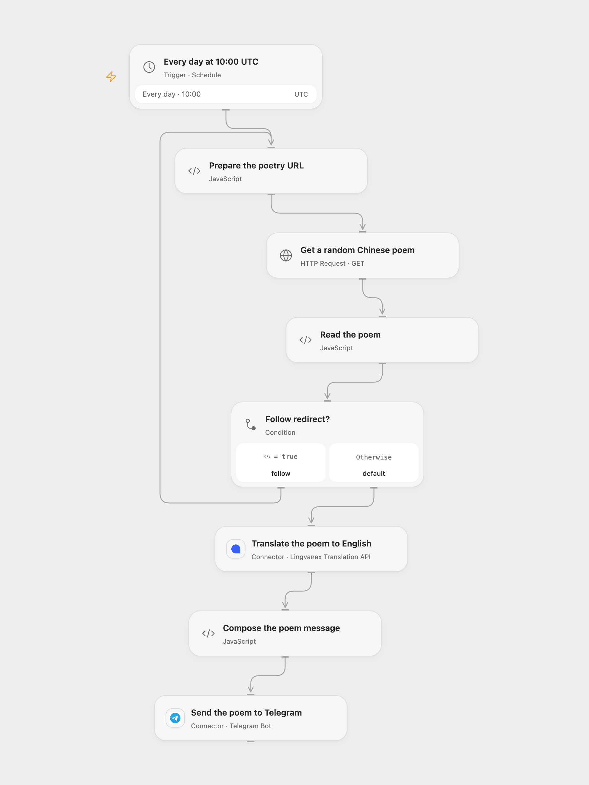

# Daily Translated Chinese Poem to Telegram

Translate a random Chinese classical poem into English and send it to a Telegram chat each day.

<picture>
  <source media="(prefers-color-scheme: dark)" srcset="preview-dark.png">
  
</picture>

[Open Flow JSON](templates/daily-translated-chinese-poem-to-telegram.openflow.json) · [n8n JSON](templates/daily-translated-chinese-poem-to-telegram.n8n.json)

## Setup

Connect Lingvanex in **Translate the poem to English** and your Telegram bot in **Send the poem to Telegram**. Enter the destination chat ID and ensure the bot can send there. The schedule starts at 10:00 UTC; adjust the timezone and time for your chat.

In n8n, select LingvaNex and Telegram credentials, set the chat ID and activate the workflow. The formats use different Lingvanex endpoints, so the account must support the chosen one.

## Behavior

Each day, the workflow requests a random Chinese classical five-character quatrain from [Shiquan](https://poetry.palemoky.com/), translates its text to English and sends the translation with the original title and poet. The collection differs from the source workflow's international Poemist selection. The API uses the [chinese-poetry dataset](https://github.com/chinese-poetry/chinese-poetry), distributed under its MIT notice (Copyright 2016 JackeyGao).

A request failure, missing poem fields, translation failure, empty translation or message longer than 4096 characters stops before sending. Telegram's legacy Markdown mode can interpret formatting characters in the text or reject malformed markup. A failed or uncertain Telegram request may have delivered the message; check the chat before retrying. No automatic resend is configured. The HTTP step follows up to 21 redirects with a 30-second timeout per request; Open Flow limits each response to 4 MiB.

Open Flow uses Lingvanex `api-gl.lingvanex.com`, with the API key in the request URL; protect URL logs. n8n uses the legacy `api-b2b.backenster.com` endpoint with a Bearer credential. Translation quality depends on the service.

Inspiration &amp; credits

## Changes to the source

- Replace the Poemist endpoint, which currently returns 404, with Shiquan's Chinese classical quatrain collection and disclose its narrower range.
- Send the English translation as the original author's workflow description specifies. The source Telegram expression instead referenced the untranslated poem.
- Add response and length checks and configurable chat. The original timezone came from the n8n instance; both formats start at UTC. n8n Cron V1 chooses a fixed randomized second within the minute while Open Flow runs at the minute boundary.

Adapted from [Daily poems in Telegram](https://github.com/Zie619/n8n-workflows/blob/ae8cf6dc5b873cbb4f74587aa9180ed3a9f70682/workflows/Http/0936_HTTP_Lingvanex_Automation_Webhook.json) in [Zie619/n8n-workflows](https://github.com/Zie619/n8n-workflows). The matching [n8n community listing](https://n8n.io/workflows/975-get-daily-poems-in-telegram/) credits Lorena. The original template does not state a separate license.

The collection’s [MIT notice](https://github.com/Zie619/n8n-workflows/blob/94007c1445d9258a7da116646b79473e7c7c3282/LICENSE) is pinned at a later revision. This is the collection notice at that revision; it does not establish a separate original template author's license. Our changes are listed above; see [repository licensing](../../README.md#licensing).

> MIT License
>
> Copyright (c) 2025 Zie619
>
> Permission is hereby granted, free of charge, to any person obtaining a copy
> of this software and associated documentation files (the "Software"), to deal
> in the Software without restriction, including without limitation the rights
> to use, copy, modify, merge, publish, distribute, sublicense, and/or sell
> copies of the Software, and to permit persons to whom the Software is
> furnished to do so, subject to the following conditions:
>
> The above copyright notice and this permission notice shall be included in all
> copies or substantial portions of the Software.
>
> THE SOFTWARE IS PROVIDED "AS IS", WITHOUT WARRANTY OF ANY KIND, EXPRESS OR
> IMPLIED, INCLUDING BUT NOT LIMITED TO THE WARRANTIES OF MERCHANTABILITY,
> FITNESS FOR A PARTICULAR PURPOSE AND NONINFRINGEMENT. IN NO EVENT SHALL THE
> AUTHORS OR COPYRIGHT HOLDERS BE LIABLE FOR ANY CLAIM, DAMAGES OR OTHER
> LIABILITY, WHETHER IN AN ACTION OF CONTRACT, TORT OR OTHERWISE, ARISING FROM,
> OUT OF OR IN CONNECTION WITH THE SOFTWARE OR THE USE OR OTHER DEALINGS IN THE
> SOFTWARE.

