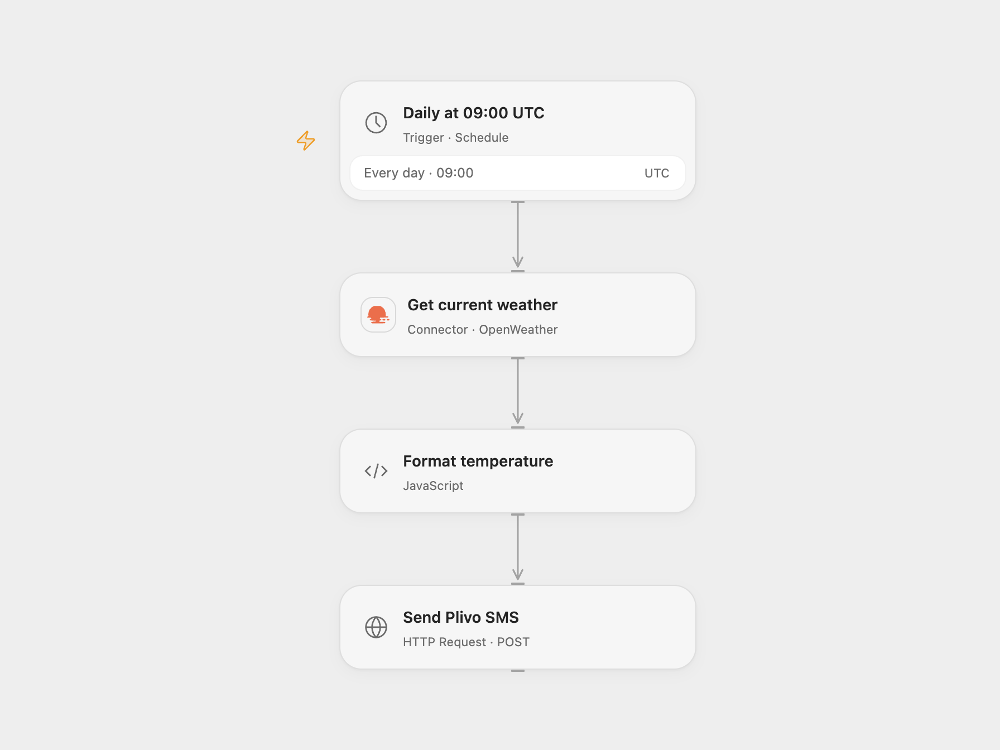

# Daily Weather Temperature to Plivo SMS

Send the current city temperature by SMS every morning.

<picture>
  <source media="(prefers-color-scheme: dark)" srcset="preview-dark.png">
  
</picture>

[Open Flow JSON](templates/daily-weather-temperature-to-plivo-sms.openflow.json) · [n8n JSON](templates/daily-weather-temperature-to-plivo-sms.n8n.json)

## Setup and use

Connect OpenWeather and Plivo. Set the city in **Get current weather**; the example uses Berlin and metric units. Set the Plivo Auth ID, sender and destination in **Format temperature**. Bind the same Auth ID and its Auth Token to secret Variables **PLIVO_AUTH_ID** and **PLIVO_AUTH_TOKEN** in **Send Plivo SMS**. In n8n configure OpenWeather and Plivo credentials, sender and destination. Enable one format to avoid duplicate messages.

The initial schedule is 09:00 UTC daily. The source used the n8n instance timezone; adjust the schedule and timezone to your preference.

## Behavior

Each run reads the current temperature in Celsius and sends one SMS. If the weather read fails, no notification is sent. If the notification result is unknown, check Plivo before retrying to avoid duplicates.

Inspiration &amp; credits

## Changes to the source

- Make the schedule timezone explicit and validate the temperature before sending.

Adapted from [Send daily weather updates by Plivo SMS](https://github.com/Zie619/n8n-workflows/blob/ae8cf6dc5b873cbb4f74587aa9180ed3a9f70682/workflows/Openweathermap/0006_Openweathermap_Cron_Automate_Scheduled.json) in [Zie619/n8n-workflows](https://github.com/Zie619/n8n-workflows). The source export does not identify a separate template author or license.

The collection’s [MIT notice](https://github.com/Zie619/n8n-workflows/blob/94007c1445d9258a7da116646b79473e7c7c3282/LICENSE) is pinned at a later revision. This is the collection notice at that revision; it does not establish a separate original template author's license. Our changes are listed above; see [repository licensing](../../README.md#licensing).

> MIT License
>
> Copyright (c) 2025 Zie619
>
> Permission is hereby granted, free of charge, to any person obtaining a copy
> of this software and associated documentation files (the "Software"), to deal
> in the Software without restriction, including without limitation the rights
> to use, copy, modify, merge, publish, distribute, sublicense, and/or sell
> copies of the Software, and to permit persons to whom the Software is
> furnished to do so, subject to the following conditions:
>
> The above copyright notice and this permission notice shall be included in all
> copies or substantial portions of the Software.
>
> THE SOFTWARE IS PROVIDED "AS IS", WITHOUT WARRANTY OF ANY KIND, EXPRESS OR
> IMPLIED, INCLUDING BUT NOT LIMITED TO THE WARRANTIES OF MERCHANTABILITY,
> FITNESS FOR A PARTICULAR PURPOSE AND NONINFRINGEMENT. IN NO EVENT SHALL THE
> AUTHORS OR COPYRIGHT HOLDERS BE LIABLE FOR ANY CLAIM, DAMAGES OR OTHER
> LIABILITY, WHETHER IN AN ACTION OF CONTRACT, TORT OR OTHERWISE, ARISING FROM,
> OUT OF OR IN CONNECTION WITH THE SOFTWARE OR THE USE OR OTHER DEALINGS IN THE
> SOFTWARE.

