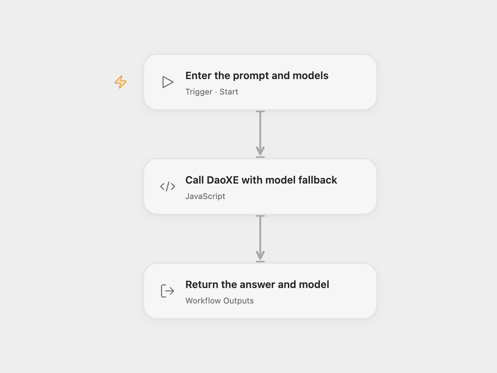

# Run a DaoXE Prompt with Model Fallback

Send one prompt to a primary DaoXE model and use a second model if the first is temporarily unavailable.

<!-- template-actions:start -->
 
<!-- template-actions:end -->

<picture>
  <source media="(prefers-color-scheme: dark)" srcset="preview-dark.png">
  
</picture>

## Setup

1. Create a DaoXE API key and choose a group that permits both Chat Completions models. Copy their exact IDs from your DaoXE console or the model list for that key. [DaoXE models and groups](https://daoxe.com/docs/en/guide/models) · [Model list API](https://daoxe.com/docs/en/api/models)
2. Bind the key as the secret variable `DAOXE_API_KEY` in **Call DaoXE with model fallback**.
3. Run the workflow with a `prompt` and different `primary_model` and `fallback_model` IDs. Set `system` to change the default plain-text instruction.

## Behavior

The workflow sends the prompt and system message to DaoXE once on the primary model. HTTP 408, 429, 5xx, or a transport error triggers one request with the same messages on the fallback model. Each request has a 30-second transport timeout. Authentication, access, billing, or other request errors stop the run. A malformed or incomplete answer also stops the run.

A successful run returns `answer`, `via` (`primary` or `fallback`) and `served_model` from DaoXE's response. If DaoXE omits its model field, `served_model` is null. A timeout can leave the first call's billing status unknown even if the fallback returns an answer. The workflow sends both messages to DaoXE and keeps no conversation state. [DaoXE Chat Completions](https://daoxe.com/docs/en/api/openai-chat)

In n8n

Create one **Header Auth** credential with header name `Authorization` and value `Bearer YOUR_DAOXE_API_KEY`. Assign the same credential to **Call the primary model** and **Call the fallback model**. Enter the prompt, system instruction and exact model IDs in **Set the prompt and models**, then run manually. Read the result from **Return the answer and model**. An incomplete reply, account rejection, or failure of the fallback stops the run.

Inspiration &amp; credits

Adapted from [DaoXE Multi-Model Chat with Automatic Fallback](https://github.com/enescingoz/awesome-n8n-templates/blob/827110332c21cbe000ab13f6d292d5adb1f1f8db/OpenAI_and_LLMs/DaoXE%20Multi-Model%20Chat%20with%20Automatic%20Fallback.json) in [enescingoz/awesome-n8n-templates](https://github.com/enescingoz/awesome-n8n-templates).

Source collection notice: © 2024–2026 Enes Cingoz, [CC BY 4.0](https://github.com/enescingoz/awesome-n8n-templates/blob/827110332c21cbe000ab13f6d292d5adb1f1f8db/LICENSE). The fixed source history credits contributor seven7763. See [repository licensing](../../README.md#licensing) for the scope of OOMOL contributions and third-party material.

## Changes to the source

The workflow uses DaoXE's recommended Chat Completions endpoint and limits fallback to HTTP 408, 429, and 5xx responses and recognized transport failures. It keeps the source's single prompt, shared key and answer fields. [DaoXE error handling](https://daoxe.com/docs/en/guide/errors)

