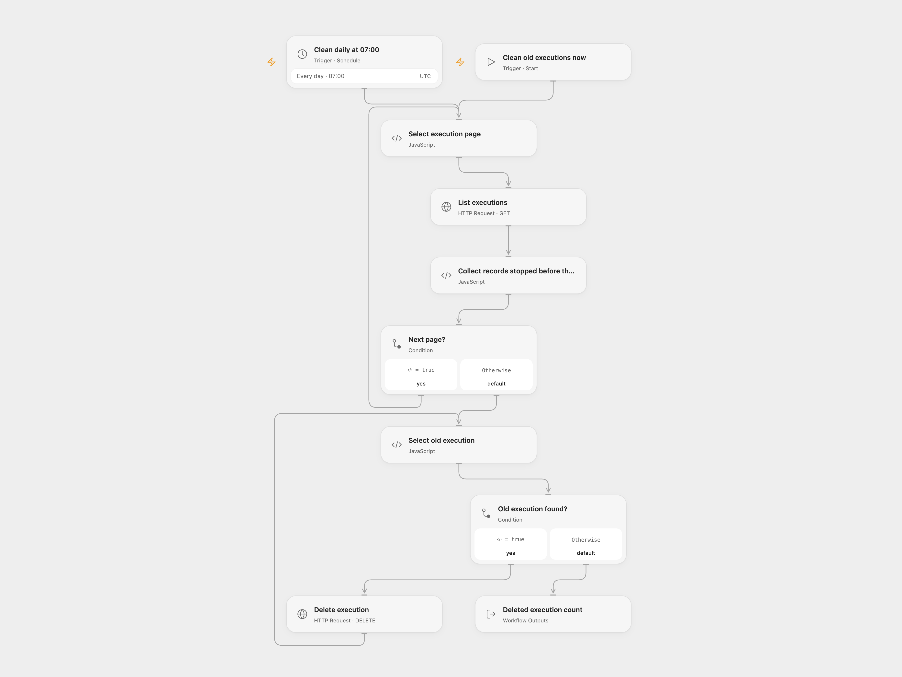

# Delete n8n Executions Stopped Over 30 Days Ago

Delete n8n execution records stopped before the date 30 days ago on a schedule or manually.

<picture>
  <source media="(prefers-color-scheme: dark)" srcset="preview-dark.png">
  
</picture>

[Open Flow JSON](templates/delete-n8n-executions-stopped-over-30-days-ago.openflow.json) · [n8n JSON](templates/delete-n8n-executions-stopped-over-30-days-ago.n8n.json)

## Setup and use

Set your n8n HTTPS base URL in Select execution page and Select old execution, and bind an API key with execution list and deletion permissions as secret Variable N8N_API_KEY in both HTTP nodes. The schedule and date cutoff use UTC; change the schedule timezone and edit the cutoff calculation in the collection step if the source MySQL server uses a different timezone. In n8n configure the n8n credential with access to all workflows to be cleaned. Use one format.

## Behavior

The workflow collects execution IDs from every page, then permanently deletes those whose stoppedAt date is before the UTC date 30 days ago. Manual and scheduled runs both delete records. If a delete outcome is unknown, inspect the execution in n8n before retrying.

Inspiration &amp; credits

## Changes to the source

- Both formats use the n8n API instead of direct MySQL access; they list all visible executions before deleting. The API only covers workflows accessible to the configured key, and may not expose previously deleted records.

Adapted from [Delete n8n executions stopped before the date 30 days ago](https://github.com/Zie619/n8n-workflows/blob/ae8cf6dc5b873cbb4f74587aa9180ed3a9f70682/workflows/Manual/1076_Manual_Cron_Automation_Scheduled.json) in [Zie619/n8n-workflows](https://github.com/Zie619/n8n-workflows). The source export does not identify a separate template author or license.

The collection’s [MIT notice](https://github.com/Zie619/n8n-workflows/blob/94007c1445d9258a7da116646b79473e7c7c3282/LICENSE) is pinned at a later revision. This is the collection notice at that revision; it does not establish a separate original template author's license. Our changes are listed above; see [repository licensing](../../README.md#licensing).

> MIT License
>
> Copyright (c) 2025 Zie619
>
> Permission is hereby granted, free of charge, to any person obtaining a copy
> of this software and associated documentation files (the "Software"), to deal
> in the Software without restriction, including without limitation the rights
> to use, copy, modify, merge, publish, distribute, sublicense, and/or sell
> copies of the Software, and to permit persons to whom the Software is
> furnished to do so, subject to the following conditions:
>
> The above copyright notice and this permission notice shall be included in all
> copies or substantial portions of the Software.
>
> THE SOFTWARE IS PROVIDED "AS IS", WITHOUT WARRANTY OF ANY KIND, EXPRESS OR
> IMPLIED, INCLUDING BUT NOT LIMITED TO THE WARRANTIES OF MERCHANTABILITY,
> FITNESS FOR A PARTICULAR PURPOSE AND NONINFRINGEMENT. IN NO EVENT SHALL THE
> AUTHORS OR COPYRIGHT HOLDERS BE LIABLE FOR ANY CLAIM, DAMAGES OR OTHER
> LIABILITY, WHETHER IN AN ACTION OF CONTRACT, TORT OR OTHERWISE, ARISING FROM,
> OUT OF OR IN CONNECTION WITH THE SOFTWARE OR THE USE OR OTHER DEALINGS IN THE
> SOFTWARE.

