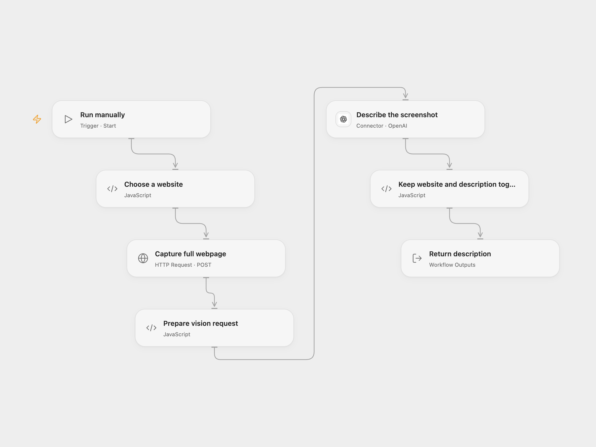

# Describe a Website Screenshot

Capture a public webpage and describe the screenshot in one sentence.

<picture>
  <source media="(prefers-color-scheme: dark)" srcset="preview-dark.png">
  
</picture>

[Open Flow JSON](templates/describe-a-website-screenshot.openflow.json) · [n8n JSON](templates/describe-a-website-screenshot.n8n.json)

## Setup

Set the website name and public HTTP or HTTPS URL in **Choose a website**. Create and bind the secret Variable `URLBOX_API_SECRET` to **Capture full webpage**. Connect OpenAI and select an available vision model in **Describe the screenshot**.

In n8n, set the name and URL in **Setup**, configure Header Auth with name `Authorization` and value `Bearer YOUR_URLBOX_API_SECRET` for **URLbox API Request**, and connect OpenAI; select a vision-capable model in **Analyze the Screenshot**.

## Behavior

A manual run asks URLbox for a full-page screenshot, sends its temporary image URL to OpenAI, and returns the name, URL and generated description together. Both services receive the webpage or screenshot; use URLs you are authorized to share. Generated descriptions can be inaccurate. URLbox's screenshot link expires, and the workflow does not retain the image.

An unsuccessful capture or model request stops the run. A screenshot request can have succeeded even if its response is lost; inspecting URLbox before retrying can avoid duplicate renders. The source n8n capture retries on failure; Open Flow does not automatically retry. Open Flow stops after 30 seconds or a redirect; slower URLbox renders may therefore require another approach.

Inspiration &amp; credits

## Changes to the source

- Replace the sample URL and credential with configuration. Correct the n8n image input to use URLbox's returned `renderUrl` instead of the literal text `renderURL`. Both formats use a current vision-capable model; Open Flow uses the OpenAI Responses Action.

Adapted from [Automate Screenshots with URLbox & Analyze them with AI](https://github.com/enescingoz/awesome-n8n-templates/blob/827110332c21cbe000ab13f6d292d5adb1f1f8db/Other_Integrations_and_Use_Cases/Automate%20Screenshots%20with%20URLbox%20%26%20Analyze%20them%20with%20AI.json) in [enescingoz/awesome-n8n-templates](https://github.com/enescingoz/awesome-n8n-templates).

Source collection notice: © 2024–2026 Enes Cingoz, [CC BY 4.0](https://github.com/enescingoz/awesome-n8n-templates/blob/827110332c21cbe000ab13f6d292d5adb1f1f8db/LICENSE). The matching [n8n listing](https://n8n.io/workflows/2207-automate-screenshots-with-urlbox-and-analyze-them-with-ai/) credits Bela. The original template does not state a separate license. See [repository licensing](../../README.md#licensing) for the scope of OOMOL contributions and third-party material.

