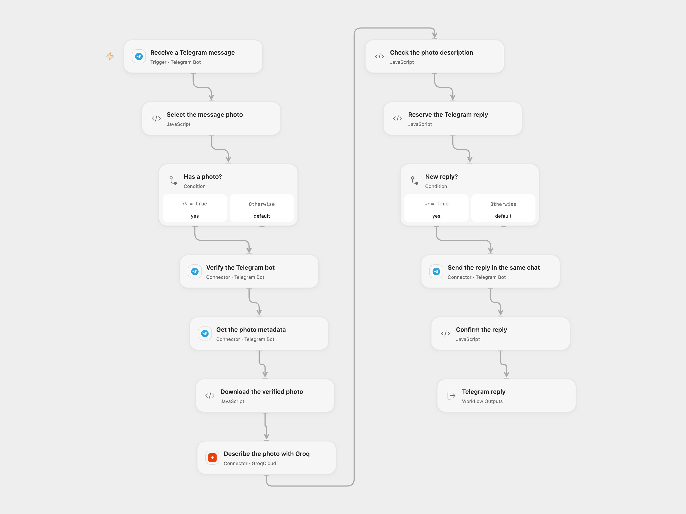

# Describe Telegram Photos with Groq

Describe a Telegram photo with Groq and return the description to the original chat.

<!-- template-actions:start -->
 
<!-- template-actions:end -->

<picture>
  <source media="(prefers-color-scheme: dark)" srcset="preview-dark.png">
  
</picture>

## Setup

1. Connect the same Telegram bot in **Receive a Telegram message**, **Verify the Telegram bot**, **Get the photo metadata**, and **Send the reply in the same chat**. Bind its token as the secret variable `TELEGRAM_PHOTO_BOT_TOKEN` in **Download the verified photo**. Use only one active webhook per bot.
2. Select a GroqCloud connection with access to the Qwen 3.8 27B preview model in **Describe the photo with Groq**. [Groq vision guide](https://console.groq.com/docs/vision)
3. Set the trigger's allowed chat IDs to limit who can use the bot. Publish and enable the workflow. Only one platform can register a webhook for the same bot at a time.

## Behavior

Send a photo in a message to the bot. The workflow takes Telegram's first size variant and checks the downloaded JPEG or PNG, up to 1 MiB. Groq receives the image bytes and produces a description of visible content. The bot sends one text reply in the original chat. Messages without a photo are ignored. Only submit photos you are allowed to send to Groq.

A failed download or incomplete description stops before sending. The workflow reserves one reply per update and chat. If delivery is uncertain, check the chat before clearing the pending reservation.

In n8n

Use the same Telegram bot credential in **Receive a Telegram message**, **Download the verified photo**, and **Send the reply in the same chat**. In **Describe the photo with Groq**, select a Header Auth credential with header name `Authorization` and value `Bearer YOUR_GROQ_API_KEY`. Use a public HTTPS webhook URL.

For a restricted audience, set **Restrict to Chat IDs** in **Receive a Telegram message**. Use one production execution at a time and select the same dedicated Data Table in **New reply?**, **Reserve the Telegram reply**, and **Record the Telegram reply**. Add text columns `update_key`, `status`, and `message_id`. Inspect the chat before clearing a pending reply. Retrying directly at **Send the reply in the same chat** bypasses the reservation.

Inspiration &amp; credits

Adapted from [Convert image to text using GROQ LLaVA V1.5 7B](https://github.com/Zie619/n8n-workflows/blob/ae8cf6dc5b873cbb4f74587aa9180ed3a9f70682/workflows/Http/1800_HTTP_Telegram_Automation_Webhook.json) in [Zie619/n8n-workflows](https://github.com/Zie619/n8n-workflows). Attribution: felipe biava cataneo (original workflow) / Zie619 (collection).

The collection’s [MIT notice](https://github.com/Zie619/n8n-workflows/blob/94007c1445d9258a7da116646b79473e7c7c3282/LICENSE) is pinned at a later revision. This is the collection notice at that revision; it does not establish a separate original template author's license. Our changes are listed above; see [repository licensing](../../README.md#licensing).

> MIT License
>
> Copyright (c) 2025 Zie619
>
> Permission is hereby granted, free of charge, to any person obtaining a copy
> of this software and associated documentation files (the "Software"), to deal
> in the Software without restriction, including without limitation the rights
> to use, copy, modify, merge, publish, distribute, sublicense, and/or sell
> copies of the Software, and to permit persons to whom the Software is
> furnished to do so, subject to the following conditions:
>
> The above copyright notice and this permission notice shall be included in all
> copies or substantial portions of the Software.
>
> THE SOFTWARE IS PROVIDED "AS IS", WITHOUT WARRANTY OF ANY KIND, EXPRESS OR
> IMPLIED, INCLUDING BUT NOT LIMITED TO THE WARRANTIES OF MERCHANTABILITY,
> FITNESS FOR A PARTICULAR PURPOSE AND NONINFRINGEMENT. IN NO EVENT SHALL THE
> AUTHORS OR COPYRIGHT HOLDERS BE LIABLE FOR ANY CLAIM, DAMAGES OR OTHER
> LIABILITY, WHETHER IN AN ACTION OF CONTRACT, TORT OR OTHERWISE, ARISING FROM,
> OUT OF OR IN CONNECTION WITH THE SOFTWARE OR THE USE OR OTHER DEALINGS IN THE
> SOFTWARE.

[Original n8n workflow by felipe biava cataneo](https://n8n.io/workflows/2437-convert-image-to-text-using-groq-llava-v15-7b/). The adaptation replaces the retired LLaVA preview with Groq's Qwen 3.8 vision model and validates the photo, chat and reply before recording success.

