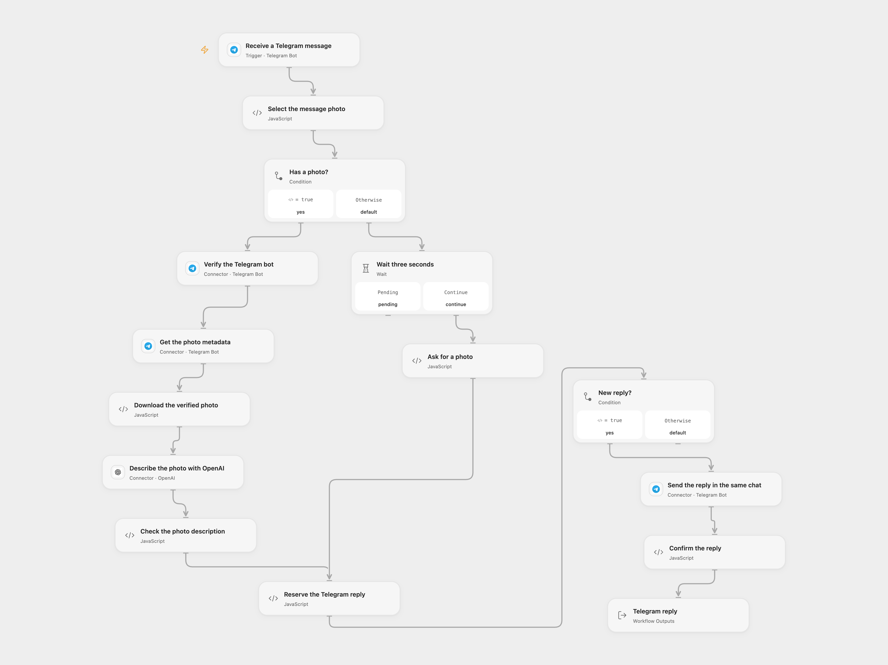

# Describe Telegram Photos with OpenAI

Describe a Telegram photo with OpenAI and reply in the same chat. Ask for a photo after other messages.

<!-- template-actions:start -->
 
<!-- template-actions:end -->

<picture>
  <source media="(prefers-color-scheme: dark)" srcset="preview-dark.png">
  
</picture>

## Setup

1. Connect the same Telegram bot in **Receive a Telegram message**, **Verify the Telegram bot**, **Get the photo metadata**, and **Send the reply in the same chat**. Bind its token as the secret variable `TELEGRAM_PHOTO_BOT_TOKEN` in **Download the verified photo**. Use only one active webhook per bot.
2. Select an OpenAI connection with GPT-6 Luna access in **Describe the photo with OpenAI**.
3. Publish and enable the workflow so Telegram can deliver message updates. Set the trigger's allowed chat IDs if you want to limit which chats can use it.

## Behavior

For a Telegram photo, the workflow uses the third size variant when available, or the first one otherwise. It confirms the selected file and checks the downloaded JPEG or PNG, up to 1 MiB. OpenAI receives the image bytes. The description returns to the same chat. Other messages receive a request for a photo after three seconds.

A failed image download or incomplete analysis stops before sending. The workflow holds one reply per Telegram update and chat. If delivery is uncertain, inspect the chat to see whether the reply arrived.

In n8n

Use the same Telegram bot credential in **Receive a Telegram message**, **Download the verified photo**, and **Send the reply in the same chat**, and connect OpenAI in **Describe the photo with OpenAI**. Use a public HTTPS webhook URL. Set one production execution at a time and select the same dedicated Data Table in **New reply?**, **Reserve the Telegram reply**, and **Record the Telegram reply**. Add text columns `update_key`, `status`, and `message_id`. If a reply remains pending, inspect the chat before clearing that row.

Inspiration &amp; credits

Adapted from [Automated AI image analysis and response via Telegram](https://github.com/enescingoz/awesome-n8n-templates/blob/827110332c21cbe000ab13f6d292d5adb1f1f8db/Telegram/Automated%20AI%20image%20analysis%20and%20response%20via%20Telegram.json) in [enescingoz/awesome-n8n-templates](https://github.com/enescingoz/awesome-n8n-templates).

Source collection notice: © 2024–2026 Enes Cingoz, [CC BY 4.0](https://github.com/enescingoz/awesome-n8n-templates/blob/827110332c21cbe000ab13f6d292d5adb1f1f8db/LICENSE). The original workflow is credited to AlQaisi. The collection notice does not establish a separate license for the original workflow. See [repository licensing](../../README.md#licensing) for the scope of OOMOL contributions and third-party material.

[Original n8n workflow by AlQaisi](https://n8n.io/workflows/2235-automated-ai-image-analysis-and-response-via-telegram/).

## Changes to the source

Confirm and validate the selected image before sending its bytes to the vision model. Keep the reply linked to the source chat and a single delivery per Telegram update.

