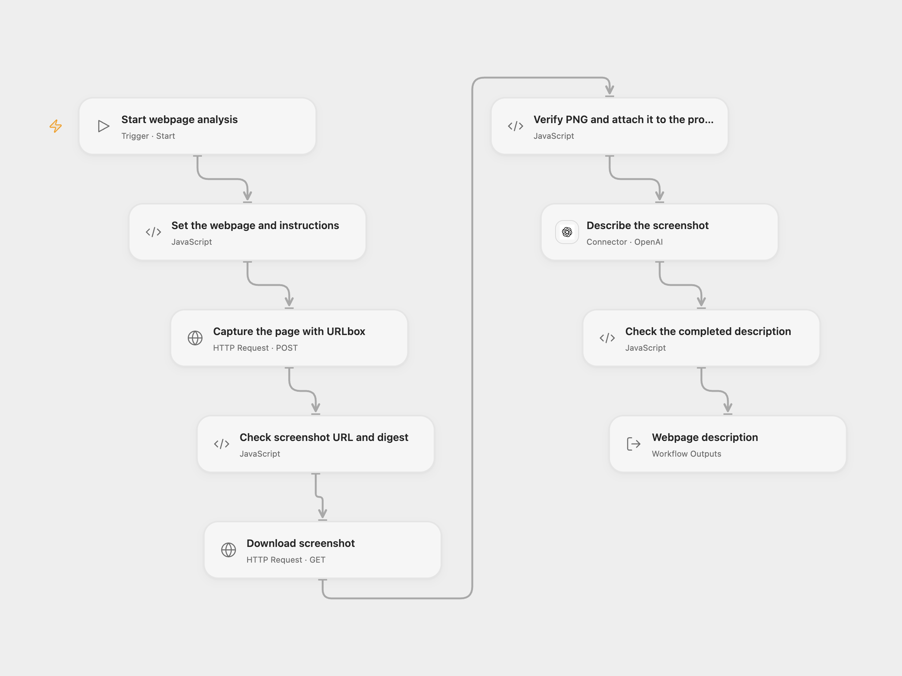

# Describe Webpage Screenshots with URLbox

Capture a full-page screenshot and return its visual description with the original webpage name and URL.

<!-- template-actions:start -->
 
<!-- template-actions:end -->

<picture>
  <source media="(prefers-color-scheme: dark)" srcset="preview-dark.png">
  
</picture>

## Setup

1. In **Set the webpage and instructions**, enter a name and public URL. Keep the one-sentence description instruction or edit it to focus on the content you need.
2. Bind the secret Variable `URLBOX_SECRET` in **Capture the page with URLbox**. Use a URLbox project that supports `save_hashes` and uses default render storage at `renders.urlbox.com`.
3. Select an OpenAI API connection in **Describe the screenshot**, then run manually and open **Webpage description**.

## Behavior

URLbox captures a full-page PNG. The workflow downloads it and compares its SHA-256 with the digest URLbox returned. GPT-4.1 mini receives the verified PNG bytes and your instructions. The output combines the description with the original name and URL.

A missing digest, mismatched image, render error or incomplete model response stops the run. The PNG must fit the 2 MiB workflow limit and the synchronous render must finish within 30 seconds.

In n8n

In **Capture the page with URLbox**, select a Bearer Auth credential with the URLbox project secret. Use default URLbox storage at `renders.urlbox.com`. In **Describe the screenshot**, select an OpenAI credential with GPT-4.1 mini access. Edit **Set the webpage and instructions**, run manually, and open **Webpage description**. The n8n import verifies the same digest with its Crypto node and analyzes the verified binary file.

Inspiration &amp; credits

## Changes to the source

- Use Bearer authentication with the current URLbox render API and verify screenshots with `save_hashes`.
- Pass the checked PNG bytes to a current vision model and keep each description with the input webpage. The capture request runs once per execution.
- [Original n8n listing by Bela](https://n8n.io/workflows/2207-automate-screenshots-with-urlbox-and-analyze-them-with-ai/)
- [URLbox render and digest verification](https://urlbox.com/guides/certify-a-screenshot) and [GPT-4.1 mini](https://developers.openai.com/api/docs/models/gpt-4.1-mini)

Adapted from [Automate screenshots with URLbox and analyze them with AI](https://github.com/Zie619/n8n-workflows/blob/ae8cf6dc5b873cbb4f74587aa9180ed3a9f70682/workflows/Http/1334_HTTP_Manual_Automation_Webhook.json) in [Zie619/n8n-workflows](https://github.com/Zie619/n8n-workflows). Attribution: Bela (original workflow); Zie619 / n8n-workflows (collection).

The collection’s [MIT notice](https://github.com/Zie619/n8n-workflows/blob/94007c1445d9258a7da116646b79473e7c7c3282/LICENSE) is pinned at a later revision. This is the collection notice at that revision; it does not establish a separate original template author's license. Our changes are listed above; see [repository licensing](../../README.md#licensing).

> MIT License
>
> Copyright (c) 2025 Zie619
>
> Permission is hereby granted, free of charge, to any person obtaining a copy
> of this software and associated documentation files (the "Software"), to deal
> in the Software without restriction, including without limitation the rights
> to use, copy, modify, merge, publish, distribute, sublicense, and/or sell
> copies of the Software, and to permit persons to whom the Software is
> furnished to do so, subject to the following conditions:
>
> The above copyright notice and this permission notice shall be included in all
> copies or substantial portions of the Software.
>
> THE SOFTWARE IS PROVIDED "AS IS", WITHOUT WARRANTY OF ANY KIND, EXPRESS OR
> IMPLIED, INCLUDING BUT NOT LIMITED TO THE WARRANTIES OF MERCHANTABILITY,
> FITNESS FOR A PARTICULAR PURPOSE AND NONINFRINGEMENT. IN NO EVENT SHALL THE
> AUTHORS OR COPYRIGHT HOLDERS BE LIABLE FOR ANY CLAIM, DAMAGES OR OTHER
> LIABILITY, WHETHER IN AN ACTION OF CONTRACT, TORT OR OTHERWISE, ARISING FROM,
> OUT OF OR IN CONNECTION WITH THE SOFTWARE OR THE USE OR OTHER DEALINGS IN THE
> SOFTWARE.

