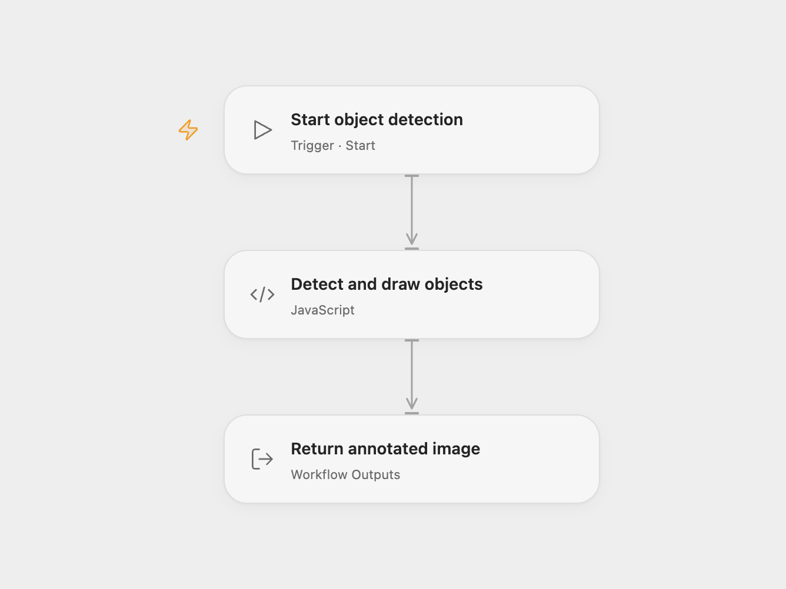

# Detect Objects and Draw Bounding Boxes

Detect requested objects in an image and draw bounding boxes over it.

<!-- template-actions:start -->
 
<!-- template-actions:end -->

<picture>
  <source media="(prefers-color-scheme: dark)" srcset="preview-dark.png">
  
</picture>

## Setup

Bind Secret Variable GEMINI_API_KEY, enter a public HTTPS JPEG or PNG URL and the object to find in **Detect and draw objects**, and add the image host to its HTTP allowlist. Large images require a server supporting byte ranges and a stable validator.

## Behavior

The workflow downloads the image, asks Gemini for object bounding boxes normalized to 0–1000, scales them to the original dimensions, and draws them over the original. Download the self-contained SVG result, which embeds the original image. Open Flow also returns the coordinates and labels. The image must be at most 20 MiB.

Detection can miss objects or produce inaccurate boxes. Review the image before using the result. The image is uploaded to Gemini; restrict access to its execution history and any temporary Files API upload. If an upload result is unknown, inspect the Files API before retrying.

In n8n

In n8n set the image URL and Gemini credential, and edit the object name in **Gemini 2.0 Object Detection**.

Inspiration &amp; credits

## Changes to the source

- Use a configurable image and subject, current Gemini model, and render every returned box in a self-contained SVG rather than a fixed six boxes.

Adapted from [Gemini image object detection](https://github.com/Zie619/n8n-workflows/blob/ae8cf6dc5b873cbb4f74587aa9180ed3a9f70682/workflows/Code/0665_Code_Editimage_Update_Webhook.json) in [Zie619/n8n-workflows](https://github.com/Zie619/n8n-workflows). The source export does not identify a separate template author or license.

The collection’s [MIT notice](https://github.com/Zie619/n8n-workflows/blob/94007c1445d9258a7da116646b79473e7c7c3282/LICENSE) is pinned at a later revision. This is the collection notice at that revision; it does not establish a separate original template author's license. Our changes are listed above; see [repository licensing](../../README.md#licensing).

> MIT License
>
> Copyright (c) 2025 Zie619
>
> Permission is hereby granted, free of charge, to any person obtaining a copy
> of this software and associated documentation files (the "Software"), to deal
> in the Software without restriction, including without limitation the rights
> to use, copy, modify, merge, publish, distribute, sublicense, and/or sell
> copies of the Software, and to permit persons to whom the Software is
> furnished to do so, subject to the following conditions:
>
> The above copyright notice and this permission notice shall be included in all
> copies or substantial portions of the Software.
>
> THE SOFTWARE IS PROVIDED "AS IS", WITHOUT WARRANTY OF ANY KIND, EXPRESS OR
> IMPLIED, INCLUDING BUT NOT LIMITED TO THE WARRANTIES OF MERCHANTABILITY,
> FITNESS FOR A PARTICULAR PURPOSE AND NONINFRINGEMENT. IN NO EVENT SHALL THE
> AUTHORS OR COPYRIGHT HOLDERS BE LIABLE FOR ANY CLAIM, DAMAGES OR OTHER
> LIABILITY, WHETHER IN AN ACTION OF CONTRACT, TORT OR OTHERWISE, ARISING FROM,
> OUT OF OR IN CONNECTION WITH THE SOFTWARE OR THE USE OR OTHER DEALINGS IN THE
> SOFTWARE.

