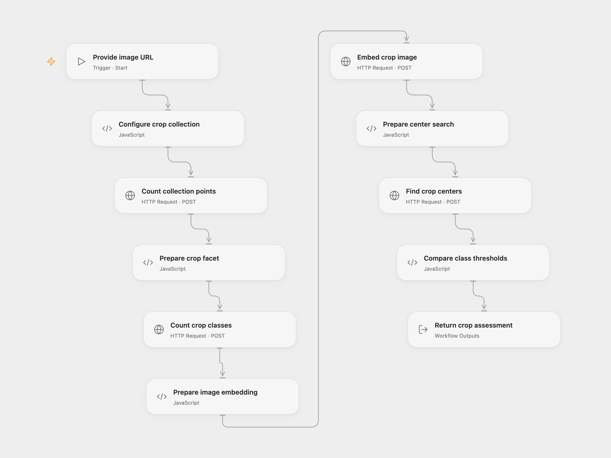

# Detect Unusual Crop Images

Compare a crop image with prepared class centers and thresholds in Qdrant.

<picture>
  <source media="(prefers-color-scheme: dark)" srcset="preview-dark.png">
  
</picture>

[Open Flow JSON](templates/detect-unusual-crop-images.openflow.json) · [n8n JSON](templates/detect-unusual-crop-images.n8n.json)

## Setup and use

Prepare a Qdrant collection with the named vector **voyage**, one or more crop center points marked **is_medoid**, and a numeric **is_medoid_cluster_threshold** plus **crop_name** on each center. The collection must use embeddings compatible with Voyage multimodal-3. Set the Qdrant host and collection in **Configure crop collection**, and configure the QDRANT_API_KEY and VOYAGE_API_KEY secrets. In n8n configure the same collection in **Variables for medoids** and connect Qdrant and Voyage credentials.

Run the Open Flow workflow with a publicly accessible HTTP image URL, or call the n8n sub-workflow with an input object containing query.imageURL. The image URL is sent to Voyage. The collection and thresholds must already exist; this workflow does not create them.

## Behavior

The workflow counts crop classes, embeds the image and compares each returned center with its own threshold. It reports the highest-scoring qualifying crop or an undefined-crop alert. This is a similarity-based indication and should be reviewed before making decisions. An empty collection or missing thresholds requires configuration.

Inspiration &amp; credits

Adapted from [Anomaly detection tool (crops dataset)](https://github.com/enescingoz/awesome-n8n-templates/blob/827110332c21cbe000ab13f6d292d5adb1f1f8db/AI_Research_RAG_and_Data_Analysis/Automated%20Hugging%20Face%20Paper%20Summary%20Fetching%20%26%20Categorization%20Workflow.json) in [enescingoz/awesome-n8n-templates](https://github.com/enescingoz/awesome-n8n-templates).

Source collection notice: © 2024–2026 Enes Cingoz, [CC BY 4.0](https://github.com/enescingoz/awesome-n8n-templates/blob/827110332c21cbe000ab13f6d292d5adb1f1f8db/LICENSE). The source export does not identify a separate template author or license. See [repository licensing](../../README.md#licensing) for the scope of OOMOL contributions and third-party material.

