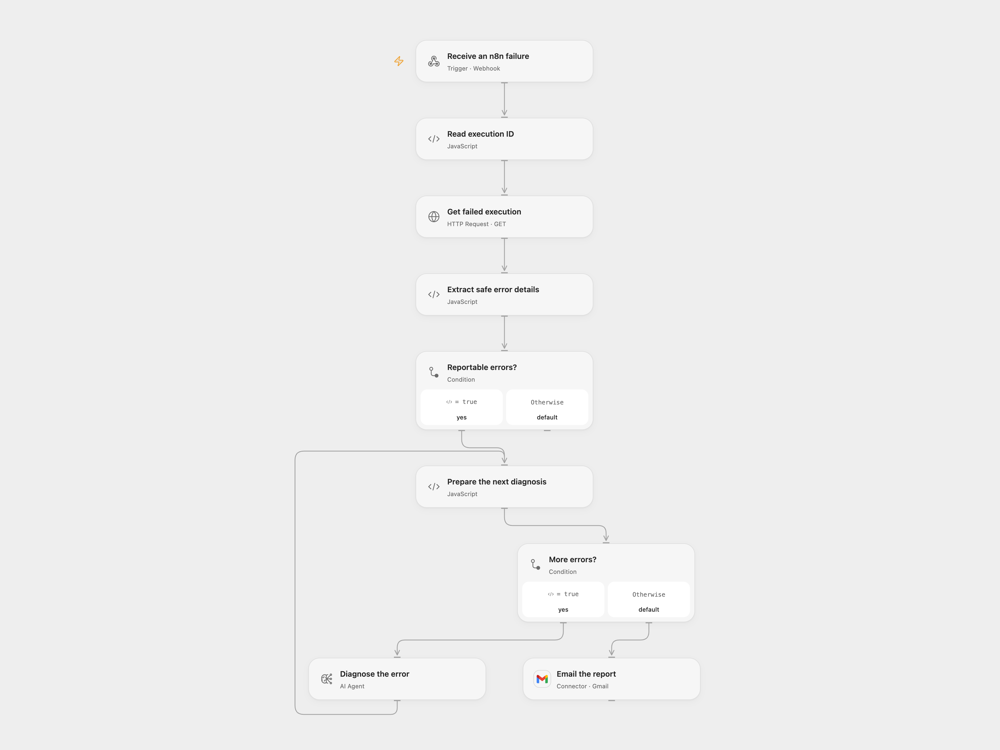

# Diagnose n8n Execution Errors by Email

Analyze failed n8n executions with AI and email a diagnostic report.

<picture>
  <source media="(prefers-color-scheme: dark)" srcset="preview-dark.png">
  
</picture>

[Open Flow JSON](templates/diagnose-n8n-execution-errors-by-email.openflow.json) · [n8n JSON](templates/diagnose-n8n-execution-errors-by-email.n8n.json)

## Setup

Set the n8n instance URL in **Read execution ID**, bind the n8n API key as Secret Variable `N8N_API_KEY`, and connect an OpenAI model and Gmail. Set the recipient in **Email the report**; configure CC and BCC there if needed. Deploy the Open Flow webhook. In n8n create an error workflow with an Error Trigger and an HTTP Request that POSTs the complete error event as JSON to this webhook (set JSON Body to `={{ $json }}`), then select that error workflow in the source workflows. Do not assign the relay to itself. The webhook is a public entry point that triggers API reads, model calls and email.

For the n8n format, connect n8n API, OpenAI and Gmail credentials, set the recipient and optional CC/BCC, activate the workflow, and select it as the error workflow in the source workflows. Use one format for a given failure.

## Behavior

For error events that include an execution ID, the workflow retrieves the failed execution with details, ignores manual runs and errors in node names containing `SERP`, and asks the model for a diagnosis, cause and resolution for each remaining failed node. It sends one report containing the results. If no matching errors are present, it sends no email. A failed or uncertain email may have been delivered; inspect Sent mail before replaying.

Execution data is read from n8n and may contain sensitive information in workflow history. The model receives selected error names, messages and node context, without raw trigger payloads, node parameters, credentials or stacks. Common credential patterns are redacted, but error messages and model output may still contain sensitive information. Restrict access to execution history and the recipient, and review the report before sharing it.

Inspiration &amp; credits

## Changes to the source

- Open Flow accepts a relayed n8n error event and reads that n8n execution through its HTTP API; n8n retains its native error trigger.
- Omit raw trigger data, credentials, node parameters and stacks from the model input; combine all matched node diagnoses into one plain-text email.

Adapted from [Error Alert and Summarizer](https://github.com/Zie619/n8n-workflows/blob/ae8cf6dc5b873cbb4f74587aa9180ed3a9f70682/workflows/Error/0945_Error_Code_Send_Triggered.json) in [Zie619/n8n-workflows](https://github.com/Zie619/n8n-workflows). The source report links to Real Simple Solutions; no separate original template license is stated.

The collection’s [MIT notice](https://github.com/Zie619/n8n-workflows/blob/94007c1445d9258a7da116646b79473e7c7c3282/LICENSE) is pinned at a later revision. This is the collection notice at that revision; it does not establish a separate original template author's license. Our changes are listed above; see [repository licensing](../../README.md#licensing).

> MIT License
>
> Copyright (c) 2025 Zie619
>
> Permission is hereby granted, free of charge, to any person obtaining a copy
> of this software and associated documentation files (the "Software"), to deal
> in the Software without restriction, including without limitation the rights
> to use, copy, modify, merge, publish, distribute, sublicense, and/or sell
> copies of the Software, and to permit persons to whom the Software is
> furnished to do so, subject to the following conditions:
>
> The above copyright notice and this permission notice shall be included in all
> copies or substantial portions of the Software.
>
> THE SOFTWARE IS PROVIDED "AS IS", WITHOUT WARRANTY OF ANY KIND, EXPRESS OR
> IMPLIED, INCLUDING BUT NOT LIMITED TO THE WARRANTIES OF MERCHANTABILITY,
> FITNESS FOR A PARTICULAR PURPOSE AND NONINFRINGEMENT. IN NO EVENT SHALL THE
> AUTHORS OR COPYRIGHT HOLDERS BE LIABLE FOR ANY CLAIM, DAMAGES OR OTHER
> LIABILITY, WHETHER IN AN ACTION OF CONTRACT, TORT OR OTHERWISE, ARISING FROM,
> OUT OF OR IN CONNECTION WITH THE SOFTWARE OR THE USE OR OTHER DEALINGS IN THE
> SOFTWARE.

