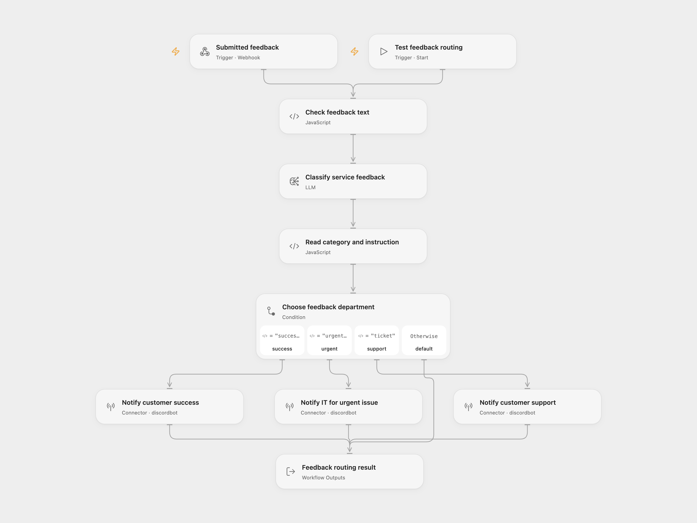

# Discord Feedback Router

Route one submitted feedback message to a department in Discord. The model writes a short instruction for customer success, IT, or customer support, and the workflow sends it to that department’s channel.

<picture>
  <source media="(prefers-color-scheme: dark)" srcset="preview-dark.png">
  
</picture>

[Open Flow JSON](templates/discord-feedback-router.openflow.json) · [n8n JSON](templates/discord-feedback-router.n8n.json)

## Setup and use

Select a configured `gpt-4o-mini-2024-07-18` model in **Classify service feedback**. In n8n, select your OpenAI credential on **Analyze User Request**. Both formats use temperature `0.5` and a 500-token completion budget. The default snapshot remains available now and has an [announced shutdown on January 14, 2027](https://developers.openai.com/api/docs/deprecations/). Choose a compatible available model in both formats before that date and check classification quality again.

Connect a Discord bot that can send messages in the chosen customer-success, IT, and support channels. Set the three channel IDs on their message nodes. In n8n, select a Discord Bot credential plus server and channel on each corresponding Discord node. This uses bot accounts in both formats; incoming-webhook URLs from the source are replaced by normal account and channel configuration.

For a manual Open Flow run, supply:

```json
{ "feedback": "Our production integration has stopped working and customers cannot sign in." }
```

For n8n manual testing, edit **Example Feedback** and use Execute Workflow. To receive submissions, publish and enable the workflow and POST the same JSON to its webhook. The webhook acknowledges receipt immediately with HTTP 200; execution results show the later routing outcome.

## Behavior

- `success-story` sends the generated instruction to customer success.
- `urgent-issue` sends it to IT.
- `ticket` sends it to customer support.
- An unrecognized category produces `status: ignored` and sends no message.

The result contains the normalized category, generated instruction, original feedback and `status`. A recognized category sends exactly one message. Invalid JSON, missing required category/instruction, an instruction longer than Discord’s 2000-character limit, or a failed model/message step stops the execution. No workflow-level retries or duplicate-submission checks are configured.

Submitted feedback is sent to the selected model service. Only its generated department instruction is sent to Discord. The category and urgency assessment are model judgments; check the instructions with examples appropriate for your support process.

<details>
<summary>Inspiration &amp; credits</summary>

## Changes to the source

- Replace the retired GPT-4 default with the documented model snapshot above.
- Give the manual test a real feedback value and validate empty submissions.
- Parse the classifier into an object, retain the source repair for literal newlines inside JSON strings, and accept fenced JSON.
- Normalize category whitespace/case, validate routed message length, and preserve the no-message fallback for unknown categories.
- Keep original feedback available after model/message responses and use configured Discord Bot connections.

Adapted from [Discord AI-powered bot](https://github.com/enescingoz/awesome-n8n-templates/blob/827110332c21cbe000ab13f6d292d5adb1f1f8db/Discord/Discord%20AI-powered%20bot.json) in [enescingoz/awesome-n8n-templates](https://github.com/enescingoz/awesome-n8n-templates).

Source collection notice: © 2024–2026 Enes Cingoz, [CC BY 4.0](https://github.com/enescingoz/awesome-n8n-templates/blob/827110332c21cbe000ab13f6d292d5adb1f1f8db/LICENSE). The source export does not identify a separate template author or license. See [repository licensing](../../README.md#licensing) for the scope of OOMOL contributions and third-party material.

</details>
