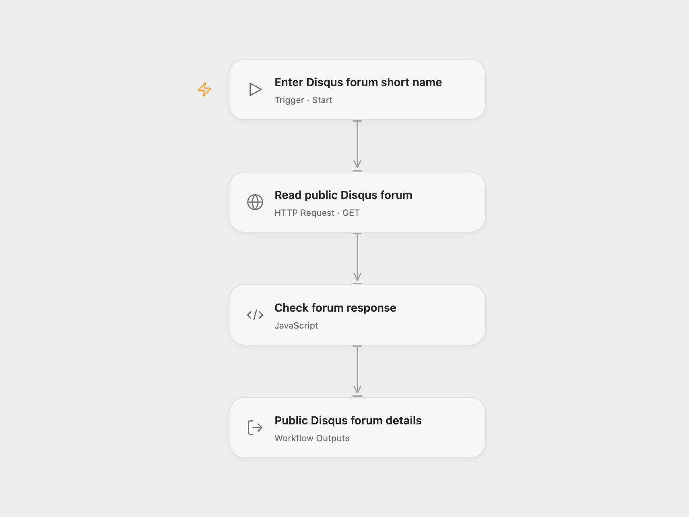

# Disqus Forum Reader

Read a Disqus forum’s public details using its short name, and return the complete forum record.

<picture>
  <source media="(prefers-color-scheme: dark)" srcset="preview-dark.png">
  
</picture>

[Open Flow JSON](templates/disqus-forum-reader.openflow.json) · [n8n JSON](templates/disqus-forum-reader.n8n.json)

## Setup

Use the **Public API Key** from your Disqus API application. This is the application key sent as `api_key`, not an account-owner access token or API secret. Configure the HTTP step’s **Referer** header with a site URL registered in that application’s trusted domains, following Disqus’s public-key access rules.

In Open Flow, store the key in a Variable and bind **Auth Token** (`auth.token`) in **Read public Disqus forum** to it. Run with the **Forum** short name. In n8n, choose **HTTP Query Auth** credentials with name `api_key` and your application’s Public API Key as the value. Set the registered Referer URL and forum query value in **Read public Disqus forum**. Shared files contain no key or Variable binding.

Each run makes one GET request for forum details, checks the API success code and forum ID, and retains every returned forum property. It does not read posts, moderate comments, expand related records or authenticate a Disqus user. Private user data is outside this template’s public-data access mode.

Disqus application permissions, trusted-domain checks and API rate limits apply. A rejected request, nonzero API code or missing forum record stops the run. No workflow retry is configured. Open Flow’s HTTP step has a 30-second execution budget.

Inspiration &amp; credits

## Changes to the source

- Replace the example forum with user configuration.
- Clarify that the existing `api_key` request uses an application Public API Key. The source credential’s access-token label and instructions are ambiguous for that request.
- Use formal query authentication, a configured trusted-site Referer and encoded query values in both formats.
- Check API success before returning the full public forum record.

Adapted from [Disqus forum details workflow](https://github.com/Zie619/n8n-workflows/blob/ae8cf6dc5b873cbb4f74587aa9180ed3a9f70682/workflows/Manual/0080_Manual_Disqus_Import_Triggered.json) in [Zie619/n8n-workflows](https://github.com/Zie619/n8n-workflows). The source export does not identify a separate template author or license.

The collection’s [MIT notice](https://github.com/Zie619/n8n-workflows/blob/94007c1445d9258a7da116646b79473e7c7c3282/LICENSE) is pinned at a later revision. This is the collection notice at that revision; it does not establish a separate original template author's license. Our changes are listed above; see [repository licensing](../../README.md#licensing).

> MIT License
>
> Copyright (c) 2025 Zie619
>
> Permission is hereby granted, free of charge, to any person obtaining a copy
> of this software and associated documentation files (the "Software"), to deal
> in the Software without restriction, including without limitation the rights
> to use, copy, modify, merge, publish, distribute, sublicense, and/or sell
> copies of the Software, and to permit persons to whom the Software is
> furnished to do so, subject to the following conditions:
>
> The above copyright notice and this permission notice shall be included in all
> copies or substantial portions of the Software.
>
> THE SOFTWARE IS PROVIDED "AS IS", WITHOUT WARRANTY OF ANY KIND, EXPRESS OR
> IMPLIED, INCLUDING BUT NOT LIMITED TO THE WARRANTIES OF MERCHANTABILITY,
> FITNESS FOR A PARTICULAR PURPOSE AND NONINFRINGEMENT. IN NO EVENT SHALL THE
> AUTHORS OR COPYRIGHT HOLDERS BE LIABLE FOR ANY CLAIM, DAMAGES OR OTHER
> LIABILITY, WHETHER IN AN ACTION OF CONTRACT, TORT OR OTHERWISE, ARISING FROM,
> OUT OF OR IN CONNECTION WITH THE SOFTWARE OR THE USE OR OTHER DEALINGS IN THE
> SOFTWARE.

