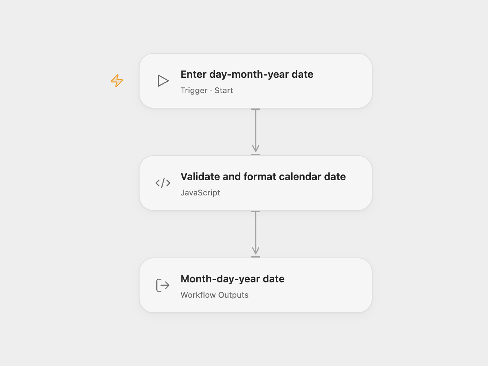

# DMY to MDY Date Converter

Convert a calendar date written as DD/MM/YYYY into MM/DD/YYYY. For example, 14/02/2020 becomes 02/14/2020.

<picture>
  <source media="(prefers-color-scheme: dark)" srcset="preview-dark.png">
  
</picture>

[Open Flow JSON](templates/dmy-to-mdy-date-converter.openflow.json) · [n8n JSON](templates/dmy-to-mdy-date-converter.n8n.json)

## Use

In Open Flow, run with **Value**, such as `14/02/2020`. In n8n, edit the `value` string at the start of **Validate and format calendar date** and run the workflow manually. Both formats return the converted string in `data`. No account or external service is required.

Use two digits for the day and month and four digits for the year. The workflow checks month lengths and Gregorian leap years. Invalid dates, extra text and other input formats stop the run. It does not guess the date convention, convert timezones or create a timestamp.

## Changes to the source

- Make the source’s default MM/DD/YYYY output format explicit.
- Require the stated input format and a valid calendar date instead of accepting lenient parsing or returning an invalid-date string.
- Use the same calendar calculation in both formats without depending on the execution machine’s timezone.

Source and license

Adapted from [Date and Time calendar formatting workflow](https://github.com/Zie619/n8n-workflows/blob/ae8cf6dc5b873cbb4f74587aa9180ed3a9f70682/workflows/Manual/1039_Manual_Datetime_Automate_Triggered.json) in [Zie619/n8n-workflows](https://github.com/Zie619/n8n-workflows). The source export does not identify a separate template author or license.

The collection’s [MIT notice](https://github.com/Zie619/n8n-workflows/blob/94007c1445d9258a7da116646b79473e7c7c3282/LICENSE) is pinned at a later revision. This is the collection notice at that revision; it does not establish a separate original template author's license. Our changes are listed above; see [repository licensing](../../README.md#licensing).

> MIT License
>
> Copyright (c) 2025 Zie619
>
> Permission is hereby granted, free of charge, to any person obtaining a copy
> of this software and associated documentation files (the "Software"), to deal
> in the Software without restriction, including without limitation the rights
> to use, copy, modify, merge, publish, distribute, sublicense, and/or sell
> copies of the Software, and to permit persons to whom the Software is
> furnished to do so, subject to the following conditions:
>
> The above copyright notice and this permission notice shall be included in all
> copies or substantial portions of the Software.
>
> THE SOFTWARE IS PROVIDED "AS IS", WITHOUT WARRANTY OF ANY KIND, EXPRESS OR
> IMPLIED, INCLUDING BUT NOT LIMITED TO THE WARRANTIES OF MERCHANTABILITY,
> FITNESS FOR A PARTICULAR PURPOSE AND NONINFRINGEMENT. IN NO EVENT SHALL THE
> AUTHORS OR COPYRIGHT HOLDERS BE LIABLE FOR ANY CLAIM, DAMAGES OR OTHER
> LIABILITY, WHETHER IN AN ACTION OF CONTRACT, TORT OR OTHERWISE, ARISING FROM,
> OUT OF OR IN CONNECTION WITH THE SOFTWARE OR THE USE OR OTHER DEALINGS IN THE
> SOFTWARE.

