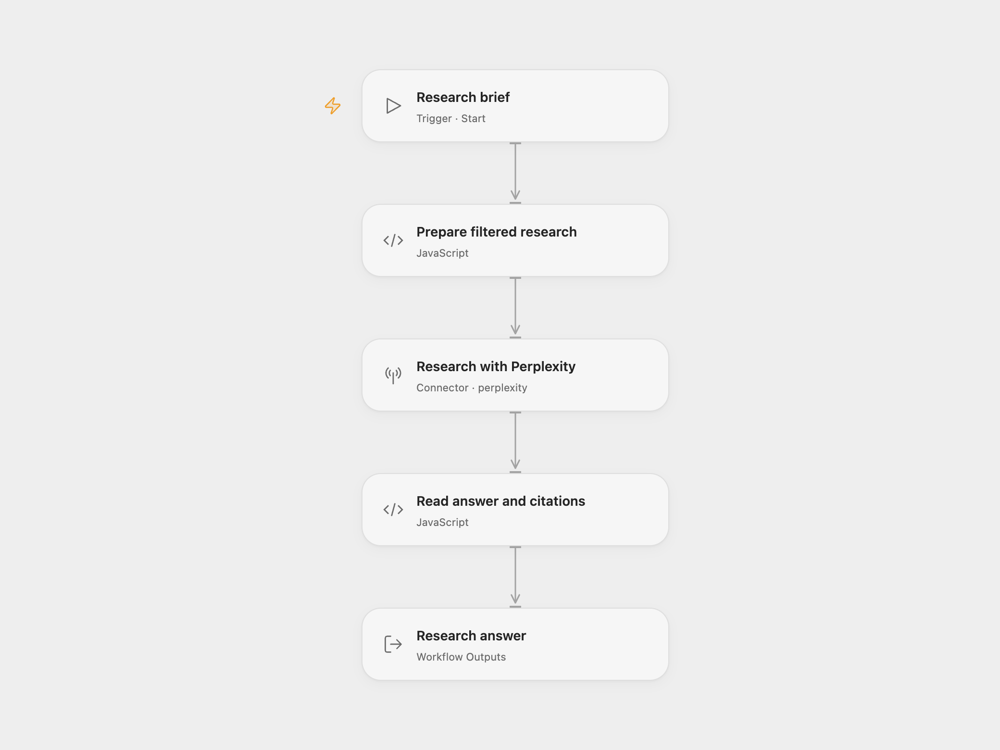

# Domain Filtered Research

Ask a research question using Perplexity web search, restrict search to your chosen domains, and request sources published within the last month. The result contains the first answer and its citation URLs.

<picture>
  <source media="(prefers-color-scheme: dark)" srcset="preview-dark.png">
  
</picture>

[Open Flow JSON](templates/domain-filtered-research.openflow.json) · [n8n JSON](templates/domain-filtered-research.n8n.json)

## Setup and use

In Open Flow, connect Perplexity in **Research with Perplexity**. Use Run and supply:

```json
{
  "user_prompt": "What are the differences between n8n and Make?",
  "domains": "n8n.io, make.com",
  "system_prompt": "Answer using retrieved sources and distinguish facts from uncertainty."
}
```

`user_prompt` and `domains` are required. `domains` is a comma-separated list of domains or URL prefixes; surrounding spaces and empty entries are removed. Optional `system_prompt` supplies research instructions. The request uses `sonar` and a fixed `month` publication-recency filter.

In n8n, edit the same fields in **Set Params**. Configure a Header Auth credential in **Perplexity Request** with name `Authorization` and value `Bearer YOUR_PERPLEXITY_API_KEY`, then use Execute Workflow. Keep the key in the credential.

Each run makes one synchronous research request and returns `output` and `citations`. If the service omits citations, the list is empty. Missing answer text or a failed request stops the run. There are no automatic retries, stored conversations, or publishing steps.

The template uses Perplexity’s legacy Sonar-compatible completion route. Perplexity may rewrite these requests to its newer service; model behavior and sampling can change. Domain and publication-recency filters constrain search, and do not prove every generated statement. Check the answer against the cited sources before using it.

<details>
<summary>Inspiration &amp; credits</summary>

## Changes to the source

- Trim domain filters and validate the research question before requesting an answer.
- Build the request as a JSON object so quotes and line breaks in prompts remain valid.
- Use neutral research instructions as the editable default.
- Preserve the answer’s citation list and handle an omitted list.
- Replace credential identities and outdated model notes with reusable setup instructions.

Adapted from [Query Perplexity AI from your n8n workflows](https://github.com/enescingoz/awesome-n8n-templates/blob/827110332c21cbe000ab13f6d292d5adb1f1f8db/AI_Research_RAG_and_Data_Analysis/Query%20Perplexity%20AI%20from%20your%20n8n%20workflows.json) in [enescingoz/awesome-n8n-templates](https://github.com/enescingoz/awesome-n8n-templates).

Source collection notice: © 2024–2026 Enes Cingoz, [CC BY 4.0](https://github.com/enescingoz/awesome-n8n-templates/blob/827110332c21cbe000ab13f6d292d5adb1f1f8db/LICENSE). The source export does not identify a separate template author or license. See [repository licensing](../../README.md#licensing) for the scope of OOMOL contributions and third-party material.

</details>
