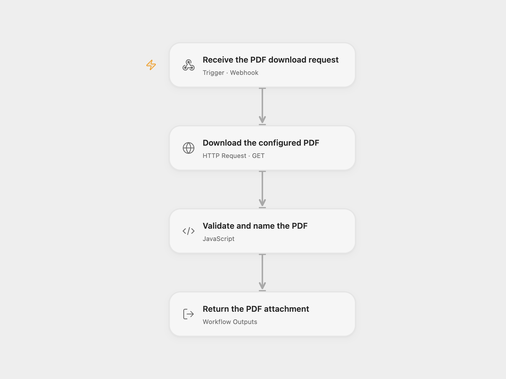

# Download a PDF Attachment from a Webhook

Return a configured PDF as a dated attachment in the same GET request.

<!-- template-actions:start -->
 
<!-- template-actions:end -->

<picture>
  <source media="(prefers-color-scheme: dark)" srcset="preview-dark.png">
  
</picture>

## Setup

1. Replace the example URL in **Download the configured PDF** with a direct HTTPS URL to a PDF you are authorized to share. Keep this URL in the workflow configuration.
2. Publish the workflow and open its GET webhook URL. Anyone with the deployed URL can request the file.

## Behavior

The request downloads the configured file and returns its original bytes with HTTP 200, `Content-Type: application/pdf`, and `Content-Disposition: attachment`. The filename is `my_document_yyyy-MM-dd.pdf` using the UTC date. Request parameters cannot select another URL.

The workflow accepts complete PDFs up to 10 MiB. An unsuccessful or invalid upstream response fails the request without returning an attachment. The webhook waits up to 60 seconds for the workflow result.

In n8n

Set the source HTTPS URL in **Download the configured PDF**, activate the workflow and open the production GET URL for `download-pdf`. The download node has a 30-second timeout. The response node sends the binary with the same UTC filename.

Inspiration &amp; credits

Adapted from [Download a PDF file from a GET Webhook](https://github.com/Zie619/n8n-workflows/blob/ae8cf6dc5b873cbb4f74587aa9180ed3a9f70682/workflows/Http/0306_HTTP_Respondtowebhook_Import_Webhook.json) in [Zie619/n8n-workflows](https://github.com/Zie619/n8n-workflows). Attribution: Zie619 / n8n-workflows.

The collection’s [MIT notice](https://github.com/Zie619/n8n-workflows/blob/94007c1445d9258a7da116646b79473e7c7c3282/LICENSE) is pinned at a later revision. This is the collection notice at that revision; it does not establish a separate original template author's license. Our changes are listed above; see [repository licensing](../../README.md#licensing).

> MIT License
>
> Copyright (c) 2025 Zie619
>
> Permission is hereby granted, free of charge, to any person obtaining a copy
> of this software and associated documentation files (the "Software"), to deal
> in the Software without restriction, including without limitation the rights
> to use, copy, modify, merge, publish, distribute, sublicense, and/or sell
> copies of the Software, and to permit persons to whom the Software is
> furnished to do so, subject to the following conditions:
>
> The above copyright notice and this permission notice shall be included in all
> copies or substantial portions of the Software.
>
> THE SOFTWARE IS PROVIDED "AS IS", WITHOUT WARRANTY OF ANY KIND, EXPRESS OR
> IMPLIED, INCLUDING BUT NOT LIMITED TO THE WARRANTIES OF MERCHANTABILITY,
> FITNESS FOR A PARTICULAR PURPOSE AND NONINFRINGEMENT. IN NO EVENT SHALL THE
> AUTHORS OR COPYRIGHT HOLDERS BE LIABLE FOR ANY CLAIM, DAMAGES OR OTHER
> LIABILITY, WHETHER IN AN ACTION OF CONTRACT, TORT OR OTHERWISE, ARISING FROM,
> OUT OF OR IN CONNECTION WITH THE SOFTWARE OR THE USE OR OTHER DEALINGS IN THE
> SOFTWARE.

