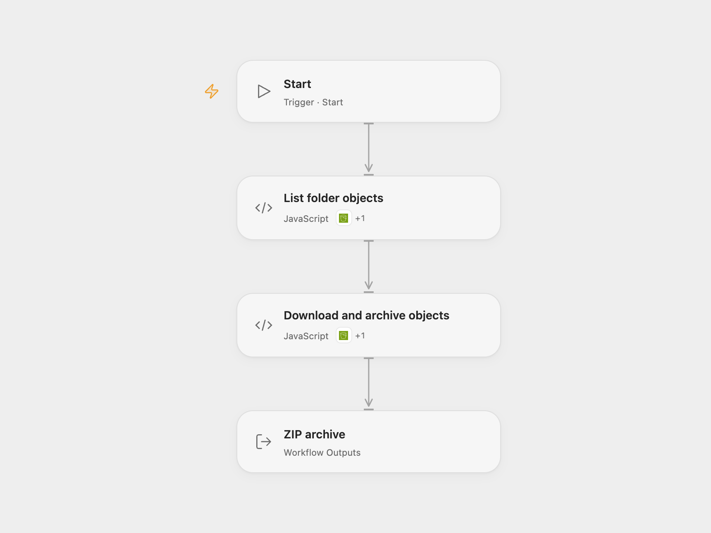

# Download an S3 Folder as ZIP

Download nonempty files directly within an S3 folder into a ZIP archive.

<picture>
  <source media="(prefers-color-scheme: dark)" srcset="preview-dark.png">
  
</picture>

[Open Flow JSON](templates/download-s3-folder-as-zip.openflow.json) · [n8n JSON](templates/download-s3-folder-as-zip.n8n.json)

## Setup and use

Connect AWS S3 with permission to list the bucket and download its objects. Set the same bucket and region in **List folder objects** and **Download and archive objects**. Set the folder prefix in **List folder objects**, including its trailing slash. Add the Connector file transit hostname to **Download and archive objects** HTTP allowed hosts. Run the workflow manually and download the returned ZIP artifact. In n8n connect AWS credentials and set the same bucket and folder in both S3 nodes, then run the workflow manually.

## Behavior

The workflow lists nonempty files directly under the prefix, downloads each file and creates `s3-export.zip` with their filenames. It skips empty objects, folder markers and nested folders. Open Flow stops if no files remain, filenames collide, a download fails or its size does not match. Each transit download must fit the host's 1 MiB HTTP response limit, and the archive must fit artifact and execution limits. Restrict access to the execution and resulting archive.

Inspiration &amp; credits

## Changes to the source

- Replace sample bucket and folder with configuration. Open Flow returns a downloadable artifact and rejects ambiguous filenames.

Adapted from [Download S3 folder as ZIP](https://github.com/Zie619/n8n-workflows/blob/ae8cf6dc5b873cbb4f74587aa9180ed3a9f70682/workflows/Awss3/0593_Awss3_Compression_Automate_Triggered.json) in [Zie619/n8n-workflows](https://github.com/Zie619/n8n-workflows). The source note credits [Workflow Automation & Development](https://let-the-work-flow.com). No separate original template license was found.

The collection’s [MIT notice](https://github.com/Zie619/n8n-workflows/blob/94007c1445d9258a7da116646b79473e7c7c3282/LICENSE) is pinned at a later revision. This is the collection notice at that revision; it does not establish a separate original template author's license. Our changes are listed above; see [repository licensing](../../README.md#licensing).

> MIT License
>
> Copyright (c) 2025 Zie619
>
> Permission is hereby granted, free of charge, to any person obtaining a copy
> of this software and associated documentation files (the "Software"), to deal
> in the Software without restriction, including without limitation the rights
> to use, copy, modify, merge, publish, distribute, sublicense, and/or sell
> copies of the Software, and to permit persons to whom the Software is
> furnished to do so, subject to the following conditions:
>
> The above copyright notice and this permission notice shall be included in all
> copies or substantial portions of the Software.
>
> THE SOFTWARE IS PROVIDED "AS IS", WITHOUT WARRANTY OF ANY KIND, EXPRESS OR
> IMPLIED, INCLUDING BUT NOT LIMITED TO THE WARRANTIES OF MERCHANTABILITY,
> FITNESS FOR A PARTICULAR PURPOSE AND NONINFRINGEMENT. IN NO EVENT SHALL THE
> AUTHORS OR COPYRIGHT HOLDERS BE LIABLE FOR ANY CLAIM, DAMAGES OR OTHER
> LIABILITY, WHETHER IN AN ACTION OF CONTRACT, TORT OR OTHERWISE, ARISING FROM,
> OUT OF OR IN CONNECTION WITH THE SOFTWARE OR THE USE OR OTHER DEALINGS IN THE
> SOFTWARE.

Open Flow bundles fflate 0.7.4 under the MIT license, included in the workflow code.

