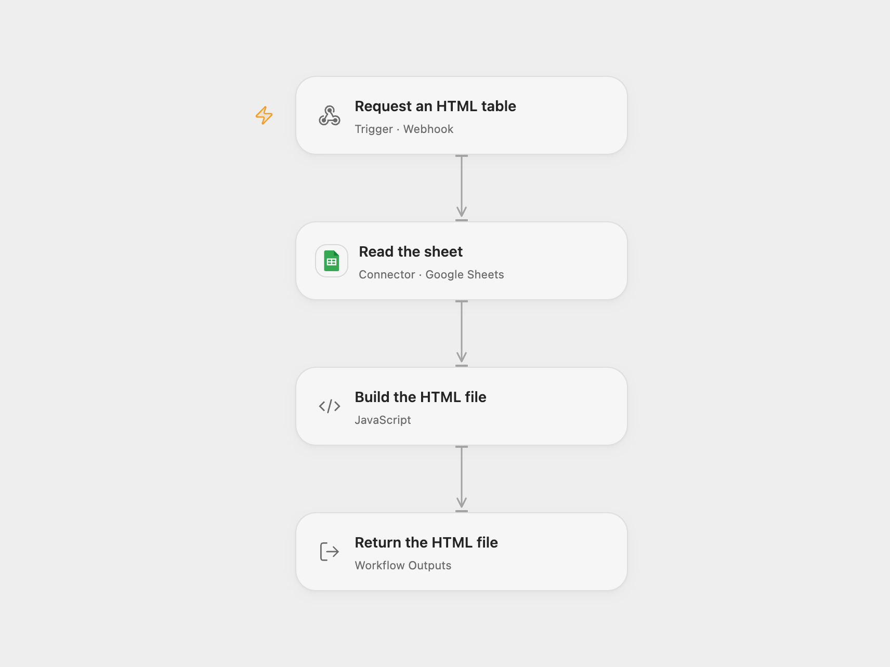

# Download a Google Sheet as an HTML Table

Download a Google Sheets range as an HTML table through a webhook.

<picture>
  <source media="(prefers-color-scheme: dark)" srcset="preview-dark.png">
  
</picture>

[Open Flow JSON](templates/download-sheet-as-html-table.openflow.json) · [n8n JSON](templates/download-sheet-as-html-table.n8n.json)

## Setup

Connect Google Sheets. In Open Flow set the spreadsheet ID and range in **Read the sheet**. In n8n configure the spreadsheet, sheet and range in **Read from Google Sheets** and connect the account. Deploy and enable one format, then request its GET webhook URL.

The webhook is unauthenticated: anyone who can reach the URL can download the configured sheet data. Use only data intended for those callers or protect the endpoint with a trusted access-control layer.

## Behavior

A request reads the configured range and returns an HTML table file. Open Flow uses the first row as headers and escapes sheet values before placing them in HTML. Its response downloads as `sheet.html` with a `text/plain` response type; opening the saved file renders the table. n8n returns the spreadsheet node's HTML binary file. Empty ranges produce an empty table in Open Flow. Sheet data and generated output must fit the workflow's execution limits. A read or generation failure stops the request.

Inspiration &amp; credits

## Changes to the source

- Replace personal sheet and webhook identifiers with configuration. Open Flow adds HTML escaping and a download filename; its response type is plain text, while the saved file contains HTML.

Adapted from [Return a Google Sheet as an HTML file](https://github.com/Zie619/n8n-workflows/blob/ae8cf6dc5b873cbb4f74587aa9180ed3a9f70682/workflows/Googlesheets/0237_GoogleSheets_Spreadsheetfile_Create_Webhook.json) in [Zie619/n8n-workflows](https://github.com/Zie619/n8n-workflows). The source export does not identify a separate template author or license.

The collection’s [MIT notice](https://github.com/Zie619/n8n-workflows/blob/94007c1445d9258a7da116646b79473e7c7c3282/LICENSE) is pinned at a later revision. This is the collection notice at that revision; it does not establish a separate original template author's license. Our changes are listed above; see [repository licensing](../../README.md#licensing).

> MIT License
>
> Copyright (c) 2025 Zie619
>
> Permission is hereby granted, free of charge, to any person obtaining a copy
> of this software and associated documentation files (the "Software"), to deal
> in the Software without restriction, including without limitation the rights
> to use, copy, modify, merge, publish, distribute, sublicense, and/or sell
> copies of the Software, and to permit persons to whom the Software is
> furnished to do so, subject to the following conditions:
>
> The above copyright notice and this permission notice shall be included in all
> copies or substantial portions of the Software.
>
> THE SOFTWARE IS PROVIDED "AS IS", WITHOUT WARRANTY OF ANY KIND, EXPRESS OR
> IMPLIED, INCLUDING BUT NOT LIMITED TO THE WARRANTIES OF MERCHANTABILITY,
> FITNESS FOR A PARTICULAR PURPOSE AND NONINFRINGEMENT. IN NO EVENT SHALL THE
> AUTHORS OR COPYRIGHT HOLDERS BE LIABLE FOR ANY CLAIM, DAMAGES OR OTHER
> LIABILITY, WHETHER IN AN ACTION OF CONTRACT, TORT OR OTHERWISE, ARISING FROM,
> OUT OF OR IN CONNECTION WITH THE SOFTWARE OR THE USE OR OTHER DEALINGS IN THE
> SOFTWARE.

