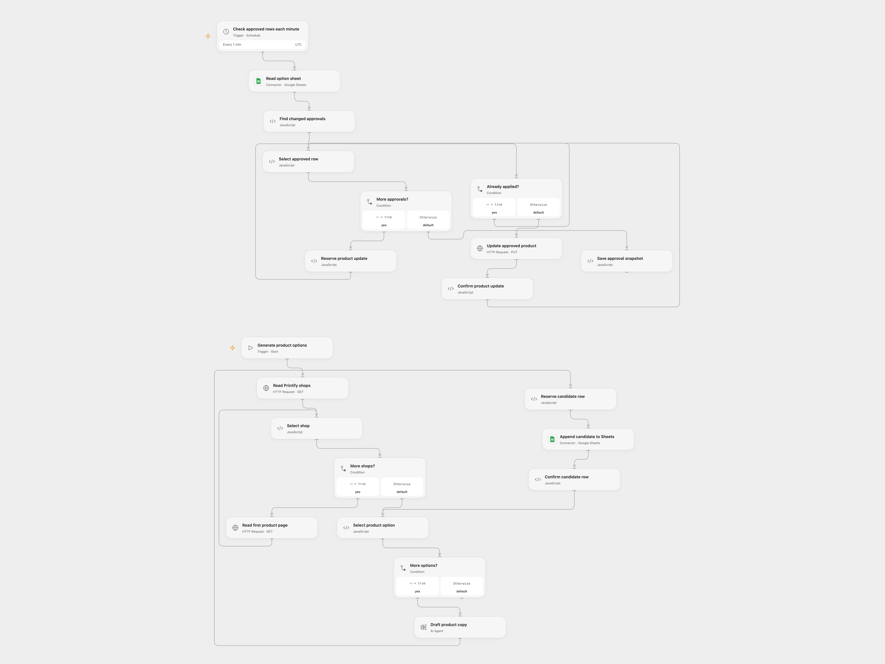

# Draft and Approve Printify Product Copy

Generate three product copy options in Sheets and apply an approved option to its Printify shop.

<!-- template-actions:start -->
 
<!-- template-actions:end -->

<picture>
  <source media="(prefers-color-scheme: dark)" srcset="preview-dark.png">
  
</picture>

## Setup

Bind PRINTIFY_TOKEN to a Printify API token, connect Google Sheets, configure the spreadsheet ID and use an Options sheet with columns xid, date, status, shop_id, product_id, original_title, original_desc, keyword, product_title, product_desc, upload in that order. Configure the AI model and persistent State. Supply a unique run ID and brand guidelines. Use one format and prevent overlapping runs.

## Behavior

A manual run reads each shop and its first product page, then writes three distinct model-generated copy options per product. The [Printify API](https://developers.printify.com/) defaults to 50 products per page; the source requests only the first page. Review an option in Sheets and change its upload cell to exactly yes to apply its title and description to the recorded shop and product. Open Flow polls each minute and establishes an initial snapshot without acting on pre-existing approvals. A cell must change to yes after the snapshot. Keep xid unique for every candidate row. Source model-node tool connections are not used.

Candidate sheet appends and product updates have independent pending checkpoints. An uncertain write may have succeeded; inspect Sheets or the exact Printify shop and product before clearing the relevant checkpoint. Use a new run ID only for a new batch of candidates. AI-generated copy requires review before approval.

In n8n

In n8n connect Printify Header Auth, OpenAI and Sheets, select the same sheet in all three nodes and configure a Data Table with item_key and status columns. N8n uses its Sheets row-update trigger. In n8n the candidate attempt records remain in the Data Table after success; use a new run ID for another batch.

Inspiration &amp; credits

Adapted from [Optimize & Update Printify Title and Description Workflow](https://github.com/enescingoz/awesome-n8n-templates/blob/827110332c21cbe000ab13f6d292d5adb1f1f8db/Other_Integrations_and_Use_Cases/Optimize%20%26%20Update%20Printify%20Title%20and%20Description%20Workflow.json) in [enescingoz/awesome-n8n-templates](https://github.com/enescingoz/awesome-n8n-templates).

Source collection notice: © 2024–2026 Enes Cingoz, [CC BY 4.0](https://github.com/enescingoz/awesome-n8n-templates/blob/827110332c21cbe000ab13f6d292d5adb1f1f8db/LICENSE). The source export does not identify a separate template author or license. See [repository licensing](../../README.md#licensing) for the scope of OOMOL contributions and third-party material.

