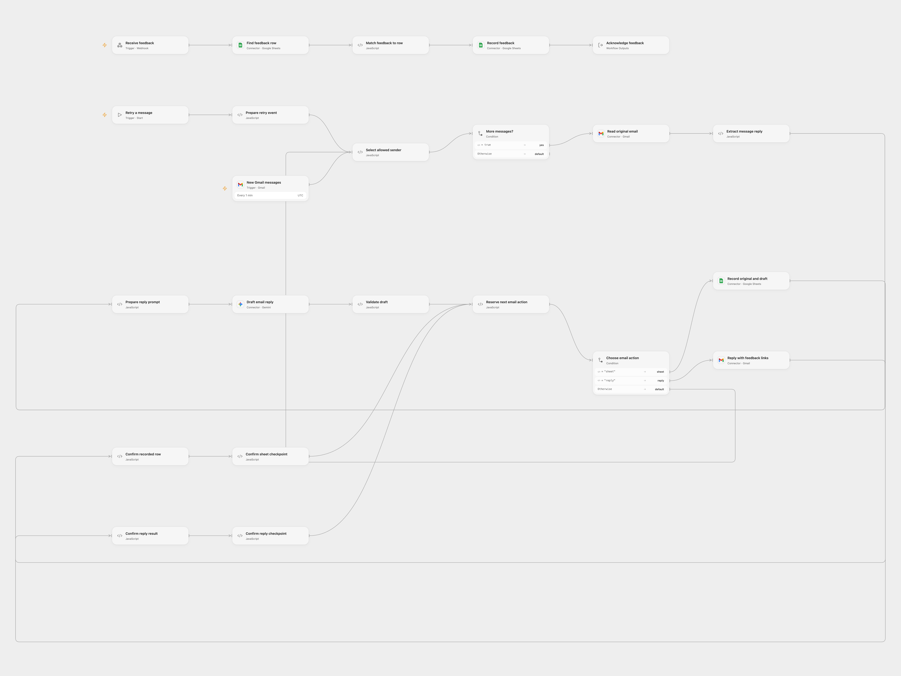

# Reply to Gmail and Record Feedback

Draft replies to selected Gmail messages and record recipient feedback in Google Sheets.

<picture>
  <source media="(prefers-color-scheme: dark)" srcset="preview-dark.png">
  
</picture>

[Open Flow JSON](templates/draft-gmail-replies-with-sheet-feedback.openflow.json) · [n8n JSON](templates/draft-gmail-replies-with-sheet-feedback.n8n.json)

## Setup

Connect Gmail, Google Sheets and Gemini. Create a sheet named Database with columns ID, Initial message, Generated reply and Good response?. Enter its ID in all three Sheets nodes, configure sender addresses in **Select allowed sender**, and set the public feedback webhook URL in **Reserve next email action**. Enable persistent State and use one format at a time. In n8n configure Gmail, Gemini, Google Sheets, the matching spreadsheet and sheet IDs, the allowed senders and the feedback URL. Select the same Data Table in all checkpoint nodes, with text columns item_key, status, token, initial and draft.

## Behavior

Incoming messages from allowed senders generate a reply. The workflow saves the message and reply before sending links that record Yes or No against the matching row. Feedback links grant the holder the ability to change that response. Avoid overlapping executions and protect stored email content. The model can produce incorrect replies; configure the allowed sender list carefully. Unquoted message text longer than 14,800 characters stops processing, and earlier messages may already have been processed.

If a sheet append or email reply has an unknown result, inspect the destination before retrying. Enter the pending key and confirmed or absent in **Reserve next email action**, run **Retry a message** with the original message ID, thread ID and sender, and clear the recovery fields afterward. In n8n inspect the matching pending Data Table row: after confirming an append set status to sheet_done; if absent delete the row. For reply_pending set done if sent or sheet_done if absent.

Inspiration &amp; credits

Keep the email reply and feedback loop, use configured Sheets and stop for uncertain writes.

Adapted from [Send a ChatGPT email reply when email received and save responses to Google Sheets](https://github.com/Zie619/n8n-workflows/blob/ae8cf6dc5b873cbb4f74587aa9180ed3a9f70682/workflows/Code/0299_Code_Webhook_Create_Webhook.json) in [Zie619/n8n-workflows](https://github.com/Zie619/n8n-workflows). The source export does not identify a separate template author or license.

The collection’s [MIT notice](https://github.com/Zie619/n8n-workflows/blob/94007c1445d9258a7da116646b79473e7c7c3282/LICENSE) is pinned at a later revision. This is the collection notice at that revision; it does not establish a separate original template author's license. Our changes are listed above; see [repository licensing](../../README.md#licensing).

> MIT License
>
> Copyright (c) 2025 Zie619
>
> Permission is hereby granted, free of charge, to any person obtaining a copy
> of this software and associated documentation files (the "Software"), to deal
> in the Software without restriction, including without limitation the rights
> to use, copy, modify, merge, publish, distribute, sublicense, and/or sell
> copies of the Software, and to permit persons to whom the Software is
> furnished to do so, subject to the following conditions:
>
> The above copyright notice and this permission notice shall be included in all
> copies or substantial portions of the Software.
>
> THE SOFTWARE IS PROVIDED "AS IS", WITHOUT WARRANTY OF ANY KIND, EXPRESS OR
> IMPLIED, INCLUDING BUT NOT LIMITED TO THE WARRANTIES OF MERCHANTABILITY,
> FITNESS FOR A PARTICULAR PURPOSE AND NONINFRINGEMENT. IN NO EVENT SHALL THE
> AUTHORS OR COPYRIGHT HOLDERS BE LIABLE FOR ANY CLAIM, DAMAGES OR OTHER
> LIABILITY, WHETHER IN AN ACTION OF CONTRACT, TORT OR OTHERWISE, ARISING FROM,
> OUT OF OR IN CONNECTION WITH THE SOFTWARE OR THE USE OR OTHER DEALINGS IN THE
> SOFTWARE.

