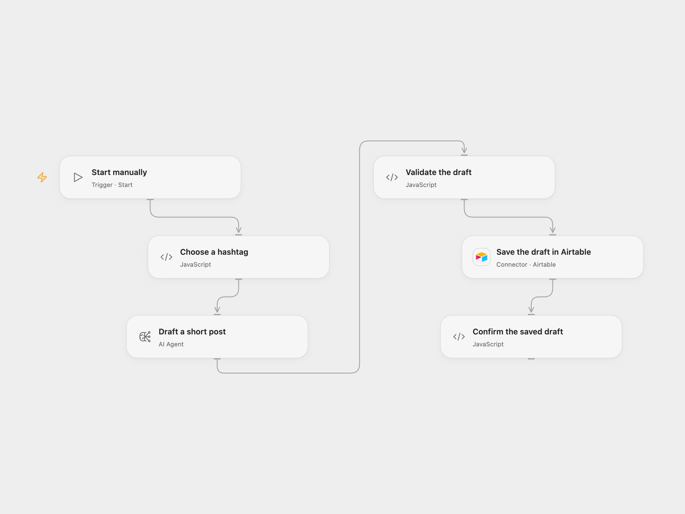

# Draft Hashtag Posts to Airtable

Generate a short post about a randomly selected hashtag and save it to Airtable for review.

<picture>
  <source media="(prefers-color-scheme: dark)" srcset="preview-dark.png">
  
</picture>

[Open Flow JSON](templates/draft-hashtag-posts-to-airtable.openflow.json) · [n8n JSON](templates/draft-hashtag-posts-to-airtable.n8n.json)

## Setup

Edit the hashtag list in **Choose a hashtag**, configure the model in **Draft a short post**, and connect Airtable in **Save the draft in Airtable**. Set the base ID and table name. The table needs text fields named **Hashtag** and **Content**. In n8n, edit the list in **Choose a hashtag**, connect OpenAI and Airtable credentials and set the same base and table. Run either format manually.

## Behavior

Each run randomly chooses one configured hashtag, asks the model for a post about it and saves one draft. The workflow trims the result and requires the selected hashtag and fewer than 100 Unicode code points before creating a record. Empty, overlong or mismatched output stops the run. The selected hashtag is sent to the model provider. Review the generated text for accuracy before use; the workflow does not publish a post.

An uncertain Airtable write may already have created a record. Check the table before retrying; repeating a run can create another draft.

Inspiration &amp; credits

## Changes to the source

- Replace the retired text-davinci-001 completion with a configured chat model, and replace the private Airtable base with configuration.
- Validate the generated hashtag and length before saving. Open Flow uses an AI Agent; n8n uses an OpenAI message node.

Adapted from [OpenAI-powered tweet generator](https://github.com/Zie619/n8n-workflows/blob/ae8cf6dc5b873cbb4f74587aa9180ed3a9f70682/workflows/Manual/0181_Manual_HTTP_Automation_Webhook.json) in [Zie619/n8n-workflows](https://github.com/Zie619/n8n-workflows). The matching [n8n listing](https://n8n.io/workflows/1520-openai-powered-tweet-generator/) credits Gareth Roll. No separate original template license was found.

The collection’s [MIT notice](https://github.com/Zie619/n8n-workflows/blob/94007c1445d9258a7da116646b79473e7c7c3282/LICENSE) is pinned at a later revision. This is the collection notice at that revision; it does not establish a separate original template author's license. Our changes are listed above; see [repository licensing](../../README.md#licensing).

> MIT License
>
> Copyright (c) 2025 Zie619
>
> Permission is hereby granted, free of charge, to any person obtaining a copy
> of this software and associated documentation files (the "Software"), to deal
> in the Software without restriction, including without limitation the rights
> to use, copy, modify, merge, publish, distribute, sublicense, and/or sell
> copies of the Software, and to permit persons to whom the Software is
> furnished to do so, subject to the following conditions:
>
> The above copyright notice and this permission notice shall be included in all
> copies or substantial portions of the Software.
>
> THE SOFTWARE IS PROVIDED "AS IS", WITHOUT WARRANTY OF ANY KIND, EXPRESS OR
> IMPLIED, INCLUDING BUT NOT LIMITED TO THE WARRANTIES OF MERCHANTABILITY,
> FITNESS FOR A PARTICULAR PURPOSE AND NONINFRINGEMENT. IN NO EVENT SHALL THE
> AUTHORS OR COPYRIGHT HOLDERS BE LIABLE FOR ANY CLAIM, DAMAGES OR OTHER
> LIABILITY, WHETHER IN AN ACTION OF CONTRACT, TORT OR OTHERWISE, ARISING FROM,
> OUT OF OR IN CONNECTION WITH THE SOFTWARE OR THE USE OR OTHER DEALINGS IN THE
> SOFTWARE.

