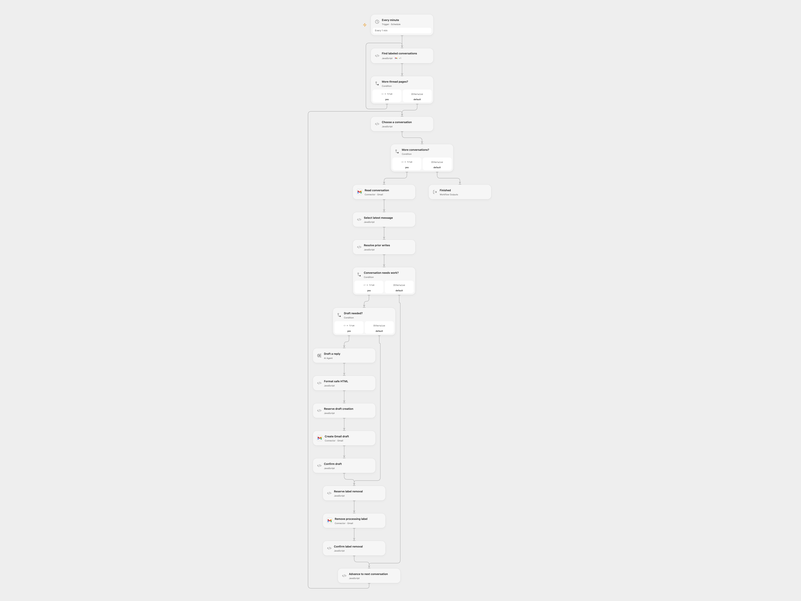

# Draft Labeled Gmail Thread Replies

Draft a reply to the latest message in each labeled Gmail conversation and remove the processing label.

<picture>
  <source media="(prefers-color-scheme: dark)" srcset="preview-dark.png">
  
</picture>

[Open Flow JSON](templates/draft-labeled-gmail-thread-replies.openflow.json) · [n8n JSON](templates/draft-labeled-gmail-thread-replies.n8n.json)

## Setup

Connect the same Gmail mailbox on all Gmail nodes and configure an AI model. Create a processing label. Enter its name in **Find labeled conversations** and its matching label ID in **Remove processing label**. Enable persistent State. In n8n select the same label on the thread search and removal nodes, configure Gmail, a Data Table with item_key and status text columns, and an AI model. Prevent overlapping runs and use one format.

## Behavior

Each minute, read labeled conversations, draft a reply to each latest message in the original thread and remove the processing label after the draft is confirmed. No message is sent. Email content is sent to the model; review drafts before sending.

If a draft or label update has an unknown result, inspect Gmail. In Open Flow enter the pending key in **Resolve prior writes**, set resolution to confirmed or absent, rerun and clear those fields. In n8n inspect the pending Data Table row; complete a missing label update manually and mark it done, or delete the pending-draft row only after confirming no draft exists.

Inspiration &amp; credits

## Changes to the source

Process each thread independently, replace the private Assistant and checkpoint both external writes.

Adapted from [Compose reply draft in Gmail with OpenAI Assistant](https://github.com/enescingoz/awesome-n8n-templates/blob/827110332c21cbe000ab13f6d292d5adb1f1f8db/Gmail_and_Email_Automation/Compose%20reply%20draft%20in%20Gmail%20with%20OpenAI%20Assistant.json) in [enescingoz/awesome-n8n-templates](https://github.com/enescingoz/awesome-n8n-templates).

Source collection notice: © 2024–2026 Enes Cingoz, [CC BY 4.0](https://github.com/enescingoz/awesome-n8n-templates/blob/827110332c21cbe000ab13f6d292d5adb1f1f8db/LICENSE). The source export does not identify a separate template author or license. See [repository licensing](../../README.md#licensing) for the scope of OOMOL contributions and third-party material.

