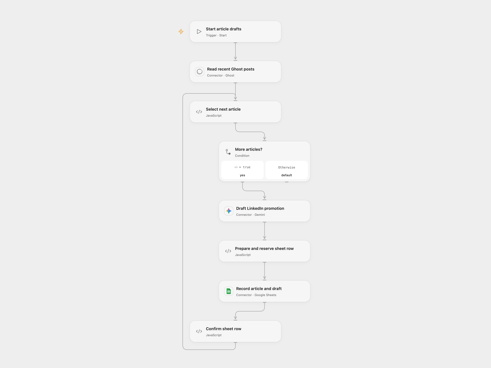

# Draft LinkedIn Posts from Ghost Articles

Draft LinkedIn promotional copy for recent Ghost posts and record it in Google Sheets.

<picture>
  <source media="(prefers-color-scheme: dark)" srcset="preview-dark.png">
  
</picture>

[Open Flow JSON](templates/draft-linkedin-posts-from-ghost-articles.openflow.json) · [n8n JSON](templates/draft-linkedin-posts-from-ghost-articles.n8n.json)

## Setup

Connect Ghost Content API, Gemini and Google Sheets. Set a unique namespace for each Ghost site and destination sheet in **Select next article**, configure the spreadsheet and range, and optionally add your own signature. The sheet columns are id, title, featured_image, excerpt, content, clean_content and linkedin_post. Enable persistent State. In n8n set the namespace in each Data Table checkpoint filter and reserve node, configure the same Data Table with text columns item_key and status, connect Ghost Content API, Google Gemini and Google Sheets, and set the spreadsheet and sheet IDs. For an uncertain append, inspect the sheet by post ID: set the matching Data Table status to done if confirmed, or delete the checkpoint if absent. Avoid overlapping executions.

## Behavior

Run manually to read up to three recent published Ghost posts. Review the generated drafts in the sheet before publishing. For an uncertain sheet append, inspect the row by post ID. Enter the pending key and confirmed or absent in **Select next article**, run again and clear the recovery fields afterward. Avoid overlapping runs for the same site.

Inspiration &amp; credits

Use a configurable signature, retain a per-post checkpoint and stop on an uncertain append.

Adapted from [Ghost blog posts to LinkedIn promotional drafts](https://github.com/Zie619/n8n-workflows/blob/ae8cf6dc5b873cbb4f74587aa9180ed3a9f70682/workflows/Code/0844_Code_Ghost_Create_Triggered.json) in [Zie619/n8n-workflows](https://github.com/Zie619/n8n-workflows). Attribution: Samir Saci (named in source) / Zie619 (collection).

The collection’s [MIT notice](https://github.com/Zie619/n8n-workflows/blob/94007c1445d9258a7da116646b79473e7c7c3282/LICENSE) is pinned at a later revision. This is the collection notice at that revision; it does not establish a separate original template author's license. Our changes are listed above; see [repository licensing](../../README.md#licensing).

> MIT License
>
> Copyright (c) 2025 Zie619
>
> Permission is hereby granted, free of charge, to any person obtaining a copy
> of this software and associated documentation files (the "Software"), to deal
> in the Software without restriction, including without limitation the rights
> to use, copy, modify, merge, publish, distribute, sublicense, and/or sell
> copies of the Software, and to permit persons to whom the Software is
> furnished to do so, subject to the following conditions:
>
> The above copyright notice and this permission notice shall be included in all
> copies or substantial portions of the Software.
>
> THE SOFTWARE IS PROVIDED "AS IS", WITHOUT WARRANTY OF ANY KIND, EXPRESS OR
> IMPLIED, INCLUDING BUT NOT LIMITED TO THE WARRANTIES OF MERCHANTABILITY,
> FITNESS FOR A PARTICULAR PURPOSE AND NONINFRINGEMENT. IN NO EVENT SHALL THE
> AUTHORS OR COPYRIGHT HOLDERS BE LIABLE FOR ANY CLAIM, DAMAGES OR OTHER
> LIABILITY, WHETHER IN AN ACTION OF CONTRACT, TORT OR OTHERWISE, ARISING FROM,
> OUT OF OR IN CONNECTION WITH THE SOFTWARE OR THE USE OR OTHER DEALINGS IN THE
> SOFTWARE.

