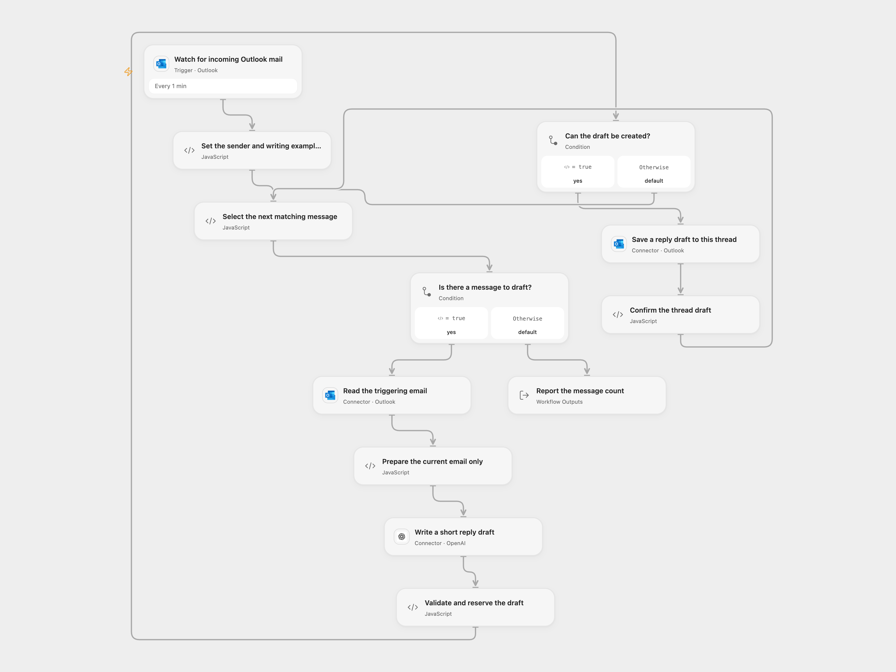

# Draft Replies to Outlook Threads

Draft concise replies to emails from a configured Outlook sender and save each draft in its original conversation.

<!-- template-actions:start -->
 
<!-- template-actions:end -->

<picture>
  <source media="(prefers-color-scheme: dark)" srcset="preview-dark.png">
  
</picture>

## Setup

1. In **Set the sender and writing examples**, set the exact sender email address. To filter before the workflow runs, also enter the same address in **Watch for incoming Outlook mail**. Connect the same Outlook mailbox in the trigger, **Read the triggering email**, and **Save a reply draft to this thread**. The connection needs mail read access and Provider API access with Microsoft Graph `Mail.ReadWrite` to create replies in Drafts.
2. Connect OpenAI in **Write a short reply draft**. You can supply up to 4,000 characters of authorized writing examples in **Set the sender and writing examples**. Pick examples that contain only what you are allowed to share with OpenAI.
3. Keep persistent State enabled and publish one active copy for the mailbox and sender. Start with new mail from your test sender. The initial poll sets a starting position for new arrivals.

## Behavior

Outlook is checked every minute. For each message from the configured sender, the workflow retrieves the current email's own plain-text body and verifies its message and conversation IDs. OpenAI receives that text, the sender address, subject, and optional voice examples. The rest of the conversation and attachments stay in Outlook. This template supports current text bodies up to 12,000 characters.

The workflow saves the proposed reply with Microsoft Graph's `createReply` operation and confirms the returned draft's conversation. Outlook uses the original message's reply address. Review the reply and recipients in Outlook Drafts before sending it yourself. If an acknowledgement is missing or mismatched, inspect the original thread and Drafts before clearing the held reservation. [Microsoft Graph createReply](https://learn.microsoft.com/en-us/graph/api/message-createreply?view=graph-rest-1.0)

In n8n

Select the same Microsoft Outlook OAuth2 credential on the trigger and both Outlook HTTP nodes. Use the signed-in account's own mailbox. Set the exact sender in **Watch for incoming Outlook mail** and **Set the sender and writing examples**. Select the OpenAI credential in **Write a short reply draft**. A manual trigger test can create a draft for a matching email already in the mailbox.

Create a Data Table with a string column named `request_key`. Select it in **Check for a previous draft attempt** and **Validate and reserve the draft**. Use one self-hosted regular-mode instance with `N8N_CONCURRENCY_PRODUCTION_LIMIT=1`, and avoid overlapping manual runs. If the draft outcome is uncertain, check Drafts before deleting its table row. [n8n concurrency control](https://docs.n8n.io/hosting/scaling/concurrency-control/)

Inspiration &amp; credits

## Changes to the source

Follow the original instruction to save a reply draft on the triggering thread. Use the current email text and optional examples without giving the model access to Outlook actions.

Adapted from [Outlook reply draft workflow](https://github.com/Zie619/n8n-workflows/blob/ae8cf6dc5b873cbb4f74587aa9180ed3a9f70682/workflows/Microsoftoutlook/1925_Microsoftoutlook_Microsoftoutlooktool_Automation_Triggered.json) in [Zie619/n8n-workflows](https://github.com/Zie619/n8n-workflows). Attribution: Zie619 / n8n-workflows.

The collection’s [MIT notice](https://github.com/Zie619/n8n-workflows/blob/94007c1445d9258a7da116646b79473e7c7c3282/LICENSE) is pinned at a later revision. This is the collection notice at that revision; it does not establish a separate original template author's license. Our changes are listed above; see [repository licensing](../../README.md#licensing).

> MIT License
>
> Copyright (c) 2025 Zie619
>
> Permission is hereby granted, free of charge, to any person obtaining a copy
> of this software and associated documentation files (the "Software"), to deal
> in the Software without restriction, including without limitation the rights
> to use, copy, modify, merge, publish, distribute, sublicense, and/or sell
> copies of the Software, and to permit persons to whom the Software is
> furnished to do so, subject to the following conditions:
>
> The above copyright notice and this permission notice shall be included in all
> copies or substantial portions of the Software.
>
> THE SOFTWARE IS PROVIDED "AS IS", WITHOUT WARRANTY OF ANY KIND, EXPRESS OR
> IMPLIED, INCLUDING BUT NOT LIMITED TO THE WARRANTIES OF MERCHANTABILITY,
> FITNESS FOR A PARTICULAR PURPOSE AND NONINFRINGEMENT. IN NO EVENT SHALL THE
> AUTHORS OR COPYRIGHT HOLDERS BE LIABLE FOR ANY CLAIM, DAMAGES OR OTHER
> LIABILITY, WHETHER IN AN ACTION OF CONTRACT, TORT OR OTHERWISE, ARISING FROM,
> OUT OF OR IN CONNECTION WITH THE SOFTWARE OR THE USE OR OTHER DEALINGS IN THE
> SOFTWARE.

